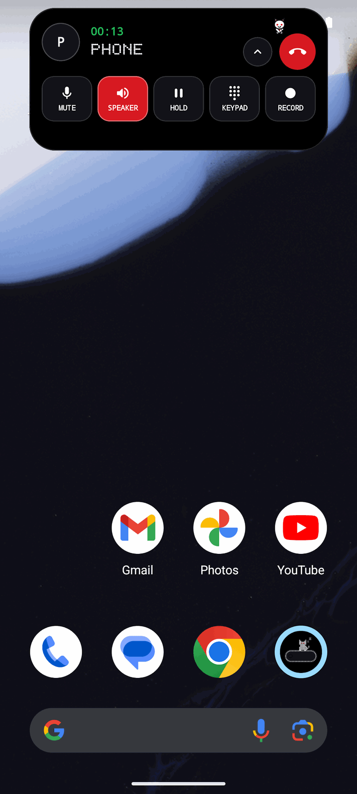
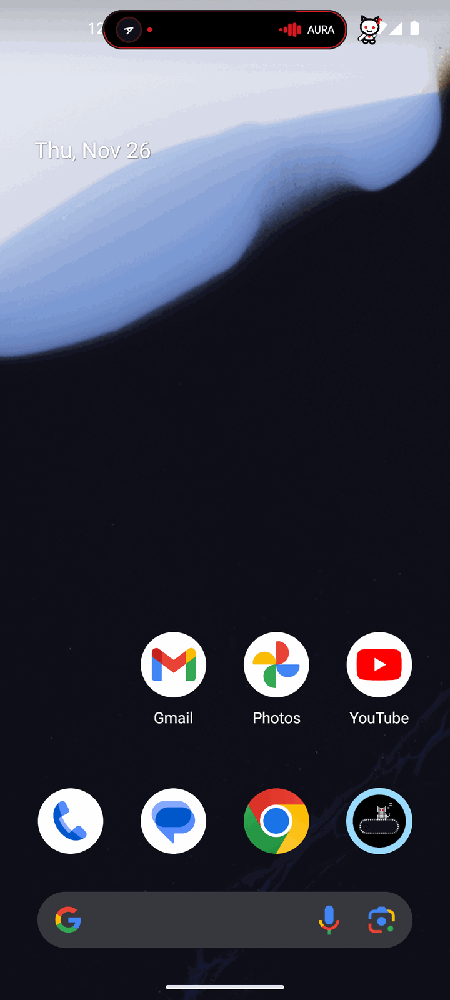
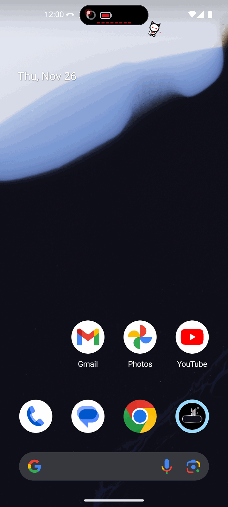
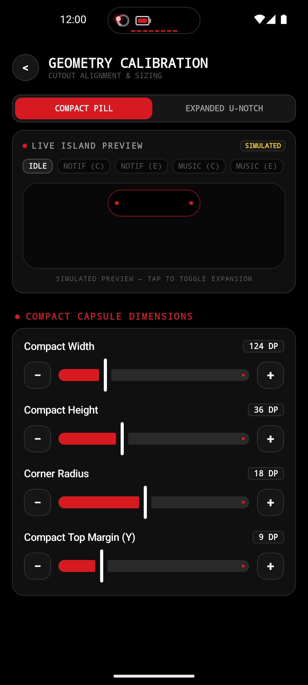

# Dot Island

**Dynamic Capsule, Live Activities & Reactive Pixel Companions for Android — 100% Offline, Zero Internet Permissions**

Dot Island turns the camera punch-hole on Android 10+ devices into a responsive, AMOLED-black Dynamic Capsule for active calls, media visualizers, charging telemetry, Bluetooth peripherals, and pixel companions — running strictly on-device with zero network permissions (`android.permission.INTERNET` is absent from the release manifest).

→ **[Explore the Interactive Live Site](https://sumitsinghjatav64-creator.github.io/nothing-island/)** · **[Download DotIsland-v1.1.2.apk](https://github.com/sumitsinghjatav64-creator/nothing-island/releases/latest)**

---

## Captured on Device

<table>
  <tr>
    <td align="center" width="50%">
       
      <strong>Live In-Call Capsule</strong> 
      Outgoing <code>CALLING...</code> hold, live <code>MM:SS</code> timer, Speaker, Mute, Hold, DTMF Keypad &amp; End Call
    </td>
    <td align="center" width="50%">
       
      <strong>Compact Music Visualizer</strong> 
      Real-time waveform bars, track info, scrubber &amp; swipe-to-resume media pill
    </td>
  </tr>
  <tr>
    <td align="center" width="50%">
       
      <strong>Pixel Chibi Companion</strong> 
      Articulated Compose <code>Canvas</code> companion perched cleanly below status bar icons
    </td>
    <td align="center" width="50%">
       
      <strong>Universal Punch-Hole Calibration</strong> 
      Per-dp X/Y offset, width, height, corner radius &amp; expanded U-notch alignment
    </td>
  </tr>
</table>

---

## Key Features

- **Universal Punch-Hole Calibration (`124dp × 36dp` Capsule)**  
  Reads hardware `DisplayCutout` insets automatically and exposes fine X/Y offset, size, corner-radius, and independent expanded U-notch sliders in **Studios → Geometry Calibration** for center, left, or pill cutouts.
- **Live In-Call Controls & Accurate Outgoing Detection**  
  Distinguishes outgoing `CALLING...` from answered calls via `Notification.EXTRA_SHOW_CHRONOMETER` and `notification.when`, keeping the timer at `00:00` until pickup, with live `CallStyle` controls (Speaker, Mute, Hold, DTMF Keypad, Record, Answer/Decline).
- **Compact & Expanded Music Visualizer**  
  Syncs with Android `MediaSession` playback for animated audio visualizers, seek/transport controls, output device badges, and idle compact pill swipe-to-resume.
- **Reactive Pixel Chibi Companion**  
  Expressive pixel companions (`CAT`, `DOTCAT`, `GLYPHORB`, `TAPE BUDDY`) react physically to idle states, music playback, active calls, and taps without blocking underlying status bar icons or touch targets.
- **100% Offline, Zero-Internet Privacy**  
  Notifications, media metadata, call states, Bluetooth battery readouts, and preferences stay strictly in memory and local Jetpack DataStore. No analytics SDKs, no cloud sync, and **no `android.permission.INTERNET`**.
- **Smart Game-Mode Auto-Hide & Charging Telemetry**  
  Automatically hides the overlay during `CATEGORY_GAME` or fullscreen landscape gaming, and surfaces live charging wattage/voltage/temperature telemetry cards.

---

## 3-Step Installation & Setup

1. **Download Signed APK:** Grab `DotIsland-v1.1.2.apk` from the **[Latest GitHub Release](https://github.com/sumitsinghjatav64-creator/nothing-island/releases/latest)**.
2. **Grant Core Permissions:** Allow installation from your browser, open **Dot Island**, and enable **Display over other apps** and **Notification access** *(optional: enable Accessibility in System Settings as a top-bar anchor and global screenshot action)*.
3. **Calibrate & Start:** Open **Studios → Geometry Calibration** to align around your punch-hole and tap **Start Dot Island**.

---

## Tech Stack & Verification

- **Stack:** Kotlin, Jetpack Compose (`BOM 2024.12.01`), Material 3, AMOLED dot-matrix design tokens (`#000000` / `#111111` / `#FFFFFF` / `#D71921`), `minSdk 29` (Android 10+), `targetSdk 36`.
- **Tests:** **399** JVM unit tests (`.\gradlew.bat testDebugUnitTest`) + on-device instrumentation & APK verification (`.\gradlew.bat assembleRelease`, `apkanalyzer manifest permissions` verified internet-free).

---

## Privacy & Open Source

Dot Island collects and transmits **zero user data**. Read the full [Privacy Policy](https://sumitsinghjatav64-creator.github.io/nothing-island/privacy.html) or browse the [Live Showcase Site](https://sumitsinghjatav64-creator.github.io/nothing-island/).
