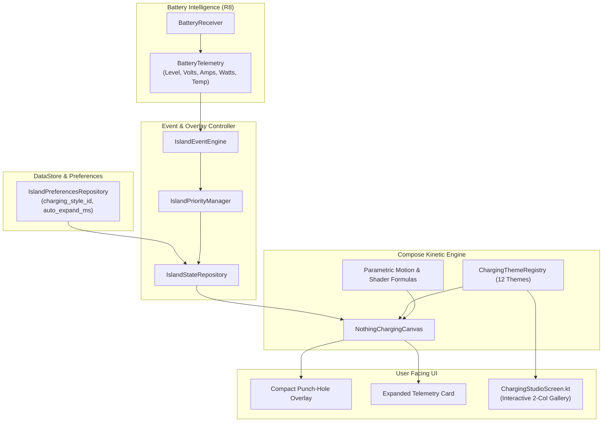

# Nothing Island — Charging Animation Implementation Specification
**Target Device:** Nothing Phone (4a), Android 17 / API 37  
**Package:** `com.nothing.island.ai`  
**Execution Target:** Phase 3 / R9 — Charging Animation Engine  
**Prerequisites:** Accepted Phase 2 Design System Baseline, R8 Battery Intelligence Checkpoint  
**Architecture Guardrail:** Strict Single `TYPE_ACCESSIBILITY_OVERLAY` Window Model (100% Jetpack Compose)  
**Date:** November 2026  

---

## 1. Architectural Blueprint & Core Principles

This specification defines the architectural blueprint and visual engine for Nothing Island's **Kinetic Charging Animation Engine** and **Charging Studio**.

### Guiding Principles:
1. **Zero External Lottie or Proprietary Binaries:** All visual effects, waves, particles, and arcs are generated programmatically via Jetpack Compose `Canvas`, `Animatable`, `Brush`, and `PathEffect`. This achieves instantaneous 120fps hardware-accelerated rendering and eliminates megabytes of APK overhead.
2. **Nothing OS Design Authenticity:** Every theme embraces Nothing's signature industrial aesthetic: Dot Matrix typography, Glyph lighting strips, monochromatic contrast (`#000000`, `#FFFFFF`), and surgical Nothing Red accents (`#D71921`).
3. **Strict Window Integrity:** Renders exclusively within the established single `TYPE_ACCESSIBILITY_OVERLAY` overlay window (`IslandOverlayView.kt`). No fullscreen activities, lock-screen overlays, or intrusive dialogs are permitted.
4. **Dynamic Wattage Scaling:** Motion frequency and intensity dynamically scale with live charging wattage (e.g. 45W Super Fast vs 15W Standard vs 5W USB).



---

## 2. Data Models & Theme Architecture

### 2.1 Theme Definition & Style Enum
```kotlin
package com.nothing.island.ai.domain.model

import androidx.compose.ui.graphics.Color
import com.nothing.island.ai.ui.theme.NothingColors

enum class ChargingStyle(
    val id: String,
    val displayName: String,
    val category: ChargingCategory,
    val description: String
) {
    // Category 1: Nothing Signature
    GLYPH_ARC("glyph_arc", "Glyph Arc", ChargingCategory.SIGNATURE, "Segmented Glyph lighting ring with orbiting white arc"),
    DOT_MATRIX_REACTOR("dot_matrix_reactor", "Dot Matrix", ChargingCategory.SIGNATURE, "LED dot-matrix ring pulsating around the camera lens"),
    WIREFRAME_ORBIT("wireframe_orbit", "Wireframe Orbit", ChargingCategory.SIGNATURE, "Dual counter-rotating technical wireframe rings"),
    NOTHING_RED_SURGE("nothing_red_surge", "Red Surge", ChargingCategory.SIGNATURE, "Iconic Nothing Red energy wave tracking charge level"),

    // Category 2: Fluid & Elemental
    LIQUID_MERCURY("liquid_mercury", "Liquid Mercury", ChargingCategory.ELEMENTAL, "Monochrome fluid reservoir with buoyant meniscus physics"),
    ELECTRIC_PULSE("electric_pulse", "Electric Pulse", ChargingCategory.ELEMENTAL, "High-frequency neon electrical discharge shimmer"),
    CYBER_HORIZON("cyber_horizon", "Cyber Horizon", ChargingCategory.ELEMENTAL, "Dual cyan laser lines sweeping laterally across the notch"),
    PLASMA_FLOW("plasma_flow", "Plasma Flow", ChargingCategory.ELEMENTAL, "Multi-stop angular sweep gradient with continuous rotation"),

    // Category 3: Technical & Minimalist
    DIGITAL_GAUGE("digital_gauge", "Digital Gauge", ChargingCategory.MINIMALIST, "Precision 360-degree calibrated technical tick dial"),
    WATTAGE_REACTOR("wattage_reactor", "Wattage Reactor", ChargingCategory.MINIMALIST, "Kinetic power bars scaling directly with charging speed"),
    MINIMALIST_BOLT("minimalist_bolt", "Minimalist Bolt", ChargingCategory.MINIMALIST, "Subtle high-contrast lightning glyph with pulse glow"),
    BATTERY_CELL("battery_cell", "Battery Cell", ChargingCategory.MINIMALIST, "Classic battery enclosure with segmented dot fill");

    companion object {
        fun fromId(id: String): ChargingStyle = entries.find { it.id == id } ?: GLYPH_ARC
    }
}

enum class ChargingCategory(val title: String) {
    SIGNATURE("NOTHING SIGNATURE"),
    ELEMENTAL("FLUID & ELEMENTAL"),
    MINIMALIST("TECHNICAL & MINIMAL")
}

data class ChargingThemeDefinition(
    val style: ChargingStyle,
    val primaryColor: Color,
    val secondaryColor: Color,
    val accentColor: Color,
    val strokeWidthDp: Float,
    val baseCycleDurationMs: Int,
    val supportsWattageScaling: Boolean = true
)
```

---

## 3. Detailed Specifications for the 12 Curated Themes

### Theme 1: `GLYPH_ARC` (Nothing Signature)
* **Concept:** Inspired by the Nothing Phone's physical Glyph interface. Renders 3 concentric segmented arcs around the camera cut-out with an orbiting bright pulse head.
* **Colors:** Background segments: `Color(0x33FFFFFF)`; Orbiting Arc: `Color(0xFFFFFFFF)`; Accent Core: `NothingColors.RedAccent`.
* **Motion Physics:**
  * Orbit Angle: $\theta(t) = (360^\circ \times \frac{t}{T_{\text{cycle}}}) \pmod{360^\circ}$
  * Sweep Angle: $60^\circ$ with smooth cosine head-tail attenuation.
  * Sweep Gradient: `Brush.sweepGradient(listOf(Color.Transparent, Color.White, Color.Transparent))`
* **Wattage Scaling:** $T_{\text{cycle}} = \max(600\text{ms}, 1600\text{ms} - (\text{Watts} \times 20\text{ms}))$.

---

### Theme 2: `DOT_MATRIX_REACTOR` (Nothing Signature)
* **Concept:** A ring of 32 discrete LED dots arranged circularly around the punch hole. Dots illuminate sequentially in a clockwise running chase.
* **Colors:** Inactive Dots: `Color(0x22FFFFFF)`; Active Dots: `Color(0xFFFFFFFF)`; Trailing Glow: `Color(0x88FFFFFF)`.
* **Geometry:** Dot count $N = 32$, radius $R = 24\text{dp}$, dot radius $r = 1.5\text{dp}$.
* **Motion Physics:**
  * Active Dot Index: $k(t) = \lfloor 32 \times (\frac{t}{T_{\text{cycle}}} \pmod 1) \rfloor$
  * Intensity Falloff: $I_i(t) = \exp\left(-\frac{\text{angularDistance}(i, k(t))^2}{2\sigma^2}\right)$ with $\sigma = 2.5$.

---

### Theme 3: `WIREFRAME_ORBIT` (Nothing Signature)
* **Concept:** Precision engineering wireframe composed of two counter-rotating ellipses tilted at $\pm 25^\circ$.
* **Colors:** Outer Ring: `Color(0x88FFFFFF)`; Inner Ring: `Color(0x88FFFFFF)`; Intersecting Nodes: `NothingColors.RedAccent`.
* **Motion Physics:**
  * Ring 1: Clockwise rotation $\omega_1 = +0.75\text{ rad/s}$.
  * Ring 2: Counter-clockwise rotation $\omega_2 = -1.15\text{ rad/s}$.
  * Path Effect: `PathEffect.dashPathEffect(floatArrayOf(8f, 12f), phase)`.

---

### Theme 4: `NOTHING_RED_SURGE` (Nothing Signature)
* **Concept:** A surgical red laser wave that sweeps along the pill perimeter, leaving an incandescent ruby particle trail.
* **Colors:** Base Track: `Color(0x22D71921)`; Surge Head: `NothingColors.RedAccent` (`#D71921`); Core Spark: `Color(0xFFFFFFFF)`.
* **Motion Physics:** Perimeter traversal parameterized by normalized arc length $s \in [0, 1]$ over $1200\text{ms}$ with `FastOutSlowInEasing`.

---

### Theme 5: `LIQUID_MERCURY` (Fluid & Elemental)
* **Concept:** A liquid metal reservoir filling the lower half of the notch. Uses a sinusoidal wave equation to simulate liquid surface tension.
* **Colors:** Fluid Body: `Color(0xCCFFFFFF)`; Meniscus Crest: `Color(0xFFFFFFFF)`; Ambient Floor: `Color(0x22FFFFFF)`.
* **Mathematical Wave Equation:**
  $$y(x, t) = y_{\text{base}} + A_1 \sin\left(\frac{2\pi x}{\lambda_1} + \omega_1 t\right) + A_2 \cos\left(\frac{2\pi x}{\lambda_2} - \omega_2 t\right)$$
  Where $y_{\text{base}} = \text{height} \times \left(1.0 - \frac{\text{batteryPercent}}{100}\right)$, $A_1 = 3\text{dp}$, $A_2 = 1.5\text{dp}$, $\lambda_1 = 60\text{dp}$, $\omega_1 = 4\text{ rad/s}$.

---

### Theme 6: `ELECTRIC_PULSE` (Fluid & Elemental)
* **Concept:** High-voltage perimeter arcing that jitters around the punch hole contour like an electrostatic field.
* **Colors:** Core Arc: `Color(0xFF00E5FF)` (Cyan Neon) or `Color(0xFFFFFFFF)`; Plasma Glow: `Color(0x4400E5FF)`.
* **Motion Physics:** Procedural jitter computed via pseudo-random displacement vectors updated every $33\text{ms}$ (30Hz jitter frequency) with stroke width oscillating between $1.5\text{dp}$ and $3.0\text{dp}$.

---

### Theme 7: `CYBER_HORIZON` (Fluid & Elemental)
* **Concept:** Dual neon laser lines extending left and right from the punch hole, expanding and retracting in a rhythmic heartbeat.
* **Colors:** Laser Line: `Color(0xFF00FF66)`; Ambient Aura: `Color(0x2200FF66)`.
* **Motion Physics:** Length expands from $10\text{dp}$ to $36\text{dp}$ using `CubicBezierEasing(0.4f, 0.0f, 0.2f, 1.0f)`.

---

### Theme 8: `PLASMA_FLOW` (Fluid & Elemental)
* **Concept:** Continuous multi-stop gradient rotation creating a smooth liquid-light vortex around the camera cut-out.
* **Colors:** 4-stop gradient: `Color(0xFFFFFFFF)`, `NothingColors.RedAccent`, `Color(0xFF666666)`, `Color(0xFFFFFFFF)`.
* **Shader:**
  ```kotlin
  Brush.sweepGradient(
      colors = listOf(Color.White, NothingColors.RedAccent, Color(0xFF333333), Color.White)
  )
  ```
* **Rotation:** Linear continuous rotation, 1 revolution per $1500\text{ms}$.

---

### Theme 9: `DIGITAL_GAUGE` (Technical & Minimalist)
* **Concept:** A miniature tachometer dial featuring 12 engraved tick marks. Ticks illuminate progressively up to the current battery level.
* **Colors:** Unlit Ticks: `Color(0x33FFFFFF)`; Lit Ticks: `Color(0xFFFFFFFF)`; 100% Full Indicator: `NothingColors.RedAccent`.
* **Geometry:** Angle spans from $135^\circ$ to $405^\circ$ ($270^\circ$ sweep).

---

### Theme 10: `WATTAGE_REACTOR` (Technical & Minimalist)
* **Concept:** Real-time charging speed reactor. Displays live wattage as an animated segmented power meter beside the punch hole.
* **Colors:** Standard Charging (<15W): `Color(0xFF888888)`; Fast Charging (15–30W): `Color(0xFFFFFFFF)`; Super Fast (>30W): `NothingColors.RedAccent`.
* **Display Elements:** Text `"45W SUPER FAST"` in Nothing Dot-Matrix font + 5 dynamic reactor bars.

---

### Theme 11: `MINIMALIST_BOLT` (Technical & Minimalist)
* **Concept:** Ultra-clean Apple/Nothing hybrid. A high-contrast lightning bolt glyph pulsating with an 800ms ease-in-out breathing curve.
* **Colors:** Normal: `Color(0xFF34C759)`; Low Battery (<=20%): `NothingColors.RedAccent` (`#D71921`).
* **Motion:** Alpha breathes between $0.4\text{f}$ and $1.0\text{f}$; scale breathes between $0.95\text{f}$ and $1.05\text{f}$.

---

### Theme 12: `BATTERY_CELL` (Technical & Minimalist)
* **Concept:** Precise horizontal technical battery cell with segmented blocks matching Nothing Phone battery status widgets.
* **Colors:** Border: `Color(0x88FFFFFF)`; Fill Segments: `Color(0xFFFFFFFF)`; Terminal Cap: `Color(0x88FFFFFF)`.
* **Segments:** 5 discrete blocks (20% each), with the active top segment pulsing during charge.

---

## 4. UI Layout & Component Architecture

### 4.1 Compact Overlay State (`NothingCompactChargingPill.kt`)
* **Anchor:** Centralized around the front camera cutout (default Nothing Phone 4a offset: $X = 0$, $Y = 24\text{dp}$).
* **Dimensions:**
  * Width: $160\text{dp}$ (standard) expanding to $190\text{dp}$ for wattage telemetry.
  * Height: $38\text{dp}$.
  * Corner Radius: $19\text{dp}$ (perfect squircle pill).
* **Hierarchy:**
  1. `Box` (Root capsule with `#000000` background and subtle `#22FFFFFF` border).
  2. `NothingChargingCanvas` (Renders selected kinetic theme centered on the punch hole).
  3. `Row` (Left: Lightning Icon + Status; Right: Battery Percentage in Nothing Dot-Matrix typography).

### 4.2 Expanded Telemetry Card (`NothingExpandedChargingCard.kt`)
* **Trigger:** Auto-expands on power connection for `autoExpandDurationMs` (default: 3500ms), or when tapped by the user.
* **Dimensions:** Width: $340\text{dp}$, Height: $140\text{dp}$, Corner Radius: $28\text{dp}$.
* **Content:**
  * Header: Nothing Dot Matrix `"CHARGING INTELLIGENCE"`, battery health badge (`"GOOD"`, `"OVERHEAT"`).
  * Center: Large battery gauge (`"85%"`) + selected charging theme animation canvas.
  * Telemetry Grid:
    * Left Cell: Live Wattage (`"45.2 W"`) + Charging Protocol (`"PPS / PD 3.0"`).
    * Center Cell: Voltage / Current (`"9.1 V / 4.9 A"`).
    * Right Cell: Estimated Time to Full (`"22 min left"`).

### 4.3 Charging Studio Gallery (`ChargingStudioScreen.kt`)
* **Layout:**
  * Top Sticky Preview Well (`NothingCard`): Shows a simulated Nothing Phone (4a) punch hole rendering the currently selected theme at live device battery level.
  * Switch: `"Enable Charging Animation"` with description.
  * Auto-Expand Duration Selector: Stepper slider ($2.5\text{s}$, $3.5\text{s}$, $5.0\text{s}$, `"Always On"`).
  * Category Header Tabs (`SIGNATURE`, `ELEMENTAL`, `MINIMALIST`).
  * 2-Column Responsive Card Grid (`LazyVerticalGrid(GridCells.Fixed(2))`):
    * Preview canvas running the theme in real time.
    * Theme title in Nothing typography.
    * Category badge and selection checkmark indicator.
    * Tapping immediately updates the live preview well and commits the preference to DataStore.

---

## 5. Persistence & DataStore Schema

All settings are persisted using Jetpack DataStore via `IslandPreferencesRepository.kt`:

| Key Name | Storage Type | Default Value | Description |
|---|---|---|---|
| `charging_animation_enabled` | `booleanPreferencesKey` | `true` | Master toggle for charging overlay animation |
| `charging_style_id` | `stringPreferencesKey` | `"glyph_arc"` | Active theme ID (from `ChargingStyle.id`) |
| `charging_auto_expand_ms` | `intPreferencesKey` | `3500` | Auto-expansion duration on charger connect |
| `charging_show_wattage` | `booleanPreferencesKey` | `true` | Display calculated wattage in overlay |
| `charging_wattage_scaling_enabled` | `booleanPreferencesKey` | `true` | Dynamically accelerate animation speed with higher wattage |
| `charging_low_battery_threshold` | `intPreferencesKey` | `20` | Percentage threshold for low-battery alert state |

---

## 6. Implementation Sequencing & Phased Execution Plan

The implementation is structured into 4 sequential stages for Phase 3 / R9:

```mermaid
gantt
    title Nothing Island — Phase 3 Implementation Roadmap
    dateFormat  X
    axisFormat %s

    section Stage 1: Core Engine
    Data Models & Repository Migration     :active, s1, 0, 1
    Compose Canvas Shader & Math Library   :s2, 1, 2

    section Stage 2: Theme Suite
    Signature Themes (Glyph Arc, Dot Matrix, Wireframe, Red Surge) :s3, 2, 3
    Fluid & Minimalist Themes (Mercury, Pulse, Gauge, Wattage)      :s4, 3, 4

    section Stage 3: UI & Studio
    Compact & Expanded Overlay Integration :s5, 4, 5
    ChargingStudioScreen.kt 2-Column Grid  :s6, 5, 6

    section Stage 4: Verification
    Unit & Motion Tests (260+ tests)       :s7, 6, 7
    Physical Device Testing (Nothing 4a)   :s8, 7, 8
```



### Stage 1: Data Architecture & Canvas Primitives
* Add `ChargingStyle`, `ChargingThemeDefinition`, and DataStore keys to `IslandPreferencesRepository.kt`.
* Implement base Canvas modifiers and custom shaders in `com.nothing.island.ai.ui.animation.charging`.

### Stage 2: Kinetic Theme Implementation
* Implement the 12 bespoke themes using hardware-accelerated Compose Canvas.
* Wire dynamic wattage scaling equations into cycle timing.

### Stage 3: Overlay Integration & Charging Studio Screen
* Integrate `NothingChargingCanvas` into `IslandOverlayView.kt` for both compact and expanded states.
* Refactor `ChargingStudioScreen.kt` from Phase 2 stub into a fully functional 2-column theme picker.

### Stage 4: Testing & Verification Gate
* Unit test coverage for all theme math, wattage calculations, and DataStore serialization.
* Physical device verification on Nothing Phone (4a): verify 120Hz frame stability, power plug/unplug transitions, and battery telemetry accuracy.

---
*Specification approved for Phase 3 / R9 development.*
