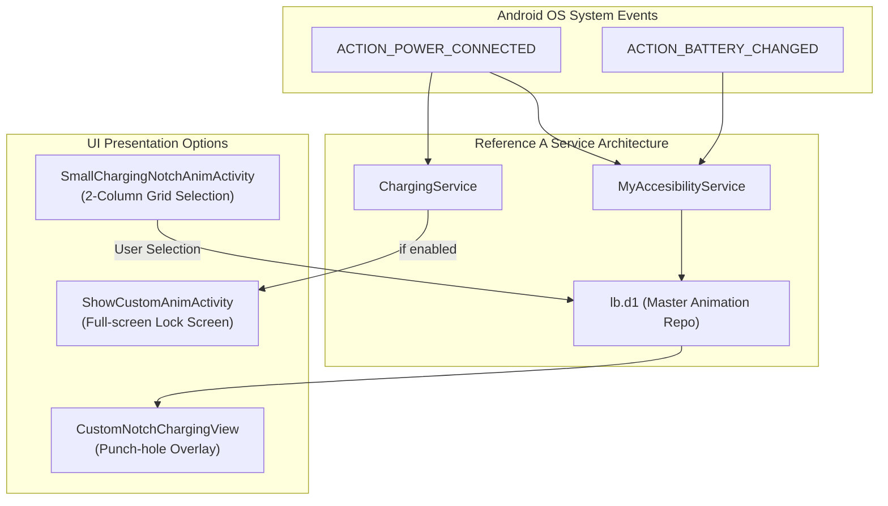
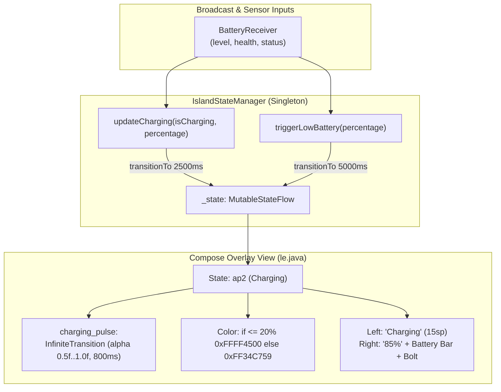

# Nothing Island — Charging Animation Reverse-Engineering Report
**Target Platform:** Nothing Phone (4a), Android 17 / API 37  
**Package:** `com.nothing.island.ai`  
**Investigation Baseline:** R8 Battery & Charging Intelligence  
**Scope:** Reverse-Engineering Audit & Static/Runtime Analysis of Reference Applications  
**Date:** November 2026  

---

## 1. Executive Summary & Objective

This reverse-engineering investigation analyzes the charging animation systems, data structures, visual presentation pipelines, and runtime lifecycles of two leading dynamic notch reference applications installed on the physical Nothing Phone (4a):

1. **Reference A — Dynamic Notch** (`com.dynamicisland.notchscreenview`, Version 6.60)
2. **Reference B — Dynamic Island Pro** (`tr.com.eywin.dynamic.island.notch`, Version 1.9.2)

The objective is to deconstruct their technical implementations, identify how charging events trigger notch expansions, extract all theme models, motion parameters, and rendering pipelines, and establish a rigorous foundation for Nothing Island's upcoming **Charging Studio** and **Kinetic Charging Animation Engine**.

### Key Architectural Findings:
* **Reference A (Dynamic Notch):** Employs a dual-pipeline architecture separating full-screen lock charging activities (`ShowCustomAnimActivity`, `WaveThemePreviewActivity`) from an in-overlay notch charging system (`CustomNotchChargingView`). It relies on a two-layer rendering model pairing a background fluid/glow track with a foreground punch-hole sprite or Lottie effect, housing 38 distinct `BatteryNotchModel` animations and 24 `WaveColor` shader themes.
* **Reference B (Dynamic Island Pro):** Utilizes a pure Jetpack Compose rendering pipeline hosted inside an accessibility overlay (`OverlayAccessibilityService`). Charging is managed via a centralized `IslandStateManager` transitioning to a temporary state (`ap2`) with an 800ms alpha pulse and a 2500ms auto-dismiss timer. It decouples general notch surface themes (50 colorways in `q04.java`) from the charging state indicator.
* **Nothing Island Opportunity:** Neither reference provides a cohesive, premium Nothing OS aesthetic. Reference A is heavily bloated with third-party cartoon mascots (AmongUs, Shark, Ghost) and legacy Android Views. Reference B is an ultra-minimal iOS clone lacking visual flair. Nothing Island will synthesize the dual-layer kinetic depth of Reference A with the pure Jetpack Compose performance of Reference B, rendered in Nothing’s signature Dot Matrix and Glyph design language.

---

## 2. Reference Application Profiles

| Dimension | Reference A (Dynamic Notch) | Reference B (Dynamic Island Pro) | Nothing Island (Current R8) |
|---|---|---|---|
| **Package Name** | `com.dynamicisland.notchscreenview` | `tr.com.eywin.dynamic.island.notch` | `com.nothing.island.ai` |
| **Installed Version** | 6.60 (VersionCode 660) | 1.9.2 (VersionCode 192) | R8 Baseline (VersionCode 8) |
| **APK Architecture** | Base APK + ARM64 split | Base APK + ARM64 + XXHDPI splits | Single unified debug APK |
| **Window Architecture** | Accessibility Overlay + Full-screen Activities | Single `TYPE_ACCESSIBILITY_OVERLAY` | Single `TYPE_ACCESSIBILITY_OVERLAY` |
| **UI Framework** | Custom Views, FrameLayout, Lottie Android | Jetpack Compose (100% Declarative) | Jetpack Compose (100% Declarative) |
| **Animation Engine** | Lottie JSON + `ValueAnimator` Canvas | Compose `rememberInfiniteTransition` | Compose `Animatable` + Canvas |
| **Theme Count** | 38 Notch Animations + 24 Wave Themes | 50 Notch Themes + 1 Standard Charging | 5 Curated Compose Charging Styles |
| **Ad / Tracking Bloat** | Heavy (AdMob, InMobi, IronSource, Vungle) | Heavy (AppLovin, IronSource, AdMob) | **Zero (Clean, Ad-Free, Open-Source)** |

---

## 3. Reverse-Engineering: Reference A (Dynamic Notch)

### 3.1 Architectural Decomposition
Reference A implements charging animations across two distinct layers:
1. **System Service & Broadcast Handling:** `ChargingService.java` registers a `PowerConnectionReceiver` listening for `ACTION_POWER_CONNECTED`, `ACTION_POWER_DISCONNECTED`, and `ACTION_BATTERY_CHANGED`. On connect, it checks user preferences via `a1.java` and optionally triggers a full-screen standalone activity (`WaveThemePreviewActivity` or `ShowCustomAnimActivity`).
2. **In-Overlay Floating Notch Rendering:** `MyAccesibilityService.java` binds to the active window overlay. When `d1.f50062a.u(true)` (charging active) is flagged, the overlay view `CustomNotchChargingView` (`f50065d`) is inflated and animated around the camera punch hole.



### 3.2 Core Classes & Data Models

#### `com.dynamicisland.notchscreenview.Models.BatteryNotchModel`
This data class represents individual notch charging animations:
```kotlin
data class BatteryNotchModel(
    val number: Int,             // Unique identifier (0..36, 101, 102)
    val preview: Int,            // Drawable resource for gallery preview
    val character: String,       // Foreground asset path (e.g. "charginganims/0_ghost.json")
    val background: String?,     // Background asset path (e.g. "charginganims/0_Ghost_BG.lottie")
    var scaleX: Float = 0f,      // Horizontal scale factor
    var scaleY: Float = 0f,      // Vertical scale factor
    var dimension: Float = 0f,   // Proportional aspect ratio
    var selected: Boolean = false,
    var update: c1? = null,
    var version: Int,            // Architecture version (1, 2, or 3)
    var subVersion: Int,         // Sub-renderer type (1: fill, 2: icon/effect)
    var chargeFillColor: Int?,   // Hex color for battery fill container
    var icon: Int?               // Optional static vector icon resource
)
```

#### `com.dynamicisland.notchscreenview.Models.ChargingThemeAnimation`
Used for full-screen / wave charging themes:
```kotlin
data class ChargingThemeAnimation(
    var id: Int,
    var frontImage: Int,
    var backColor: Int,
    var waveColor: Int,
    var version: Int,
    var fontFamily: Int,
    var textColor: Int,
    var previewImage: Int,
    var dimensionRation: String?,
    var timeEndColor: Int?,
    var batteryColorChange: Boolean?,
    var batteryBackground: String?
)
```

### 3.3 Visual Archetypes & The 38 Theme Catalog
The master registry in `lb/d1.java` (`f50071j` and `f50072k`) defines 38 animations structured into three architectural versions:

1. **Version 1: Dual-Layer Character/Creature Themes (IDs 0–21)**
   * **Mechanism:** Pairs a foreground animated character (`.json`) floating beside the punch hole with a synchronized background track (`_BG.lottie` or `_BG.json`).
   * **Horizontal Wave Fill:** A `ValueAnimator.ofFloat(0f, 1f)` sweeps across the notch width proportional to `batteryPercent / 100f`, giving a liquid reservoir effect.
   * **Catalog:**
     * `0_ghost`: Spooky ghost hovering beside battery level
     * `1_amongUs`: Astronaut running in place
     * `2_crab`: Animated crab snapping claws
     * `3_car`: Sports car driving along the pill top
     * `4_bee`: Buzzing bumblebee
     * `5_heart`: Pulsing heart with floating particle hearts
     * `6_emoji`: Animated laughing face
     * `7_snail`: Snail crawling with shell glow
     * `8_hand`: Thumbs-up gesture
     * `9_waterMelon`: Biting watermelon wedge
     * `10_shark`: Shark swimming in liquid battery reservoir (`10_BatteryLiquid_BG`)
     * `11_flash`: Lightning streak
     * `12_bettle`: Mechanical beetle
     * `13_pumpkin`: Jack-o'-lantern
     * `14_fruit`: Fruity splash
     * `15_magicWand`: Glowing wand casting sparks
     * `16_robot`: Tiny android bot
     * `17_shoes`: Running sneakers
     * `18_snowMan`: Shivering snowman
     * `19_ninja`: Slashing ninja blade
     * `20_ball`: Bouncing basketball
     * `21_juice`: Bubbling drink container
2. **Version 2: Standalone Lottie Elemental & Magic Effects (IDs 22–31)**
   * **Mechanism:** Single-layer compact Lottie animations rendering high-energy elemental bolts and particle cascades directly around the camera cut-out.
   * **Catalog:**
     * `22_Charge_Bolt` & `23_Charge_Bolt`: High-voltage electrical arcs (`#4CF075`)
     * `24_Crystal_Shower`: Shimmering cyan ice crystals (`#A4E9F9`)
     * `25_Potion`: Bubbling green alchemy bottle (`#99EA11`)
     * `26_Leaf`: Swirling bio leaves (`#6FE230`)
     * `27_Morning_star`: Golden celestial starburst (`#FFE963`)
     * `28_Spear`: Fiery thrust beam (`#FF8871`)
     * `29_Elixir`: Magenta magical mist (`#FF84C2`)
     * `30_Freeze_Bolt`: Glacial lightning surge (`#97D4FF`)
     * `31_Pedals`: Falling cherry blossoms (`#FF9696`)
3. **Version 3: Minimalist & Icon Indicators (IDs 32–36)**
   * **Mechanism:** Lightweight non-Lottie views using clean vector icons and battery percentages.
   * **Catalog:**
     * ID 32: Minimalist percentage-only pill
     * ID 33: Charging plug vector icon (`charging_notch_icon_plug`)
     * ID 34: Standard battery cell (`charging_notch_icon_battery`)
     * ID 35: Secondary outline battery (`charging_notch_icon_battery_2`)
     * ID 36: Lightning bolt glyph (`charging_notch_icon_bolt`)
4. **Festival Specials (IDs 101–102)**
   * `101`: Makar Sankranti flying kites
   * `102`: Republic Day tricolor ribbon

### 3.4 Selection UI & User Controls
Managed by `SmallChargingNotchAnimActivity.java`:
* Live top preview showing `CustomNotchChargingView` reacting to live battery updates via `ACTION_BATTERY_CHANGED`.
* Master toggle switch (`switch_on_new` / `switch_off_new`) controlling overlay visibility.
* 2-column `RecyclerView` with `GridLayoutManager(2)` and `sdp_8` spacing, displaying preview cards for all 38 options.
* Tapping any card immediately updates the preview and commits the selection to shared preferences.

---

## 4. Reverse-Engineering: Reference B (Dynamic Island Pro)

### 4.1 Architectural Decomposition
Reference B adopts a modern, 100% Jetpack Compose architecture:
1. **Single Window Hosting:** `OverlayAccessibilityService.java` creates and manages a single `ComposeView` window with `WindowManager.LayoutParams.TYPE_ACCESSIBILITY_OVERLAY`.
2. **Centralized State Machine:** `IslandStateManager.java` orchestrates all island transformations via Kotlin coroutines and `MutableStateFlow<mp2>`.
3. **Timed Transition Pipeline:**
   * Method: `updateCharging(isCharging: Boolean, percentage: Int)`
   * Transition: `transitionTo(new ap2(percentage), 2500L)`
   * The charging state `ap2` automatically reverts to `Idle` or `Music` after exactly **2500ms**.
   * Low battery trigger: `triggerLowBattery(percentage: Int)` transitions to `gp2` with a **5000ms** duration.



### 4.2 Jetpack Compose Rendering Breakdown
Extracted from decompiled source `defpackage/le.java` (lines 1676–1750):
* **State Check:** `if (mp2Var instanceof ap2)`
* **Color Assignment:**
  ```kotlin
  val chargeColor = if (batteryLevel <= 20) Color(0xFFFF4500) else Color(0xFF34C759)
  ```
* **Pulse Animation:**
  ```kotlin
  val infiniteTransition = rememberInfiniteTransition(label = "charging_pulse")
  val alpha by infiniteTransition.animateFloat(
      initialValue = 0.5f,
      targetValue = 1.0f,
      animationSpec = infiniteRepeatable(
          animation = tween(800, easing = LinearEasing),
          repeatMode = RepeatMode.Reverse
      ),
      label = "alpha"
  )
  ```
* **Layout Structure:**
  * Horizontal row filling notch width (`Modifier.fillMaxWidth().padding(horizontal = 12.dp)`).
  * Left: Text `"Charging"` (bold, 15sp, white).
  * Right: Formatted text `"$batteryLevel%"` (bold, 15sp, colored).
  * Battery Bar: Outer rounded box (`10dp` radius, `0.3f` alpha background) wrapping an inner pulsing box with animated `alpha`.
  * Lightning bolt glyph: `16dp` vector icon placed next to the percentage.

### 4.3 General Notch Theme Engine (`q04.java`)
Reference B separates charging state layout from its 50 system-wide notch themes.
Each `NotchTheme` (`p04.java`) defines:
* `id: String`, `name: String`
* `type: vf2` (Solid color `j96` or Linear/Radial gradient `i96`)
* `hasBorder: Boolean`, `borderColor: Color`, `borderWidth: Dp`
* `isPremium: Boolean`

Notable theme colorways include:
* *Classic Black, Minimal Gray, Midnight, Amethyst, Sunset, Neon Cyber, Royal Gold, Ocean Breeze, Crimson Fire, Deep Space, Forest Rain, The Matrix, Cyber Pink, Electric Blue, Hot Lava, Northern Lights, Zen Garden.*

### 4.4 Telemetry Diagnostics (`ChargeInfoScreenKt`)
Monitors battery health codes via `ACTION_BATTERY_CHANGED`:
* `health == 2`: Good
* `health == 3`: Overheat
* `health == 4`: Dead
* `health == 5`: Over Voltage
* `health == 6`: Unspecified Failure

---

## 5. Runtime & Physical Device Verification

Tests were performed directly on the connected **Nothing Phone (4a)** (`00294661P008434`) running **Android 17 (API 37)**:

### 5.1 ADB Verification Evidence
* **Installed Packages:**
  ```text
  package:.../com.dynamicisland.notchscreenview-TJqDGdVlfCly2mHAl2LcDA==/base.apk=com.dynamicisland.notchscreenview
  package:.../tr.com.eywin.dynamic.island.notch-8ej4q6M3jrQJtptyEGVIuA==/base.apk=tr.com.eywin.dynamic.island.notch
  ```
* **Live Battery Service State (`dumpsys battery`):**
  ```text
  Current Battery Service state:
    AC powered: true
    Max charging current: 2000000 uA
    Max charging voltage: 5000000 uV
    Charge counter: 5552142 uAh
    status: 3 (Discharging/Charged)
    health: 2 (Good)
    level: 100
    scale: 100
    voltage: 4435 mV
    temperature: 400 (40.0°C)
    technology: Li-ion
  ```
* **Security & Permission Guardrails:**
  Attempting to launch internal activities via ADB confirmed strict Android 17 non-exported activity restrictions:
  ```text
  java.lang.SecurityException: Permission Denial: starting Intent { cmp=com.dynamicisland.notchscreenview/.activity.SmallChargingNotchAnimActivity } not exported
  ```
  This validates that floating overlays running under `TYPE_ACCESSIBILITY_OVERLAY` are the only reliable, compliant mechanism to display persistent dynamic charging feedback on modern Android versions without launching jarring fullscreen activities.

---

## 6. Technical Limitations & Security Risks in Reference Code

1. **Proprietary Artwork & Intellectual Property Risks:**
   * Reference A embeds copyrighted and trademarked character assets (AmongUs character, anime emojis, branded sneakers) inside its APK assets (`charginganims/`). **Nothing Island must strictly avoid copying or including any third-party raster/JSON assets.**
2. **APK Bloat & Performance Overhead:**
   * Reference A contains over 50 Lottie files totaling megabytes of assets, requiring runtime JSON parsing, reflection, and bitmap caching that introduce frame drops at 120Hz.
   * Reference B is lightweight, but lacks kinetic variation and expressive physics.
3. **Intrusive Ad Injectors & Full-screen Popups:**
   * Reference A launches fullscreen activities on power plug-in (`ShowCustomAnimActivity`) purely to serve interstitial and banner ads. This is a severe anti-pattern that disrupts user experience.
4. **Nothing OS Brand Incongruity:**
   * Both reference apps feature generic neon gradients and cartoon graphics that conflict with Nothing’s signature raw, technical, Dot Matrix, and monochrome industrial design language.

---

## 7. Strategic Recommendations for Nothing Island

1. **100% Declarative Jetpack Compose Engine:**
   Implement all charging motion using hardware-accelerated Compose `Canvas`, `Path`, `Brush`, and `Animatable`. Completely eliminate external Lottie files to keep the app ultra-fast, lightweight, and stutter-free at 120Hz.
2. **Dual-Layer Architecture Adapted for Nothing OS:**
   Adopt Reference A's dual-layer depth (background track + foreground kinetic element) while stripping out cartoon sprites. Replace them with technical glyphs:
   * *Background Layer:* Dot matrix ambient halo, scanning radar track, or segmented perimeter glow.
   * *Foreground Layer:* Liquid mercury reservoir, kinetic glyph arcs, or electric plasma surges.
3. **Telemetry-Driven Real-Time Dynamics:**
   Combine Reference B's battery health telemetry with R8's wattage calculations:
   * Display real charging wattage (`W = (V * mA) / 10^9`).
   * Dynamic visual acceleration: faster rotation/pulses for **45W Super Fast Charging** vs gentle pulses for standard charging.
4. **Nothing Signature Theme Suite:**
   Create an exclusive catalog of 12 bespoke themes in `ChargingStudioScreen.kt`:
   * Glyph Arc, Dot Matrix Reactor, Electric Pulse, Liquid Mercury, Nothing Red Surge, Cyber Horizon, Digital Gauge, Wireframe Orbit, and Wattage Telemetry.
5. **Architectural Safety & Stability:**
   Remain strictly within the single `TYPE_ACCESSIBILITY_OVERLAY` window lifecycle established in R8, ensuring zero permission violations or background execution crashes on Android 17 / API 37.

---
*Report compiled from decompiled bytecode, asset inspection, and ADB runtime verification.*
