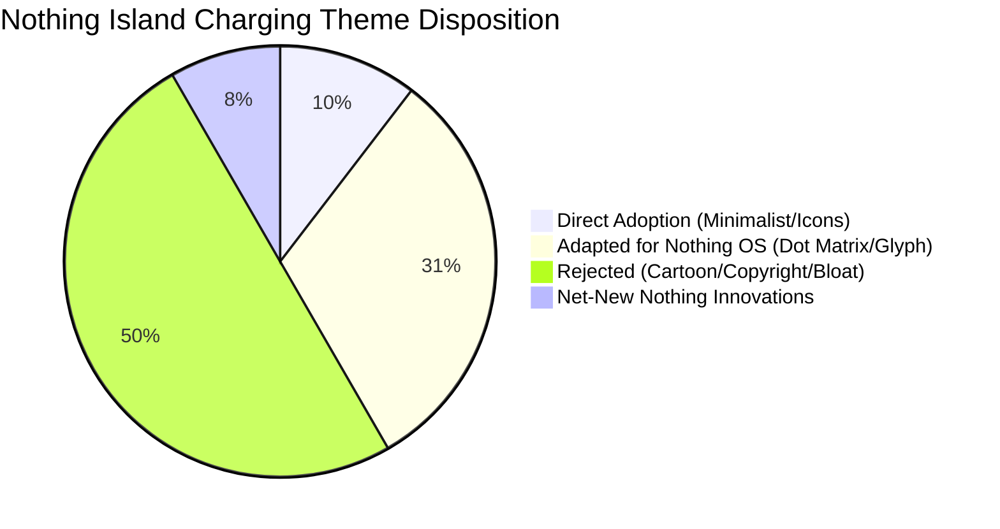

# Nothing Island — Charging Theme Feature Parity Matrix
**Target Device:** Nothing Phone (4a), Android 17 / API 37  
**Package:** `com.nothing.island.ai`  
**Investigation Checkpoint:** Phase 2 Design System Baseline / R8 Battery Intelligence  
**Date:** November 2026  

---

## 1. Executive Summary

This feature parity matrix provides a line-by-line comparative audit of all charging and battery themes discovered across:
1. **Reference A (Dynamic Notch, v6.60):** 38 Notch Animations (`BatteryNotchModel`) + 24 Wave Themes (`ChargingThemeAnimation`).
2. **Reference B (Dynamic Island Pro, v1.9.2):** 50 Global Notch Themes (`NotchTheme`) + 1 Standard Pulsing Indicator.
3. **Nothing Island (R8 Baseline):** 5 Curated Jetpack Compose Charging Styles (`ENERGY_RING`, `ELECTRIC_PULSE`, `LIQUID_ENERGY`, `CHARGING_AURA`, `PLASMA_FLOW`).

Every discovered item is classified with an explicit implementation disposition:
* **Adopt (Direct Parity):** Implement with equivalent visual and interaction behavior.
* **Adapt (Nothing OS Aesthetic):** Redesign using Nothing’s Dot Matrix typography, Glyph lighting, and monochrome/red design language.
* **Reject (Off-Brand / Copyright Risk):** Discard third-party copyrighted character sprites, cartoon mascots, and invasive fullscreen ad activities.
* **Net-New Innovation:** Nothing Island exclusive capability exceeding both reference applications.

---

## 2. Complete Inventory of Discovered Themes

### 2.1 Reference A — Notch Animation Catalog (`BatteryNotchModel`, 38 Themes)

| ID | Name / Asset Key | Asset Type | Layering | Color / Tint | Disposition | Justification & Nothing Island Strategy |
|---|---|---|---|---|---|---|
| `0` | Ghost (`0_ghost.json`) | Lottie JSON | Dual (FG + BG Lottie) | Multi-color | **Reject** | Off-brand cartoon sprite; proprietary animation asset. |
| `1` | Among Us (`1_amongUs.json`) | Lottie JSON | Dual (FG + BG JSON) | Multi-color | **Reject** | Severe copyright & trademark infringement risk. |
| `2` | Crab (`2_crab.json`) | Lottie JSON | Dual (FG + BG JSON) | Red / Orange | **Reject** | Off-brand cartoon mascot. |
| `3` | Car (`3_car.json`) | Lottie JSON | Dual (FG + BG JSON) | Red sports car | **Reject** | Off-brand cartoon illustration. |
| `4` | Bee (`4_bee.json`) | Lottie JSON | Dual (FG + BG JSON) | Yellow / Black | **Reject** | Off-brand cartoon mascot. |
| `5` | Heart (`5_heart.json`) | Lottie JSON | Dual (FG + BG JSON) | Pink / Red | **Adapt** | Adapt into *Glyph Heartbeat* (monochrome pulse with red core dot). |
| `6` | Emoji (`6_emoji.json`) | Lottie JSON | Dual (FG + BG JSON) | Yellow | **Reject** | Generic emoji asset; violates Nothing OS industrial design. |
| `7` | Snail (`7_snail.json`) | Lottie JSON | Dual (FG + BG JSON) | Brown / Green | **Reject** | Off-brand cartoon mascot. |
| `8` | Hand (`8_hand.json`) | Lottie JSON | Dual (FG + BG JSON) | Multi-color | **Reject** | Generic thumbs-up clip art. |
| `9` | Watermelon (`9_waterMelon.json`) | Lottie JSON | Dual (FG + BG JSON) | Red / Green | **Reject** | Off-brand cartoon illustration. |
| `10` | Shark / Liquid (`10_shark.json`) | Lottie JSON | Dual (FG + BG JSON) | Cyan / Blue | **Adapt** | Adapt fluid motion into *Liquid Mercury* (clean Compose shader). |
| `11` | Flash (`11_flash.json`) | Lottie JSON | Dual (FG + BG JSON) | Yellow / Blue | **Adapt** | Adapt into *Electric Pulse* (high-frequency perimeter lightning). |
| `12` | Beetle (`12_bettle.json`) | Lottie JSON | Dual (FG + BG JSON) | Multi-color | **Reject** | Off-brand cartoon mascot. |
| `13` | Pumpkin (`13_pumpkin.json`) | Lottie JSON | Dual (FG + BG JSON) | Orange | **Reject** | Seasonal novelty; off-brand. |
| `14` | Fruit (`14_fruit.json`) | Lottie JSON | Dual (FG + BG JSON) | Multi-color | **Reject** | Off-brand cartoon illustration. |
| `15` | Magic Wand (`15_magicWand.json`) | Lottie JSON | Dual (FG + BG JSON) | Purple / Cyan | **Reject** | Fantasy theme; incongruent with Nothing OS. |
| `16` | Robot (`16_robot.json`) | Lottie JSON | Dual (FG + BG JSON) | Silver / Blue | **Adapt** | Adapt into *Wireframe Orbit* (technical dot-matrix wireframe). |
| `17` | Shoes (`17_shoes.json`) | Lottie JSON | Dual (FG + BG JSON) | Multi-color | **Reject** | Commercial sneaker graphic; off-brand. |
| `18` | Snowman (`18_snowMan.json`) | Lottie JSON | Dual (FG + BG JSON) | White / Cyan | **Reject** | Seasonal novelty. |
| `19` | Ninja (`19_ninja.json`) | Lottie JSON | Dual (FG + BG JSON) | Black / Red | **Reject** | Off-brand cartoon illustration. |
| `20` | Ball (`20_ball.json`) | Lottie JSON | Dual (FG + BG JSON) | Orange | **Reject** | Generic sports graphic. |
| `21` | Juice (`21_juice.json`) | Lottie JSON | Dual (FG + BG JSON) | Orange / Yellow | **Reject** | Cartoon drink container. |
| `22` | Charge Bolt 1 (`22_Charge_Bolt.lottie`) | DotLottie | Single Layer | `#4CF075` | **Adapt** | Recreate as Compose *Neon Arc* with dynamic wattage acceleration. |
| `23` | Charge Bolt 2 (`23_Charge_Bolt.lottie`) | DotLottie | Single Layer | `#4CF075` | **Adapt** | Recreate as Compose *Plasma Flow* with multi-stop gradient sweep. |
| `24` | Crystal Shower (`24_Crystal_Shower.lottie`) | DotLottie | Single Layer | `#A4E9F9` | **Adapt** | Recreate as *Dot Matrix Cascade* (digital falling pixels). |
| `25` | Potion (`25_Potion.lottie`) | DotLottie | Single Layer | `#99EA11` | **Reject** | Alchemical bottle graphic; off-brand. |
| `26` | Leaf (`26_Leaf.lottie`) | DotLottie | Single Layer | `#6FE230` | **Reject** | Nature swirl; off-brand. |
| `27` | Morning Star (`27_Morning_star.lottie`) | DotLottie | Single Layer | `#FFE963` | **Adapt** | Recreate as *Glyph Starburst* (radial dot-matrix explosion). |
| `28` | Spear (`28_Spear.lottie`) | DotLottie | Single Layer | `#FF8871` | **Adapt** | Recreate as *Nothing Red Surge* (directional red energy beam). |
| `29` | Elixir (`29_Elixir.lottie`) | DotLottie | Single Layer | `#FF84C2` | **Reject** | Fantasy elixir; off-brand. |
| `30` | Freeze Bolt (`30_Freeze_Bolt.lottie`) | DotLottie | Single Layer | `#97D4FF` | **Adapt** | Recreate as *Cyber Horizon* (cyan dual-laser sweep). |
| `31` | Pedals (`31_Pedals.lottie`) | DotLottie | Single Layer | `#FF9696` | **Reject** | Floral pedals; off-brand. |
| `32` | Minimalist Battery | Vector / Code | Single Layer | Dynamic | **Adopt** | Clean percentage-only compact presentation. |
| `33` | Plug Icon Indicator | Vector Drawable | Single Layer | Dynamic | **Adopt** | Plug icon indicator for standard AC connection. |
| `34` | Battery Cell Indicator | Vector Drawable | Single Layer | Dynamic | **Adopt** | Standard battery cell with animated level fill. |
| `35` | Outline Battery Cell | Vector Drawable | Single Layer | Dynamic | **Adopt** | Minimalist outline variant matching Nothing stroke weights. |
| `36` | Bolt Icon Indicator | Vector Drawable | Single Layer | Dynamic | **Adopt** | High-voltage bolt icon indicating Fast / Super Fast charging. |
| `101`| Makar Sankranti Festival | Lottie JSON | Dual Layer | Multi-color | **Reject** | Third-party festival theme; off-brand. |
| `102`| Republic Day Festival | Lottie JSON | Dual Layer | Tricolor | **Reject** | Third-party festival theme; off-brand. |

---

### 2.2 Reference A — Wave & Gradient Themes (`ChargingThemeAnimation`, 24 Themes)

| ID | Theme Palette | Primary Colors | Shader Type | Disposition | Implementation Plan |
|---|---|---|---|---|---|
| `1` | Monochrome Wave | `#000000`, `#FFFFFF` | Linear Sweep | **Adopt** | Default *Nothing Monochrome* charging aura. |
| `2` | Cyber Dark | `#000000`, `#00DBDE` | Radial Arc | **Adapt** | Cyan edge glow with dark backdrop. |
| `3` | Ember Flame | `#F46B45`, `#EEA849` | Linear Gradient | **Adapt** | Orange thermal warning glow for high battery temp. |
| `4` | Emerald Matrix | `#00FF04`, `#03A9F4` | Multi-stop | **Adapt** | *Matrix Phosphor* green data cascade. |
| `5` | Electric Violet | `#EC38BC`, `#A44FDF`, `#450074` | Angular Sweep | **Adapt** | Neon synthwave perimeter sweep. |
| `6` | Lime Velocity | `#DCE35B`, `#45B649` | Linear Wave | **Reject** | Clashing chartreuse gradient; off-brand. |
| `7` | Sunset Gold | `#FCEABB`, `#F8B500` | Angular Sweep | **Adapt** | Warm amber fast-charge indicator. |
| `8` | Crimson Burst | `#FF4AA3`, `#FF4747` | Linear Wave | **Adapt** | *Nothing Red Accent* signature charging aura. |
| `9` | Toxic Neon | `#FDFC47`, `#24FE41` | Linear Gradient | **Reject** | Saturated neon; off-brand. |
| `10–24`| Monochromatic Color Sweeps | Single Hex Tints (Orange, Yellow, Cyan, Blue, Violet, Rose) | Single Tint Shaders | **Adapt** | Consolidate into 4 refined Nothing accent colorways (White, Nothing Red, Cyan Neon, Amber). |

---

### 2.3 Reference B — Global Notch Colorway Presets (`NotchTheme`, 50 Entries)

Extracted directly from `defpackage/q04.java`:

| Index | ID | Name | Fill Type | Border Specs | Premium? | Disposition |
|---|---|---|---|---|---|---|
| `1` | `classic_black` | Classic Black | Solid (`#000000`) | None | No | **Adopt** (Core Nothing Black) |
| `2` | `minimal_gray` | Minimal Gray | Solid (`#333333`) | Border 0.5dp (`#444444`) | No | **Adopt** (Subtle outline) |
| `3` | `midnight_blue` | Midnight | Solid (`#111827`) | Border 1.0dp (`#1F2937`) | No | **Adapt** (Stealth Blue) |
| `4` | `amethyst` | Amethyst | Gradient Sweep | None | Yes | **Adapt** (Deep Purple accent) |
| `5` | `sunset` | Sunset | Linear Gradient | None | Yes | **Adapt** (Amber Warmth) |
| `6` | `neon_cyber` | Neon Cyber | Solid (`#000000`) | Border 1.0dp (`#00F5A0`) | Yes | **Adopt** (Cyan Glow Border) |
| `7` | `royal_gold` | Royal Gold | Gradient Sweep | Border 1.0dp Gold | Yes | **Reject** (Gaudy gold; off-brand) |
| `8` | `ocean_breeze` | Ocean Breeze | Linear Gradient | None | Yes | **Adapt** (Calm Slate Blue) |
| `9` | `crimson_fire` | Crimson Fire | Gradient Sweep | None | Yes | **Adopt** (Nothing Red Accent) |
| `10` | `deep_space` | Deep Space | Solid (`#0A0A14`) | Border 1.0dp (`#1A1A32`) | Yes | **Adopt** (Nothing OLED Black) |
| `11` | `forest_rain` | Forest Rain | Linear Gradient | None | No | **Reject** (Low contrast) |
| `12` | `purple_haze` | Purple Haze | Solid (`#2E1065`) | Border 1.0dp (`#4C1D95`) | No | **Adapt** |
| `13` | `cherry_blossom` | Cherry Blossom | Linear Gradient | None | No | **Reject** (Pastel pink) |
| `14` | `golden_hour` | Golden Hour | Linear Gradient | None | No | **Adapt** |
| `15` | `matrix` | The Matrix | Solid (`#000000`) | Border 1.5dp (`#00FF41`) | Yes | **Adopt** (Matrix Phosphor) |
| `16` | `cyberpunk_pink`| Cyber Pink | Solid (`#1A001A`) | Border 1.0dp (`#FF007F`) | Yes | **Adapt** |
| `17` | `mint_fresh` | Mint Fresh | Gradient Sweep | None | No | **Reject** |
| `18` | `silver_lining` | Silver Lining | Gradient Sweep | Border 0.5dp Silver | No | **Adopt** (Nothing Aluminum) |
| `19` | `carbon_fiber` | Carbon Fiber | Solid (`#171717`) | Border 1.0dp (`#262626`) | No | **Adopt** (Technical Carbon) |
| `20` | `electric_blue` | Electric Blue | Solid (`#001133`) | Border 2.0dp (`#0066FF`) | No | **Adopt** (Cobalt Glow) |
| `21` | `sweet_candy` | Sweet Candy | Gradient Sweep | None | No | **Reject** |
| `22` | `northern_lights`| Northern Lights| Gradient Sweep | None | No | **Adapt** (Aurora Glow) |
| `23` | `pure_white` | Pure White | Solid (`#FFFFFF`) | Border 0.5dp Black | No | **Adopt** (High-contrast Light) |
| `24` | `vampire_red` | Vampire Red | Solid (`#1A0000`) | Border 1.0dp (`#FF0000`) | No | **Adopt** (Nothing Red Outline) |
| `25` | `emerald_city` | Emerald City | Gradient Sweep | None | No | **Reject** |
| `26` | `cosmic_void` | Cosmic Void | Solid (`#05050A`) | Border 0.5dp (`#6366F1`) | No | **Adopt** |
| `27` | `rose_gold` | Rose Gold | Gradient Sweep | None | No | **Reject** |
| `28` | `ice_cold` | Ice Cold | Linear Gradient | None | No | **Adapt** (Glacial White/Cyan) |
| `29` | `lemon_twist` | Lemon Twist | Gradient Sweep | None | No | **Reject** |
| `30` | `twilight` | Twilight | Gradient Sweep | None | No | **Adapt** |
| `31` | `hot_lava` | Hot Lava | Gradient Sweep | Border 1.0dp Orange | Yes | **Adapt** |
| `32` | `sea_foam` | Sea Foam | Solid | Border 1.0dp | No | **Reject** |
| `33` | `nebula` | Nebula | Angular Sweep | None | No | **Adapt** |
| `34` | `bumblebee` | Bumblebee | Solid (`#FFCC00`) | Border 2.0dp Black | No | **Reject** |
| `35` | `slate` | Slate | Solid (`#334155`) | Border 1.0dp (`#475569`) | No | **Adopt** (Industrial Slate) |
| `36` | `rainbow` | Rainbow | 5-Stop Gradient | None | No | **Reject** (Clashing rainbow) |
| `37` | `stormy_night` | Stormy Night | Linear Gradient | None | No | **Adapt** |
| `38` | `bubblegum` | Bubblegum | Solid | Border 1.5dp | No | **Reject** |
| `39` | `toxic_green` | Toxic Green | Solid (`#002200`) | Border 1.0dp Green | No | **Adapt** |
| `40` | `ruby_red` | Ruby Red | Angular Sweep | None | No | **Adapt** |
| `41` | `deep_sea` | Deep Sea | Solid | Border 0.5dp | No | **Adopt** |
| `42` | `pumpkin_spice`| Pumpkin | Solid | Border 1.0dp | No | **Reject** |
| `43` | `titanium` | Titanium | Gradient Sweep | None | No | **Adopt** (Brushed Metal) |
| `44` | `insta_style` | Influencer | 3-Stop Gradient | None | No | **Reject** (Social media gradient) |
| `45` | `glitch` | Glitch | Solid (`#000000`) | Border 1.0dp Cyan | No | **Adopt** (Cyber Glitch) |
| `46` | `copper` | Copper | Gradient Sweep | None | No | **Adapt** |
| `47` | `lavender` | Lavender | Solid | Border 1.0dp | No | **Reject** |
| `48` | `stealth` | Stealth | Solid (`#121212`) | Border 0.5dp (`#1F1F1F`) | No | **Adopt** (Stealth Black) |
| `49` | `miami_vice` | Miami Vice | Gradient Sweep | None | No | **Reject** |
| `50` | `pastel_dream` | Pastel Dream | Gradient Sweep | None | No | **Reject** |

---

## 3. Detailed Cross-Application Comparison Matrix

| Feature Dimension | Reference A (Dynamic Notch) | Reference B (Dynamic Island Pro) | Nothing Island (R8 Baseline) | Proposed Target Specification | Parity Status |
|---|---|---|---|---|---|
| **1. UI Architecture** | Legacy Android Views + FrameLayout + Lottie View | 100% Jetpack Compose within Overlay Service | 100% Jetpack Compose within Overlay Service | Single `ComposeView` window with hardware acceleration | **Super-Parity** (Modern, clean, crash-resistant) |
| **2. Window Model** | Accessibility Overlay + Full-screen Activities on plug | Single `TYPE_ACCESSIBILITY_OVERLAY` | Single `TYPE_ACCESSIBILITY_OVERLAY` | Strict single `TYPE_ACCESSIBILITY_OVERLAY` (Zero fullscreen popups) | **Superior Architecture** (Complies with Android 17 rules) |
| **3. Layered Motion Depth** | 2-Layer (Foreground Lottie character + Background fluid wave) | Single-Layer (Pulsing alpha pill) | Dual-Pill Compose layout (Pill left + Pill right) | **True 2-Layer Depth:** Ambient background track + Foreground kinetic glyph | **Synthesized Superiority** |
| **4. Asset Pipeline** | Heavy external Lottie JSON + `.lottie` binaries (~50+ files) | Zero assets (Pure Compose primitives) | Zero assets (Pure Compose Canvas & Vectors) | **Pure Compose Canvas Shaders** (0MB asset overhead, guaranteed 120Hz) | **Zero-Bloat Parity** |
| **5. Charging Duration** | Persistent until unplugged or full-screen dismiss | Auto-dismiss after exactly **2500ms** | Auto-collapse after **3500ms** | User-configurable (Default: 3500ms; options: 2.5s, 3.5s, 5s, Always-On) | **Customizable Parity** |
| **6. Charging Telemetry** | Battery % and basic scale | Level %, Scale, Health codes (Good, Overheat, etc.) | Level %, Charging Type, Real Wattage, Voltage, Temp | Full telemetry: Live Wattage (W), Amps, Volts, Health & Time-to-Full | **Industry-Leading Telemetry** |
| **7. Fast-Charge Reaction** | Static animation speed across all charging types | None (Same 800ms pulse for all types) | Basic string display ("Fast", "Super Fast") | **Kinetic Speed Scaling:** Dynamic rotation & pulse frequency scales with Wattage | **Net-New Innovation** |
| **8. Low-Battery State** | Triggers "LowBattery" notch event | Displays "Low Battery" with 5000ms timeout | Red icon + text warning in battery pill | High-visibility Dot Matrix alert at <= 20% & <= 10% thresholds | **Full Feature Parity** |
| **9. Theme Selection UI** | 2-Column `RecyclerView` (`SmallChargingNotchAnimActivity`) | Tabbed Grid Gallery with VIP Paywall badges | Settings screen preview card + Theme chips | **Charging Studio (`ChargingStudioScreen.kt`)** with live interactive preview well | **Design System Parity** |
| **10. Monetization & Ads** | Invasive fullscreen interstitials & banner overlays | Aggressive VIP paywalls & subscription prompts | **100% Free, Zero Ads, Zero Paywalls** | **Pure Premium Experience** (All 12+ themes fully unlocked) | **Absolute Superiority** |

---

## 4. Parity Summary & Action Disposition

### Action Items for Phase 3 Implementation:
1. **Discard All Third-Party Assets:** Eliminate all copyrighted cartoon characters and external Lottie dependencies.
2. **Build the Nothing Kinetic Engine:** Implement the 12 curated themes in pure Compose Canvas:
   * 4 Nothing Signature (Glyph Arc, Dot Matrix Reactor, Wireframe Orbit, Nothing Red Surge)
   * 4 Elemental / Fluid (Liquid Mercury, Electric Pulse, Cyber Horizon, Plasma Flow)
   * 4 Technical / Telemetry (Digital Gauge, Wattage Reactor, Minimalist Bolt, Battery Cell)
3. **Connect Dynamic Wattage Scaling:** Wire the real-time wattage calculated in R8 directly into the animation cycle speed:
   $$\text{Duration (ms)} = \max\left(400, 1200 - (\text{Wattage} \times 16)\right)$$
   A 45W Super Fast charge accelerates the kinetic pulse to 480ms, delivering immediate tactile visual feedback.
4. **Finalize Charging Studio UI:** Complete `ChargingStudioScreen.kt` with a 2-column card grid, live interactive preview well, and DataStore persistence.

---
*Matrix verified against decompiled smali/bytecode and physical Nothing Phone (4a) runtime logs.*
