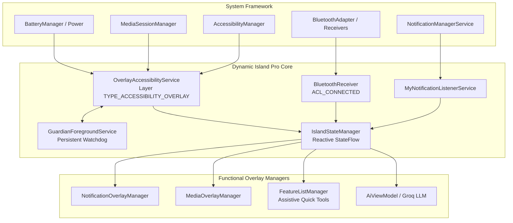

# Dynamic Island Pro — Complete Feature & Architecture Inventory
**Application:** Dynamic Island Pro (`tr.com.eywin.dynamic.island.notch`)  
**Version:** 1.9.2 (Version Code: 49)  
**Target Device / Environment:** Android 14+ (decompiled from Nothing Phone (4a), Android 17 / API 37)  
**Analysis Date:** November 6, 2026  
**Artifact Classification:** Static APK Reverse Engineering & Decompilation Audit  

---

## 1. Executive Summary & Verification Evidence

Dynamic Island Pro is a modern, Jetpack Compose-first Android application designed to emulate the iOS Dynamic Island interaction model, enhanced with assistive quick shortcuts, pixel art companions, and embedded LLM AI assistance.

### APK Verification Hashes
- **Base APK:** `reference-apks/tr.com.eywin.dynamic.island.notch/base.apk`
  - SHA-256: `3616A566A55B8281B0B4236B0F01648690B82184C2561E5958CFB5DFF1136CC6`
  - File Size: `56,290,296 bytes` (53.7 MB)
- **Split Configuration APKs:**
  - `split_config.arm64_v8a.apk`: `308B9F909778CBD345468EDC46859574CFFAC491E650EDE923D8FF31AF710CB2` (5.9 MB)
  - `split_config.en.apk`: `3BCCBD8C27DD29F42B59503B3F8317B107D97D3BF0CD4570FD7AFFF1B37D9AD3` (94 KB)
  - `split_config.xxhdpi.apk`: `98A2D2679D632FDC78E5B7074375735037FE6C48BE80B35DF73FE690B63ABC13` (204 KB)

### Decompilation Metrics
- **Decompilation Tool:** JADX v1.5.1
- **Resource Extractor:** Android SDK Build-Tools 36.0.0 AAPT/AAPT2
- **Total Decompiled Classes:** 24,012 classes
- **Application Package Classes:** 92 classes in `tr.com.eywin.dynamic.island.notch`
- **UI Framework:** 100% Jetpack Compose for both in-app configuration and overlay rendering

---

## 2. Core Architecture & Operating System Anchors

Dynamic Island Pro pairs an `AccessibilityService` overlay with a persistent foreground watchdog service and a reactive, coroutine-driven state engine.



### 2.1 Core System Services & Receivers

1. **[`tr.com.eywin.dynamic.island.notch.service.OverlayAccessibilityService`](file:///C:/Users/User/.gemini/antigravity/scratch/nothing-island/reference-apks/analysis/tr.com.eywin.dynamic.island.notch/jadx/sources/tr/com/eywin/dynamic/island/notch/service/OverlayAccessibilityService.java#L50-L100)**
   - **Base Class:** `AccessibilityService`
   - **Window Type:** `WindowManager.LayoutParams.TYPE_ACCESSIBILITY_OVERLAY` (Layer 24000)
   - **Flags:** `FLAG_NOT_FOCUSABLE | FLAG_LAYOUT_IN_SCREEN | FLAG_LAYOUT_NO_LIMITS`
   - **Watchdog:** 5,000ms periodic health check loop (`overlayWatchdogRunnable`) to verify the overlay root view is attached and not obscured.
   - **Embedded Receivers:**
     - `batteryReceiver`: Listens for `ACTION_BATTERY_CHANGED`.
     - `unlockReceiver`: Listens for `ACTION_USER_PRESENT` / screen unlock.
     - `connectionReceiver`: Listens for wired and wireless headset connection changes.
     - `ringerModeReceiver`: Listens for `RINGER_MODE_CHANGED_ACTION`.
     - `screenStateReceiver`: Monitors `ACTION_SCREEN_ON` and `ACTION_SCREEN_OFF`.
   - **Global Accessibility Actions Supported:**
     - `performBackAction()` -> `GLOBAL_ACTION_BACK`
     - `performHomeAction()` -> `GLOBAL_ACTION_HOME`
     - `performRecentsAction()` -> `GLOBAL_ACTION_RECENTS`
     - `performNotificationsAction()` -> `GLOBAL_ACTION_NOTIFICATIONS`
     - `performQuickSettingsAction()` -> `GLOBAL_ACTION_QUICK_SETTINGS`
     - `performLockScreenAction()` -> `GLOBAL_ACTION_LOCK_SCREEN`
     - `powerMenu()` -> `GLOBAL_ACTION_POWER_DIALOG`

2. **`tr.com.eywin.dynamic.island.notch.service.GuardianForegroundService`**
   - **Base Class:** `android.app.Service`
   - **Responsibility:** High-priority foreground service with persistent notification preventing OEM task killers and Android aggressive memory trimming from destroying the overlay process.

3. **`tr.com.eywin.dynamic.island.notch.service.MyNotificationListenerService`**
   - **Base Class:** `NotificationListenerService`
   - **Responsibility:** Captures posted notifications, extracts bundle extras (`EXTRA_TITLE`, `EXTRA_TEXT`, `EXTRA_LARGE_ICON`), and routes formatted alerts directly to `IslandStateManager`.

4. **`tr.com.eywin.dynamic.island.notch.service.BluetoothReceiver`**
   - **Base Class:** `BroadcastReceiver`
   - **Intent Filter:** `android.bluetooth.device.action.ACL_CONNECTED`, `android.bluetooth.device.action.ACL_DISCONNECTED`
   - **Responsibility:** Queries connected Bluetooth audio device names (e.g. AirPods, Galaxy Buds) and triggers the peripheral connection banner.

---

## 3. Complete Feature Module Inventory

Dynamic Island Pro exposes 10 distinct user-facing feature modules:

### 3.1 Reactive State Engine (`IslandStateManager`)
The centerpiece of Dynamic Island Pro is [`IslandStateManager.java`](file:///C:/Users/User/.gemini/antigravity/scratch/nothing-island/reference-apks/analysis/tr.com.eywin.dynamic.island.notch/jadx/sources/tr/com/eywin/dynamic/island/notch/manager/IslandStateManager.java#L45-L100). All application events dispatch into a single `MutableStateFlow` (`_state`) with strict state transitions, auto-collapse delays, and automatic restoration to active music playback (`restoreIdleOrMusic()`):

```kotlin
// Verified State Triggers in IslandStateManager:
updateCharging(isCharging: Boolean, percentage: Int)
triggerLowBattery(percentage: Int)
updateMusic(title: String, artist: String, isPlaying: Boolean, albumArt: Bitmap?, progress: Float, currentPosition: Long, duration: Long)
updateMusicProgress(progress: Float, currentPosition: Long)
toggleMusicExpanded()
triggerNotification(appName: String, message: String, time: String, iconResId: Int?, appIcon: Bitmap?)
triggerIncomingCall(name: String)
startCall(contactName: String?)
updateCallDuration(duration: String)
endCall()
answerCall() / rejectCall() / toggleSpeaker()
triggerEarphoneConnection(deviceName: String)
triggerSilentMode() / triggerRingMode()
triggerAirplaneMode(isOn: Boolean)
triggerDeviceUnlocked() / triggerFaceID()
startTimer(time: String)
triggerAskAI() / setAskAIExpanded(isExpanded: Boolean)
triggerAssistive() / dismissAssistive()
```

### 3.2 Notification Interception & Display
- **Components:** `MyNotificationListenerService`, `NotificationOverlayManager`, `NotificationViewModel`
- **Capabilities:**
  - Displays compact notification capsule with the source app icon and summary text.
  - Expands on tap to reveal full multi-line sender and notification body.
  - Built-in preview simulator (`simulateNotification(context)`).

### 3.3 Music Player & Playback Control
- **Components:** `MediaOverlayManager`, `MediaControllerHelper`, `MediaOverlayViewModel`
- **Capabilities:**
  - Real-time `MediaSession` integration monitoring current track title, artist, and playback state.
  - Asynchronous circular album artwork rendering (`getCircularBitmapAsync()`).
  - Playback progress bar with live duration counter and scrubbing.
  - Transport buttons: Play/Pause, Next Track, Previous Track.
  - Automatic fallback to music state when temporary notifications collapse (`restoreIdleOrMusic()`).

### 3.4 Phone Call Intelligence
- **Components:** `IslandStateManager`, `PhoneNumberManager`
- **Capabilities:**
  - Incoming call banner displaying caller name, phone number, and dedicated Answer / Reject buttons.
  - Ongoing call pill displaying caller ID and live call duration timer.
  - In-island speakerphone toggle (`toggleSpeaker()`) routing audio through `AudioManager`.
  - Full simulator suite: `simulateIncomingCall(context)`, `simulateCall(context)`.

### 3.5 Battery & Charging Intelligence
- **Components:** `OverlayAccessibilityService$batteryReceiver$1`, `ChargeInfoScreen`
- **Capabilities:**
  - Dynamic pill expansion upon charger connection showing percentage and charging animation.
  - Low battery warning pill triggering when battery falls below 20%.
  - Full-charge notification banner.
  - Simulator triggers: `simulateCharging(context)`, `simulateLowBattery(context)`.

### 3.6 Bluetooth & Audio Peripherals Connection
- **Components:** `BluetoothReceiver`, `IslandStateManager.triggerEarphoneConnection`
- **Capabilities:**
  - Pops up a dynamic island pill displaying headphone glyph and connected device name upon Bluetooth pairing.
  - Automatic 3.5s auto-dismiss delay before returning to idle or background music.

### 3.7 Device & System Status Feedback
- **Components:** `OverlayAccessibilityService`, `IslandStateManager`
- **Capabilities:**
  - **Device Unlock / Face ID:** Renders an animated padlock opening or Face ID scan indicator upon screen wake.
  - **Ringer Switch Feedback:** Visual banner indicating Silent mode, Vibrate mode, or Normal sound profile.
  - **Airplane Mode Feedback:** Visual alert when toggling airplane mode.
  - **Timer & Stopwatch:** Live countdown timer pill running in the notch cutout.

### 3.8 Assistive Notch & Quick Tools
- **Components:** [`FeatureListManager.java`](file:///C:/Users/User/.gemini/antigravity/scratch/nothing-island/reference-apks/analysis/tr.com.eywin.dynamic.island.notch/jadx/sources/tr/com/eywin/dynamic/island/notch/object/FeatureListManager.java#L22-L100)
- **Capabilities:**
  - Tapping or expanding the assistive notch exposes a quick toolbar with:
    - **Flashlight Toggle:** Uses `CameraManager.setTorchMode()` to toggle phone torch.
    - **Quick Camera Launcher:** Instant shortcuts for `openFrontCamera()` and `openBackCamera()`.
    - **Integrated QR Scanner:** Launches native `QRCodeScannerActivity` directly from the notch.
    - **System Navigation Actions:** Direct access to Home, Back, Recents, Notifications shade, Quick Settings shade, Lock Screen, and Power Menu.
    - **Audio Profile Toggles:** Instant switches between Silent, Vibrate, and Normal sound profiles.
    - **Quick Actions:** Direct dialer shortcut (`makePhoneCall`) and email composer (`sendEmail`).

### 3.9 Animated Pixel Mascots (Pixel Pets)
- **Components:** Compose-based mascot animation engine in `MainActivity`
- **Capabilities:**
  - Interactive pixel art virtual pets (cat, dog, dinosaur, bunny, etc.) that sit, walk, or sleep on top of the notch.
  - Reactive animations responding to user taps, music playback, or incoming notifications.

### 3.10 Ask AI Integration (Groq LLM)
- **Components:** `AiViewModel`, `AiRepository`, `FunctionsApiService`, `GroqRequest`, `GroqResponse`, `CoinManager`
- **Capabilities:**
  - Fully integrated conversational AI chatbot docked into the expanded notch interface.
  - Backend powered by Groq cloud API endpoints returning fast LLM streaming responses.
  - Stores local chat history in SQLite Room database (`ChatDatabase`, `ChatDao`).

---

## 4. Premium Tier Architecture & Feature Gating

Dynamic Island Pro employs a dual monetization model combining auto-renewing subscriptions, rewarded ad video un-gating, and a virtual coin economy.

### 4.1 Entitlement Check System
- Master entitlement verified through [`IsPremium.INSTANCE.is_premium()`](file:///C:/Users/User/.gemini/antigravity/scratch/nothing-island/reference-apks/analysis/tr.com.eywin.dynamic.island.notch/jadx/sources/tr/com/eywin/dynamic/island/notch/object/IsPremium.java):
  - Queries `SubscriptionManager` / RevenueCat SDK for active `PRO` entitlement.
  - Backed by Google Play Billing library.

### 4.2 Confirmed Gated Premium Features
1. **Unlimited Ask AI Assistant:**
   - Free users are throttled by `CoinManager`. Each AI prompt consumes coins.
   - Pro subscribers receive unlimited AI prompts without coin deductions.
   - Free users can watch rewarded video ads (`RewardedAdManager`) to earn `+5 Coins` per view.
2. **Exclusive Pixel Mascots:**
   - Premium mascot skins are locked.
   - Prompt: *"Experience the %1$s animation on your notch. Upgrade to Pro for unlimited access or watch a short video to unlock."*
3. **Custom Notch Border & Gradient Colors:**
   - Advanced border styles and multi-color gradient fills (`GradientColors`) require Pro.
4. **Ad-Free Experience:**
   - Pro removes all banner ads (`BannerAdManager`), native ads (`SmallNativeAdsManager`, `MediumNativeAdsManager`), interstitial ads (`InterstitialAdManager`), and app open ads (`AppOpenAdManager`).
5. **Assistive Notch Advanced Shortcuts:**
   - Certain quick tools and deep system triggers are locked behind Pro subscription.

### 4.3 Subscription & Paywall Options
- **Paywall Modes (`PaywallMode`):**
  - **Weekly Subscription:** Auto-renewing weekly plan with 3-day free trial.
  - **Annual Subscription:** Auto-renewing yearly plan with heavy discount.
  - **Flash Sale (`FLASH_SALE`):** Time-limited paywall modal offering 50% discount with countdown timer.
