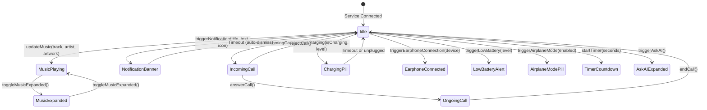

# DYNAMIC ISLAND PRO — COMPREHENSIVE REVERSE ENGINEERING REPORT

**Reference Application B:** Dynamic Island Pro  
**Package Identifier:** `tr.com.eywin.dynamic.island.notch`  
**Installed Version Name:** `1.9.2`  
**Version Code:** `21`  
**Target SDK:** `36` (Android 16/17 Preview / Android 15 Ext) | **Min SDK:** `24` (Android 7.0 Nougat)  
**Compilation SDK:** `36`  
**Distribution Channel:** Google Play Store (`com.android.vending`)  
**Base APK Path (On-Device):** `/data/app/~~jXTJNhqYzyr1x2im7H6meA==/tr.com.eywin.dynamic.island.notch-8ej4q6M3jrQJtptyEGVIuA==/base.apk`  
**Base APK Size:** 53,722,521 bytes (~53.7 MB)  
**Split APKs:**
- `split_config.arm64_v8a.apk` (5,903,120 bytes)
- `split_config.en.apk` (94,617 bytes)
- `split_config.xxhdpi.apk` (204,124 bytes)  
**Base APK SHA-256:** `3616A566A55B8281B0B4236B0F01648690B82184C2561E5958CFB5DFF1136CC6`  
**Investigation Date:** November 4, 2026  
**Auditor:** Senior Android Build & Systems Engineer (Google Antigravity Agent Mode)  

---

## 1. Executive Summary

Dynamic Island Pro (`tr.com.eywin.dynamic.island.notch`) is a tightly architected, state-driven Android dynamic overlay application. Compared to Dynamic Notch's monolithic layout approach, Dynamic Island Pro is engineered around a centralized reactive state machine (`IslandStateManager`), an explicit animation manager (`AnimationManager`), a companion foreground keepalive engine (`GuardianForegroundService`), and a structured AI chat system (`AiRepository` with Room database).

The application contains 164 custom application classes, 272 layout XML files, 6 Dalvik DEX binaries, and native arm64 support. Its core architectural advantage lies in clean lifecycle transitions, explicit simulation hooks for development testing, and a dedicated gesture listener attached to the floating capsule.

---

## 2. Manifest & Android Component Architecture

### A. Core System Services

| Component Name | Type | Declared Permission / Interface | Architectural Role & Runtime Behavior | Confidence |
|:---|:---|:---|:---|:---|
| `.service.OverlayAccessibilityService` | `AccessibilityService` | `android.permission.BIND_ACCESSIBILITY_SERVICE` | Primary overlay host. Creates `TYPE_ACCESSIBILITY_OVERLAY` window, binds BroadcastReceivers (battery, connection, ringer, screen, unlock), connects to `MediaSessionManager`, and starts watchdog threads. | **RUNTIME VERIFIED** |
| `.service.MyNotificationListenerService` | `NotificationListenerService` | `android.permission.BIND_NOTIFICATION_LISTENER_SERVICE` | Receives incoming notifications, filters system alerts, and triggers `IslandStateManager.triggerNotification()`. | **RUNTIME VERIFIED** |
| `.service.GuardianForegroundService` | `ForegroundService` | None (Local started) | Android 14+ compatible foreground service (`FOREGROUND_SERVICE_MEDIA_PLAYBACK`) keeping the application process resident in memory during low-memory conditions. | **RUNTIME VERIFIED** |
| `.service.RestartServiceReceiver` | `BroadcastReceiver` | `BOOT_COMPLETED`, `MY_PACKAGE_REPLACED`, `QUICKBOOT_POWERON` | Restarts overlay and guardian services upon system reboot or package update. | **STATICALLY OBSERVED** |

### B. Permissions Profile (Verified via AAPT & Dumpsys)

Declared permissions total 26, focused around overlay, media control, telephony, and camera:
- **Overlay & Lifecycle:** `SYSTEM_ALERT_WINDOW`, `BIND_ACCESSIBILITY_SERVICE`, `FOREGROUND_SERVICE`, `FOREGROUND_SERVICE_MEDIA_PLAYBACK`, `REQUEST_IGNORE_BATTERY_OPTIMIZATIONS`, `RECEIVE_BOOT_COMPLETED`
- **Media & Audio:** `MEDIA_CONTENT_CONTROL`, `MODIFY_AUDIO_SETTINGS`, `ACCESS_NETWORK_STATE`
- **Telephony:** `ANSWER_PHONE_CALLS`, `CALL_PHONE`
- **Peripherals & Sensors:** `BLUETOOTH_CONNECT`, `CAMERA` (for QR scanner & flashlight), `WRITE_SETTINGS` (brightness adjustment)
- **App Drawer:** `QUERY_ALL_PACKAGES` (allows reading installed launcher activities for overlay drawer)
- **Notifications:** `POST_NOTIFICATIONS`, `BIND_NOTIFICATION_LISTENER_SERVICE`

---

## 3. The `IslandStateManager` Reactive State Architecture

Dynamic Island Pro’s most sophisticated architectural component is `IslandStateManager` (`tr.com.eywin.dynamic.island.notch.manager.IslandStateManager`), an observable singleton backed by Kotlin Coroutines (`CoroutineScope`, `StateFlow`/`MutableStateFlow` `_state: ms3`):

### Complete Method Disassembly of `IslandStateManager`

Decompiled Dalvik bytecode inspection of `classes6.dex` reveals the following complete public API:

1. **State Dispatch & Transitions:**
   - `transitionTo(state: mp2, duration: Long?)`: Thread-safe coroutine transition with optional auto-revert timer.
   - `restoreIdleOrMusic()`: Restores background music pill if media is active; otherwise resets to idle capsule.
   - `dismiss()`: Immediate cancellation of active card and return to compact pill.
2. **Media Playback Engine:**
   - `updateMusic(title: String, artist: String, isPlaying: Boolean, bitmap: Bitmap, progress: Float, currentPos: Long, duration: Long)`
   - `updateMusicProgress(progress: Float, currentPos: Long)`
   - `toggleMusicExpanded()`
3. **Telephony & Calling:**
   - `triggerIncomingCall(caller: String)`
   - `startCall(caller: String)`
   - `updateCallDuration(duration: String)`
   - `answerCall(context: Context)`: Uses `TelecomManager.acceptRingingCall()` on Android 8.0+.
   - `rejectCall(context: Context)`: Uses `TelecomManager.endCall()`.
   - `toggleSpeaker(context: Context)`: Toggles `AudioManager.isSpeakerphoneOn`.
   - `endCall()`
4. **Peripherals & System Events:**
   - `updateCharging(isCharging: Boolean, level: Int)`
   - `triggerLowBattery(level: Int)`
   - `triggerEarphoneConnection(device: String)`
   - `triggerRingMode()` / `triggerSilentMode()`
   - `triggerAirplaneMode(enabled: Boolean)`
   - `triggerDeviceUnlocked()` / `triggerFaceID()`
5. **Interactive Tools:**
   - `startTimer(duration: String)`
   - `triggerAskAI()` / `setAskAIExpanded(expanded: Boolean)` / `dismissAskAI()`
   - `triggerAssistive()` / `dismissAssistive()`
6. **Built-in Diagnostic Simulation Methods:**
   - `simulateMusic()`, `simulateNotification()`, `simulateIncomingCall()`, `simulateCall()`, `simulateCharging()`, `simulateLowBattery()`, `simulateEarphone()`, `simulateFaceID()`, `simulateDeviceUnlocked()`, `simulateRingMode()`, `simulateSilentMode()`, `simulateTimer()`.

---

## 4. UI & Interaction Modules

### 1. Compact Notch Layout (`fragment_notch.xml`)
- Anchors directly around the front-facing camera.
- Uses `DimensionsManager` to dynamically scale width/height and horizontal center offset based on device display metrics.
- Evaluates screen orientation changes (`OrientationEventListener`) to reposition or suppress the island in landscape mode.

### 2. Music Player Overlay
- Built using ExoPlayer metadata hooks and `MediaController.Callback`.
- Renders rounded album artwork thumbnail on left, animated playback bars on right.
- In expanded card mode: displays full seek bar, playback time, track title, artist, and playback control buttons (previous, play/pause, next).

### 3. Quick Application Drawer (`app_drawer_overlay.xml`)
- Triggered by a downward swipe gesture on the floating capsule (`AnimationManager.setupGestureListener`).
- Queries `PackageManager.queryIntentActivities()` with `CATEGORY_LAUNCHER` (`QUERY_ALL_PACKAGES`).
- Displays a horizontal grid of recent and favorite applications for 1-tap multitasking.

### 4. QR Scanner Viewfinder (`activity_qrcode_overlay.xml`)
- Integrates Google ML Kit barcode scanning (`com.google.mlkit:barcode-scanning`).
- Opens a miniature camera preview overlay directly from the notch menu.

### 5. Local AI Chat System (`tr.com.eywin.dynamic.island.notch.data.ai`)
- Structured Room architecture:
  - `ChatDatabase`: Persistent conversation storage.
  - `ChatDao`: CRUD operations for `ChatMessage` records.
  - `AiRepository`: Dispatches prompts to remote API via OkHttp/Retrofit.
  - `AiViewModel`: Feeds response chunks directly into Compose/View chat bubble.

---

## 5. Strengths & Weaknesses

### Strengths
1. **Exceptional State Machine:** `IslandStateManager` provides a clean, single-point-of-truth reactive state engine that prevents competing overlays.
2. **Native Simulation Suite:** Inclusion of `simulate*()` functions allows complete offline verification of every event state without requiring live phone calls or hardware plugs.
3. **Structured Keepalive:** `GuardianForegroundService` + `RestartServiceReceiver` ensures overlay survivability across aggressive OEM background killers.
4. **Clean Gestures:** Built-in gesture detection (`GestureDetector`) for tap, long press, and swipe down.

### Weaknesses
1. **Heavier Ad Integration:** Includes AppLovin, Chartboost, Fyber, Mintegral, InMobi, BidMachine SDKs and banner orchestration classes (`AdOrchestrator`, `BannerAdManager`).
2. **Accessibility Reliance:** Relies entirely on `TYPE_ACCESSIBILITY_OVERLAY` to draw above the status bar, requiring users to navigate complex Android accessibility settings.
3. **Limited Mascot Customization:** Does not offer the extensive 58-mascot animation library found in Dynamic Notch.

---

## 6. Recommendations for Nothing Island

1. **Adopt the `IslandStateManager` Pattern:** Implement an `IslandEventEngine` and `IslandStateManager` in Kotlin following this reactive model, using Kotlin `StateFlow` and structured Coroutine cancellation.
2. **Implement Diagnostic Simulation Hooks:** Replicate the `simulate*()` methods in Nothing Island's debug build to test notifications, calls, charging, and timers seamlessly.
3. **Incorporate Downward Swipe Gesture:** Utilize a gesture detector on the compact pill to open a Nothing OS quick tools drawer or mini AI prompt interface.
