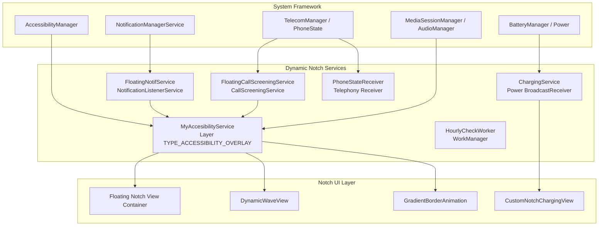

# Dynamic Notch — Complete Feature & Architecture Inventory
**Application:** Dynamic Notch (`com.dynamicisland.notchscreenview`)  
**Version:** 6.60 (Version Code: 110)  
**Target Device / Environment:** Android 14+ (decompiled from Nothing Phone (4a), Android 17 / API 37)  
**Analysis Date:** November 6, 2026  
**Artifact Classification:** Static APK Reverse Engineering & Decompilation Audit  

---

## 1. Executive Summary & Verification Evidence

Dynamic Notch is a feature-heavy Android personalization application designed to simulate Apple Dynamic Island and extended notch interactions on punch-hole and teardrop Android displays.

### APK Verification Hashes
- **Base APK:** `reference-apks/com.dynamicisland.notchscreenview/base.apk`
  - SHA-256: `1BBF152FFCD286FF51E03F793B3AA984ADA8A7ABB87D0167153818D5A8D2C022`
  - File Size: `104,710,729 bytes` (99.8 MB)
- **Split Configuration APK:** `split_config.arm64_v8a.apk`
  - SHA-256: `9B173F82829C9FDD0DA461FCADFFA2E8A5786610D92813AF3D17A76A42663806`
  - File Size: `2,323,280 bytes` (2.2 MB)

### Decompilation Metrics
- **Decompilation Tool:** JADX v1.5.1
- **Resource Extractor:** Android SDK Build-Tools 36.0.0 AAPT/AAPT2
- **Total Decompiled Classes:** 28,332 classes
- **Application Package Classes:** 277 classes in `com.dynamicisland.notchscreenview`
- **Total String Resources:** 85,646 localized entries across 30+ languages

---

## 2. Core Architecture & Operating System Anchors

Dynamic Notch relies on a multi-service architecture anchored around a central `AccessibilityService` that draws directly into Android's window hierarchy above standard system UI.



### 2.1 Core System Services

1. **`com.dynamicisland.notchscreenview.service.MyAccesibilityService`**
   - **Base Class:** [`android.accessibilityservice.AccessibilityService`](file:///C:/Users/User/.gemini/antigravity/scratch/nothing-island/reference-apks/analysis/com.dynamicisland.notchscreenview/jadx/sources/com/dynamicisland/notchscreenview/service/MyAccesibilityService.java#L1-L100)
   - **Window Type:** `WindowManager.LayoutParams.TYPE_ACCESSIBILITY_OVERLAY` (Layer 24000)
   - **Window Flags:** `FLAG_NOT_FOCUSABLE | FLAG_LAYOUT_IN_SCREEN | FLAG_LAYOUT_NO_LIMITS | FLAG_HARDWARE_ACCELERATED`
   - **Responsibility:** Main overlay lifecycle manager, notch coordinate placement, cutout alignment, touch gesture dispatching, and view inflation. Exceeds 4,054 lines of Kotlin/Java logic.
   - **Global Accessibility Actions Dispatched:**
     - `GLOBAL_ACTION_BACK`
     - `GLOBAL_ACTION_HOME`
     - `GLOBAL_ACTION_RECENTS`
     - `GLOBAL_ACTION_NOTIFICATIONS`
     - `GLOBAL_ACTION_QUICK_SETTINGS`
     - `GLOBAL_ACTION_POWER_DIALOG`
     - `GLOBAL_ACTION_LOCK_SCREEN`
     - `GLOBAL_ACTION_TAKE_SCREENSHOT`

2. **`com.dynamicisland.notchscreenview.service.FloatingNotifService`**
   - **Base Class:** `android.service.notification.NotificationListenerService`
   - **Permission:** `android.permission.BIND_NOTIFICATION_LISTENER_SERVICE`
   - **Responsibility:** Intercepts incoming status bar notifications, extracts titles, text, small/large icons, progress bars, and `Notification.Action` triggers. Transmits filtered events to `MyAccesibilityService`.

3. **`com.dynamicisland.notchscreenview.service.FloatingCallScreeningService`**
   - **Base Class:** `android.telecom.CallScreeningService`
   - **Permission:** `android.permission.BIND_SCREENING_SERVICE`
   - **Responsibility:** Intercepts incoming telecom calls before ringing, reads incoming caller ID metadata, and passes call control to the notch overlay.

4. **`com.dynamicisland.notchscreenview.service.ChargingService`**
   - **Base Class:** `android.app.Service`
   - **Receivers:** Embedded `PowerConnectionReceiver` monitoring `Intent.ACTION_POWER_CONNECTED`, `Intent.ACTION_POWER_DISCONNECTED`, and `Intent.ACTION_BATTERY_CHANGED`.
   - **Responsibility:** Drives small notch charging animations and battery percentage updates.

5. **`com.dynamicisland.notchscreenview.callendservices.PhoneStateReceiver`**
   - **Base Class:** `android.content.BroadcastReceiver`
   - **Intent Filter:** `android.intent.action.PHONE_STATE`
   - **Responsibility:** Detects call termination (`EXTRA_STATE_IDLE`) and triggers the post-call summary view (`CallEndSummaryScreen`).

6. **`com.dynamicisland.notchscreenview.receiver.HourlyCheckWorker`**
   - **Base Class:** `androidx.work.PeriodicWorkRequest` / `ListenableWorker`
   - **Interval:** Periodic background execution (hourly) to verify overlay health and check server-side remote flags via `WorkManager`.

---

## 3. Complete Feature Module Inventory

Dynamic Notch provides 12 primary functional feature modules:

### 3.1 Notification Interception & Display
- **Activities:**
  - [`NotificationActivity.java`](file:///C:/Users/User/.gemini/antigravity/scratch/nothing-island/reference-apks/analysis/com.dynamicisland.notchscreenview/jadx/sources/com/dynamicisland/notchscreenview/activity/NotificationActivity.java)
  - [`NotificationPermissionActivity.java`](file:///C:/Users/User/.gemini/antigravity/scratch/nothing-island/reference-apks/analysis/com.dynamicisland.notchscreenview/jadx/sources/com/dynamicisland/notchscreenview/activity/NotificationPermissionActivity.java)
  - [`BlockedNotificationAppsActivity.java`](file:///C:/Users/User/.gemini/antigravity/scratch/nothing-island/reference-apks/analysis/com.dynamicisland.notchscreenview/jadx/sources/com/dynamicisland/notchscreenview/activity/BlockedNotificationAppsActivity.java)
  - [`BlocklistActivity.java`](file:///C:/Users/User/.gemini/antigravity/scratch/nothing-island/reference-apks/analysis/com.dynamicisland.notchscreenview/jadx/sources/com/dynamicisland/notchscreenview/activity/BlocklistActivity.java)
- **Capabilities:**
  - Displays compact preview pill when notifications arrive.
  - Expands on tap to show app icon, title, message body, and direct action buttons.
  - Per-app inclusion/exclusion blocklist allowing users to suppress spam notifications from specific apps.
  - Download / upload progress tracking indicator on the notch.

### 3.2 Music Player & Audio Visualizers
- **Activities & Views:**
  - [`MusicActivity.java`](file:///C:/Users/User/.gemini/antigravity/scratch/nothing-island/reference-apks/analysis/com.dynamicisland.notchscreenview/jadx/sources/com/dynamicisland/notchscreenview/activity/MusicActivity.java)
  - [`MusicBlockAppsActivity.java`](file:///C:/Users/User/.gemini/antigravity/scratch/nothing-island/reference-apks/analysis/com.dynamicisland.notchscreenview/jadx/sources/com/dynamicisland/notchscreenview/activity/MusicBlockAppsActivity.java)
  - `VoiceWaveformView.java`
  - `DynamicLottieView.java`
- **Capabilities:**
  - Intercepts active Android `MediaSession` objects via `MediaSessionManager`.
  - Displays rotating or animated album artwork, song title, and artist name.
  - Transport controls: Play / Pause, Next, Previous track.
  - Real-time animated waveform bars rendered alongside the compact notch.
  - App-specific music suppression (e.g. ignore navigation voice prompts or podcast apps).

### 3.3 Battery & Charging Intelligence
- **Activities & Custom Views:**
  - [`BatteryInfoActivity.java`](file:///C:/Users/User/.gemini/antigravity/scratch/nothing-island/reference-apks/analysis/com.dynamicisland.notchscreenview/jadx/sources/com/dynamicisland/notchscreenview/activity/BatteryInfoActivity.java)
  - [`SmallChargingNotchAnimActivity.java`](file:///C:/Users/User/.gemini/antigravity/scratch/nothing-island/reference-apks/analysis/com.dynamicisland.notchscreenview/jadx/sources/com/dynamicisland/notchscreenview/activity/SmallChargingNotchAnimActivity.java)
  - `CustomNotchChargingView.java`
  - `ChargingThemAnimationView.java`
  - `CustomChargingContainerView.java`
- **Capabilities:**
  - Auto-expands into charging ring/capsule upon AC/USB plug-in.
  - Displays live percentage, charging status (Fast / Normal), battery temperature, and voltage.
  - Visual themes: 6 selectable charging animation themes (glow, liquid fill, circular progress, neon ring).

### 3.4 Phone Calls & Call Screening
- **Activities & Services:**
  - [`CallActivity.java`](file:///C:/Users/User/.gemini/antigravity/scratch/nothing-island/reference-apks/analysis/com.dynamicisland.notchscreenview/jadx/sources/com/dynamicisland/notchscreenview/activity/CallActivity.java)
  - [`CallPermissionActivity.java`](file:///C:/Users/User/.gemini/antigravity/scratch/nothing-island/reference-apks/analysis/com.dynamicisland.notchscreenview/jadx/sources/com/dynamicisland/notchscreenview/activity/CallPermissionActivity.java)
  - `UserCallHistoryActivity.java`
  - `CallEndSummaryScreen.java`
- **Capabilities:**
  - Floating notch call banner showing caller name, number, and contact photo.
  - Integrated Answer and Reject action triggers.
  - Active call timer in compact notch displaying elapsed call duration (`MM:SS`).
  - Post-call summary dialog (`CallEndSummaryScreen`) with call duration and quick SMS reminder shortcut (`ReminderSmsReceiver`).

### 3.5 Bluetooth & Audio Accessories
- **Activities:**
  - [`BluetoothActivity.java`](file:///C:/Users/User/.gemini/antigravity/scratch/nothing-island/reference-apks/analysis/com.dynamicisland.notchscreenview/jadx/sources/com/dynamicisland/notchscreenview/activity/BluetoothActivity.java)
  - [`AdjustBluetoothImgActivity.java`](file:///C:/Users/User/.gemini/antigravity/scratch/nothing-island/reference-apks/analysis/com.dynamicisland.notchscreenview/jadx/sources/com/dynamicisland/notchscreenview/activity/AdjustBluetoothImgActivity.java)
- **Capabilities:**
  - Listens for `BluetoothDevice.ACTION_ACL_CONNECTED` and `BluetoothDevice.ACTION_ACL_DISCONNECTED`.
  - Pops up a dynamic headphone/earphone card with device name upon pairing.
  - Displays battery percentage for supported Bluetooth headsets (HFP/A2DP battery level profile).

### 3.6 Live Sports Scores (Retrofit REST APIs)
- **Packages & Activities:**
  - [`CricScoreActivity.java`](file:///C:/Users/User/.gemini/antigravity/scratch/nothing-island/reference-apks/analysis/com.dynamicisland.notchscreenview/jadx/sources/com/dynamicisland/notchscreenview/activity/CricScoreActivity.java) (`liveScore/cric/LiveScoreCricApiInterface.java`)
  - [`FootballActivity.java`](file:///C:/Users/User/.gemini/antigravity/scratch/nothing-island/reference-apks/analysis/com.dynamicisland.notchscreenview/jadx/sources/com/dynamicisland/notchscreenview/activity/FootballActivity.java) (`liveScore/football/FootBallApiInterface.java`)
  - [`BasketBallActivity.java`](file:///C:/Users/User/.gemini/antigravity/scratch/nothing-island/reference-apks/analysis/com.dynamicisland.notchscreenview/jadx/sources/com/dynamicisland/notchscreenview/activity/BasketBallActivity.java) (`liveScore/basket_ball/BasketBallApiService.java`)
  - [`BaseBallActivity.java`](file:///C:/Users/User/.gemini/antigravity/scratch/nothing-island/reference-apks/analysis/com.dynamicisland.notchscreenview/jadx/sources/com/dynamicisland/notchscreenview/activity/BaseBallActivity.java) (`liveScore/baseball/BaseBallApiService.java`)
- **Capabilities:**
  - Live game scores polled from cloud endpoints rendered directly inside the notch pill.
  - Ball-by-ball cricket score updates (runs, wickets, overs).
  - Match scores for Premier League / Champions League football, NBA basketball, and MLB baseball.

### 3.7 Live Order & Delivery Tracking
- **Activity:**
  - [`OrderTrackingActivity.java`](file:///C:/Users/User/.gemini/antigravity/scratch/nothing-island/reference-apks/analysis/com.dynamicisland.notchscreenview/jadx/sources/com/dynamicisland/notchscreenview/activity/OrderTrackingActivity.java)
- **Capabilities:**
  - Intercepts active notification progress from major delivery services (Blinkit, Swiggy, Zomato, Uber, Zepto).
  - Renders live ETA and order progression stages (Order Placed -> Dispatched -> Out for Delivery -> Delivered) inside the dynamic notch.

### 3.8 Live Weather & Standby AOD Widgets
- **Packages & Activities:**
  - [`WeatherActivity.java`](file:///C:/Users/User/.gemini/antigravity/scratch/nothing-island/reference-apks/analysis/com.dynamicisland.notchscreenview/jadx/sources/com/dynamicisland/notchscreenview/activity/WeatherActivity.java) (`weatherpkgs/apiService/WeatherApiService.java`)
  - [`QuickSettingsActivity.java`](file:///C:/Users/User/.gemini/antigravity/scratch/nothing-island/reference-apks/analysis/com.dynamicisland.notchscreenview/jadx/sources/com/dynamicisland/notchscreenview/activity/QuickSettingsActivity.java)
  - `VerticalTextClock.java`, `CircularTimerView.java`
- **Capabilities:**
  - Geo-located weather updates (temperature, weather conditions icon, forecast) polled via Open-Meteo / Nominatim reverse geocoding APIs.
  - iOS-style StandBy mode when phone is placed horizontally on charging, rendering large clock widgets and calendar events.

### 3.9 Custom Notch Border Glow & RGB Lighting
- **Activities & Custom Views:**
  - [`BorderAnimationActivity.java`](file:///C:/Users/User/.gemini/antigravity/scratch/nothing-island/reference-apks/analysis/com.dynamicisland.notchscreenview/jadx/sources/com/dynamicisland/notchscreenview/activity/BorderAnimationActivity.java)
  - `GradientBorderAnimation.java`
- **Capabilities:**
  - Multi-color animated RGB gradient borders tracing the perimeter of the notch cutout or entire screen edge.
  - Configurable border thickness (0–100px), animation speed (0–100), and gradient color stops (dual-color, tri-color, rainbow).

### 3.10 Adaptive App-Colored Notch Theme
- **Activity:**
  - [`NotchByAppColorActivity.java`](file:///C:/Users/User/.gemini/antigravity/scratch/nothing-island/reference-apks/analysis/com.dynamicisland.notchscreenview/jadx/sources/com/dynamicisland/notchscreenview/activity/NotchByAppColorActivity.java)
- **Capabilities:**
  - Detects current foreground application and extracts its primary brand color from package metadata or app icon palette.
  - Dynamically tints the notch pill background and border to match the active app.

### 3.11 Multi-Action Gestures & Touch Controls
- **Activities:**
  - [`OtherNotchSettingsActivity.java`](file:///C:/Users/User/.gemini/antigravity/scratch/nothing-island/reference-apks/analysis/com.dynamicisland.notchscreenview/jadx/sources/com/dynamicisland/notchscreenview/activity/OtherNotchSettingsActivity.java)
  - [`MultiActionActivity.java`](file:///C:/Users/User/.gemini/antigravity/scratch/nothing-island/reference-apks/analysis/com.dynamicisland.notchscreenview/jadx/sources/com/dynamicisland/notchscreenview/activity/MultiActionActivity.java)
- **Capabilities:**
  - Maps 5 touch gestures on the notch to system functions:
    1. Single Tap
    2. Double Tap
    3. Long Press
    4. Swipe Left
    5. Swipe Right
  - Mappable targets: Screenshot, Lock Screen, Torch on/off, Open Camera, Power Menu, Open Recents, Home, Back.

### 3.12 Ask AI Integration
- **Package:** `aimodule`, `askAI`
- **Capabilities:**
  - Dedicated AI client (`NativeAiClient.java`) communicating with cloud proxy server (`AuthApiService.java`).
  - Text prompts submitted from a floating text input attached to the notch overlay.

---

## 4. Premium Tier Architecture & Feature Gating

Dynamic Notch implements an aggressive multi-tiered paywall and subscription verification system.

### 4.1 Master Premium Gate Mechanism
All premium checks converge on helper method `ib.c.f40434c.n7(Context context)`:
```java
// Logic reverse engineered from ib.c.java
public final boolean n7(Context context) {
    return E0(context)  // Weekly subscription active
        || n8(context)  // Monthly subscription active
        || J0(context)  // Yearly subscription active
        || m7(context)  // Lifetime license active (deal purchase)
        || k8(context); // Rewarded video ad grace period active (24 hours)
}
```

When an unentitled user attempts to toggle or open a premium feature, the application fires:
```java
context.startActivity(new Intent(context, PremiumActivity.class).putExtra("comesfrom_new", false));
```

### 4.2 Confirmed Gated Premium Features
Static analysis identified 21 source files enforcing the `PremiumActivity` redirect or `n7()` verification:

| Feature Name | Gated Source File | Behavior When Free |
|---|---|---|
| **Live Cricket Scores** | [`CricScoreActivity.java`](file:///C:/Users/User/.gemini/antigravity/scratch/nothing-island/reference-apks/analysis/com.dynamicisland.notchscreenview/jadx/sources/com/dynamicisland/notchscreenview/activity/CricScoreActivity.java) | Switch immediately redirects to `PremiumActivity` |
| **Live Football Scores** | [`FootballActivity.java`](file:///C:/Users/User/.gemini/antigravity/scratch/nothing-island/reference-apks/analysis/com.dynamicisland.notchscreenview/jadx/sources/com/dynamicisland/notchscreenview/activity/FootballActivity.java) | Switch immediately redirects to `PremiumActivity` |
| **Live Basketball Scores** | [`BasketBallActivity.java`](file:///C:/Users/User/.gemini/antigravity/scratch/nothing-island/reference-apks/analysis/com.dynamicisland.notchscreenview/jadx/sources/com/dynamicisland/notchscreenview/activity/BasketBallActivity.java) | Switch immediately redirects to `PremiumActivity` |
| **Live Baseball Scores** | [`BaseBallActivity.java`](file:///C:/Users/User/.gemini/antigravity/scratch/nothing-island/reference-apks/analysis/com.dynamicisland.notchscreenview/jadx/sources/com/dynamicisland/notchscreenview/activity/BaseBallActivity.java) | Switch immediately redirects to `PremiumActivity` |
| **Live Order Tracking** | [`OrderTrackingActivity.java`](file:///C:/Users/User/.gemini/antigravity/scratch/nothing-island/reference-apks/analysis/com.dynamicisland.notchscreenview/jadx/sources/com/dynamicisland/notchscreenview/activity/OrderTrackingActivity.java#L145-L158) | Delivery toggle reverts to OFF; opens `PremiumActivity` |
| **App-Colored Notch Theme** | [`NotchByAppColorActivity.java`](file:///C:/Users/User/.gemini/antigravity/scratch/nothing-island/reference-apks/analysis/com.dynamicisland.notchscreenview/jadx/sources/com/dynamicisland/notchscreenview/activity/NotchByAppColorActivity.java) | Palette preview locked; requires Pro subscription |
| **Live Weather Widget** | [`WeatherActivity.java`](file:///C:/Users/User/.gemini/antigravity/scratch/nothing-island/reference-apks/analysis/com.dynamicisland.notchscreenview/jadx/sources/com/dynamicisland/notchscreenview/activity/WeatherActivity.java) | Real-time weather on notch redirects to `PremiumActivity` |
| **Advanced Call Screening** | [`CallActivity.java`](file:///C:/Users/User/.gemini/antigravity/scratch/nothing-island/reference-apks/analysis/com.dynamicisland.notchscreenview/jadx/sources/com/dynamicisland/notchscreenview/activity/CallActivity.java) | Call screening actions locked behind Pro |
| **Advanced Gesture Actions** | [`OtherNotchSettingsActivity.java`](file:///C:/Users/User/.gemini/antigravity/scratch/nothing-island/reference-apks/analysis/com.dynamicisland.notchscreenview/jadx/sources/com/dynamicisland/notchscreenview/activity/OtherNotchSettingsActivity.java) | Multi-gesture mappings beyond Single Tap locked |
| **Ad-Free Popups Suppression** | [`DisablePopupsActivity.java`](file:///C:/Users/User/.gemini/antigravity/scratch/nothing-island/reference-apks/analysis/com.dynamicisland.notchscreenview/jadx/sources/com/dynamicisland/notchscreenview/activity/DisablePopupsActivity.java) | Blocked without active subscription |
| **System Info on Notch** | [`DynamicInfoActivity.java`](file:///C:/Users/User/.gemini/antigravity/scratch/nothing-island/reference-apks/analysis/com.dynamicisland.notchscreenview/jadx/sources/com/dynamicisland/notchscreenview/activity/DynamicInfoActivity.java) | CPU/RAM telemetry requires Pro tier |
| **Multi-Language Selector** | [`LanguageActivity.java`](file:///C:/Users/User/.gemini/antigravity/scratch/nothing-island/reference-apks/analysis/com.dynamicisland.notchscreenview/jadx/sources/com/dynamicisland/notchscreenview/activity/LanguageActivity.java) | Certain language packs locked behind paywall |

### 4.3 Monetization & Paywall Pathways
1. **Google Play Billing Subscription Plans (`iapmodels`):**
   - Weekly auto-renewing subscription
   - Monthly auto-renewing subscription
   - Annual auto-renewing subscription
2. **Promotional Lifetime Discount Activities (`discountscreens`):**
   - 25 separate discount deal activities baked into the APK manifest (e.g. `Discount70PercentDealActivity`, `DiscountChristmasDealActivity`, `DiscountValentineDayDealActivity`, `DiscountSuperSundayDealActivity`, `DiscountFridayScratchActivity`).
3. **Developer Micro-Donations ("Treats"):**
   - `GiveUsTreatActivity`: Buy developer coffee, pizza, or dinner.
4. **Rewarded Ad Access:**
   - Watching 2 full-length rewarded video ads grants a temporary 24-hour unlock (`+1 Day Full Premium`).
5. **Referral Program:**
   - `ReferToGetPremiumActivity`: Sharing an invite link unlocks 7 days free premium upon friend install.
