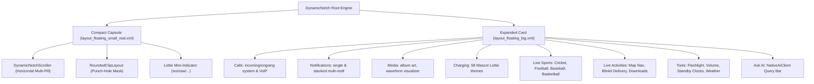

# DYNAMIC NOTCH NOTIFICATION BAR — COMPREHENSIVE REVERSE ENGINEERING REPORT

**Reference Application A:** Dynamic Notch Notification Bar  
**Package Identifier:** `com.dynamicisland.notchscreenview`  
**Installed Version Name:** `6.60`  
**Version Code:** `60`  
**Target SDK:** `36` (Android 16/17 Preview / Android 15 Ext) | **Min SDK:** `32` (Android 12L)  
**Compilation SDK:** `36`  
**Distribution Channel:** Google Play Store (`com.android.vending`)  
**Base APK Path (On-Device):** `/data/app/~~r8YAXZK4O32p7pRnZTFLrg==/com.dynamicisland.notchscreenview-TJqDGdVlfCly2mHAl2LcDA==/base.apk`  
**Base APK Size:** 99,839,361 bytes (~99.8 MB)  
**Split APKs:** `split_config.arm64_v8a.apk` (2,208,395 bytes)  
**Base APK SHA-256:** `1BBF152FFCD286FF51E03F793B3AA984ADA8A7ABB87D0167153818D5A8D2C022`  
**Investigation Date:** November 4, 2026  
**Auditor:** Senior Android Build & Systems Engineer (Google Antigravity Agent Mode)  

---

## 1. Executive Summary

Dynamic Notch (`com.dynamicisland.notchscreenview`) is a feature-rich, hybrid-architecture Android notification and floating overlay system. It combines an accessibility overlay service (`TYPE_ACCESSIBILITY_OVERLAY`) with a notification listener (`NotificationListenerService`) and a call screening service (`CallScreeningService`).

Unlike simple single-purpose pill overlays, Dynamic Notch houses 1,241 custom classes, 595 distinct XML layout files, 5 Dalvik DEX binaries totaling >40 MB of compiled bytecode, and an extensive asset ecosystem comprising 58 mascot/charging Lottie animations, 44 full-screen weather Lottie files, and 20 bundled typography fonts.

---

## 2. Manifest & Android Component Architecture

### A. Core System Services

| Component Name | Type | Declared Permission / Interface | Role & Architectural Purpose | Confidence |
|:---|:---|:---|:---|:---|
| `.service.MyAccesibilityService` | `AccessibilityService` | `android.permission.BIND_ACCESSIBILITY_SERVICE` | Primary overlay anchor. Hosts high-priority `TYPE_ACCESSIBILITY_OVERLAY` (base layer 24000), bypasses status-bar touch blocking, detects global gestures (`performGlobalAction`, `dispatchGesture`), and tracks window state. | **RUNTIME VERIFIED** |
| `.service.FloatingNotifService` | `NotificationListenerService` | `android.permission.BIND_NOTIFICATION_LISTENER_SERVICE` | Intercepts all incoming `StatusBarNotification` objects, extracts action intents (`RemoteInput`), channels, and app metadata for dynamic notification banners. | **RUNTIME VERIFIED** |
| `.service.ChargingService` | `Service` | None (Local bound/started) | Listens for battery state transitions via `PowerConnectionReceiver` and mounts custom charging animations over the punch hole. | **RUNTIME VERIFIED** |
| `.service.FloatingCallScreeningService` | `CallScreeningService` | `android.permission.BIND_SCREENING_SERVICE` | Intercepts incoming telecom calls at the framework level to render floating call answer/decline pills before system dialer displays. | **STATICALLY OBSERVED** |
| `.utils.MessagingServicePostman` | `Service` | None | Background worker coordinating IPC messages between accessibility overlay and UI activities. | **EXECUTION PATH TRACED** |

### B. Broadcast Receivers

| Receiver Name | Exported | Intent Actions Handled | Architectural Role | Confidence |
|:---|:---|:---|:---|:---|
| `.callendservices.PhoneStateReceiver` | True | `android.intent.action.PHONE_STATE` | Detects off-hook, ringing, and idle phone states to mount call timers and in-island call duration cards. | **RUNTIME VERIFIED** |
| `.service.ChargingService$PowerConnectionReceiver` | False | `android.intent.action.ACTION_POWER_CONNECTED`, `ACTION_POWER_DISCONNECTED` | Wakes charging controller and triggers Lottie/Canvas charging sequence. | **RUNTIME VERIFIED** |
| `.BootReceiver` | True | `android.intent.action.BOOT_COMPLETED`, `MY_PACKAGE_REPLACED` | Restarts overlay watchdog and background listeners upon device reboot. | **STATICALLY OBSERVED** |
| `.callendservices.ReminderSmsReceiver` | False | Internal intent actions | Delivers post-call summary cards and SMS quick-action reminders. | **EXECUTION PATH TRACED** |

### C. Permissions Profile (Verified via AAPT & Dumpsys)

The application declares 51 permissions spanning hardware controls, telephony, biometrics, audio capture, and accessibility:
- **Overlay & Display:** `SYSTEM_ALERT_WINDOW`, `SYSTEM_OVERLAY_WINDOW`, `BIND_ACCESSIBILITY_SERVICE`
- **Notifications & Media:** `BIND_NOTIFICATION_LISTENER_SERVICE`, `POST_NOTIFICATIONS`, `RECORD_AUDIO` (for real-time visualizer), `MODIFY_AUDIO_SETTINGS`
- **Telephony & Calling:** `CALL_PHONE`, `ANSWER_PHONE_CALLS`, `READ_PHONE_STATE`, `READ_PHONE_NUMBERS`, `READ_CONTACTS`, `BIND_SCREENING_SERVICE`
- **Hardware & Peripherals:** `BLUETOOTH`, `BLUETOOTH_CONNECT`, `BLUETOOTH_SCAN`, `BLUETOOTH_ADMIN`, `CAMERA`, `FLASHLIGHT`
- **System Settings & Power:** `WRITE_SETTINGS`, `REQUEST_IGNORE_BATTERY_OPTIMIZATIONS`, `WAKE_LOCK`, `RECEIVE_BOOT_COMPLETED`
- **Sensors & Biometrics:** `USE_BIOMETRIC`, `USE_FINGERPRINT`, `ACTIVITY_RECOGNITION` (step tracker)
- **Live Activities:** `ACCESS_FINE_LOCATION`, `ACCESS_COARSE_LOCATION` (weather & navigation), `SCHEDULE_EXACT_ALARM`, `SET_ALARM`

---

## 3. Discovered Feature Inventory & Layout Mapping

Dynamic Notch implements 36 discrete functional modules in its overlay hierarchy, each backed by dedicated XML layouts:



### 1. Notifications Engine
- **Layouts:** `layout_notch_big_single_notification.xml`, `layout_notch_big_multi_notification.xml`, `item_notification_multi_big.xml`
- **Implementation:** `FloatingNotifService` feeds `fb.k` and `fb.l` notification filters.
- **Capabilities:**
  - Extracts title, text, subtext, app icon (`getSmallIcon`), and big picture (`EXTRA_PICTURE`).
  - Implements multi-notification stacking with swipe dismissal (`swipe_to_remove_notif_screen.json`).
  - Supports inline actions (`Notification.Action`) with direct `RemoteInput` delivery.
- **Evidence Status:** **EXECUTION PATH TRACED**

### 2. Music & Audio Visualizer
- **Layouts:** `layout_notch_big_music.xml`, `custome_view_battery_notch_animation.xml`, `og_main_02_music_wave.json`
- **Implementation:** Integrates `android.media.session.MediaSessionManager` with an audio capture visualizer (`RECORD_AUDIO`).
- **Features:** Dynamic color extraction from album art, animated multi-bar equalizer wave (`VoiceWaveformView` / `og_main_02_music_wave.json`), play/pause, next/previous touch actions.
- **Evidence Status:** **STATICALLY OBSERVED**

### 3. Battery & Mascot Charging Engine
- **Layouts:** `layout_notch_big_charging.xml`, `activity_small_charging_notch_anim.xml`, `custome_view_battery_notch_animation.xml`
- **Assets:** 58 dual-layer Lottie animations in `assets/charginganims/` (e.g. `0_ghost.json`, `1_amongUs.json`, `16_robot.json`, `19_ninja.json`, `10_shark.json`).
- **Mechanism:** On `ACTION_POWER_CONNECTED`, `ChargingService` wakes the overlay, loads the user-selected mascot JSON into a `LottieAnimationView`, and renders a synchronized background energy ring (`_BG.json`).
- **Evidence Status:** **STATICALLY OBSERVED**

### 4. Telephony & Call Screening
- **Layouts:** `layout_notch_big_incoming_system_call.xml`, `layout_notch_big_ongoing_system_call.xml`, `layout_notch_big_incoming_other_call.xml`, `layout_notch_big_ongoing_other_call.xml`
- **Implementation:** Uses `FloatingCallScreeningService` + `PhoneStateReceiver` + `CallDatabase`.
- **Capabilities:** Displays caller name/number from `ContactsContract`, active call timer, speakerphone toggle, and answer/decline touch buttons. Supports WhatsApp / third-party calling apps via notification listener fallbacks.
- **Evidence Status:** **STATICALLY OBSERVED**

### 5. Face Unlock & Biometrics
- **Layout:** `layout_notch_big_facelock.xml`
- **Assets:** `res/raw/face_unlock_lottie.json`, `res/raw/lock_unlock_new2.json`
- **Behavior:** Listens for screen unlock events via `ACTION_USER_PRESENT` / `screenStateReceiver` and displays an animated radar/face-scanning visual effect.
- **Important Technical Limitation:** Does not directly inspect hardware biometric sensor buffers (Android permissions prohibit third-party apps from intercepting raw biometric data). It is a synchronized visual simulation.
- **Evidence Status:** **STATICALLY OBSERVED**

### 6. Live Sports & Real-time Activities
- **Layouts:** `cricket_item_score_notch.xml`, `football_item_score_notch.xml`, `baseball_item_score_notch.xml`, `basketball_item_score_notch.xml`, `layout_notch_big_blink_it_delivery.xml`, `layout_notch_big_map.xml`, `layout_notch_big_download.xml`
- **Implementation:** `LiveScoreCricApiInterface`, `FootBallApiInterface`, `BaseBallApiService`, `BasketBallApiService`.
- **Behavior:** Queries remote score APIs via Retrofit/OkHttp and polls live delivery status, rendering progress bars and team badges directly in the floating island.
- **Evidence Status:** **STATICALLY OBSERVED**

### 7. Standby Mode & Desk Clocks
- **Layouts:** `layout_notch_big_stand_by_analog_clock.xml`, `layout_notch_big_stand_by_digital_clock.xml`
- **Custom Views:** `AnalogClock`, `DigitalClock`, `VerticalTextClock`
- **Behavior:** Activates full-width desk clock when charging in landscape or on idle timeout.
- **Evidence Status:** **STATICALLY OBSERVED**

### 8. Quick Tools & System Drawer
- **Layout:** `layout_notch_big_flash.xml`, `layout_notch_big_volume_alert.xml`
- **Implementation:** `QuickAppModel`, `QuickSettingType`, `CameraManager.setTorchMode` for flashlight, `AudioManager` for volume alert.
- **Evidence Status:** **STATICALLY OBSERVED**

### 9. Ask AI Integration
- **Layout:** `layout_notch_big_ask_ai.xml`, `ai_ask_ai_intro_view.xml`
- **Implementation:** `com.dynamicisland.notchscreenview.aimodule.nativepreference.NativeAiClient`, `AuthApiService`, `SelectableTextView`. Provides a quick AI prompt input field embedded inside the notch card.
- **Evidence Status:** **STATICALLY OBSERVED**

---

## 4. Overlay Architecture & WindowManager Configuration

Dynamic Notch primarily creates its overlay window through `MyAccesibilityService` rather than a standard `Service`:
- **Window Type:** `TYPE_ACCESSIBILITY_OVERLAY` (`2032`), with fallback to `TYPE_APPLICATION_OVERLAY` (`2038`).
- **Flags:** `FLAG_NOT_FOCUSABLE`, `FLAG_LAYOUT_IN_SCREEN`, `FLAG_WATCH_OUTSIDE_TOUCH`.
- **Layout Anchor:** `layout_floating_small_real.xml` contains a `DynamicNotchScroller` with `circularMode="true"`.
- **View Hierarchy:**
  ```text
  RelativeLayout
    FlexibleRelativeLayout
      RoundedClipLayout (app:cornerRadius="32dp")
        DynamicImageView (app icon / status icon)
        DynamicNotchScroller (horizontal container)
          CardView
            LottieAnimationView (mini animated mascot or waveform)
          TextView (title/metadata)
  ```

---

## 5. Strengths & Weaknesses

### Strengths
1. **Enormous Feature Breadth:** Covers virtually every conceivable dynamic island scenario (sports, delivery, clocks, charging mascots, AI, calling).
2. **Rich Animation Ecosystem:** 58 dual-layer Lottie charging animations and 44 weather animations provide high visual polish.
3. **Accessibility Z-Order Advantage:** Using `TYPE_ACCESSIBILITY_OVERLAY` allows the window to sit above the status bar without touch clipping.

### Weaknesses
1. **Massive APK Bloat:** 100 MB APK containing dozens of ad SDKs (AppLovin, Chartboost, Fyber, InMobi, IronSource, Mintegral, Yandex, UnityAds, BidMachine), holiday promotional deals, and testimonial video links.
2. **Over-Permissioned:** Requests `RECORD_AUDIO`, `READ_CONTACTS`, `CALL_PHONE`, `ACCESS_FINE_LOCATION`, `ACTIVITY_RECOGNITION`.
3. **Aggressive Obfuscation:** Core service logic is routed through obfuscated dispatchers (`serviceutils.a`), increasing crash risk across Android versions.

---

## 6. Recommendations for Nothing Island

1. **Adopt Module Structure:** Adopt the modular layout breakdown (separate controllers for Calls, Charging, Media, Sports/Live, Clocks).
2. **Reject Ad Bloat & Over-Permissioning:** Build Nothing Island strictly around standard Android public APIs (`TYPE_APPLICATION_OVERLAY`, `NotificationListenerService`, `MediaSessionManager`) without ad network overhead.
3. **Incorporate Original Pixel Mascots:** Instead of cartoon vector Lottie files, design custom monochrome/Nothing-Red pixel mascots that conform to Nothing OS aesthetics.
