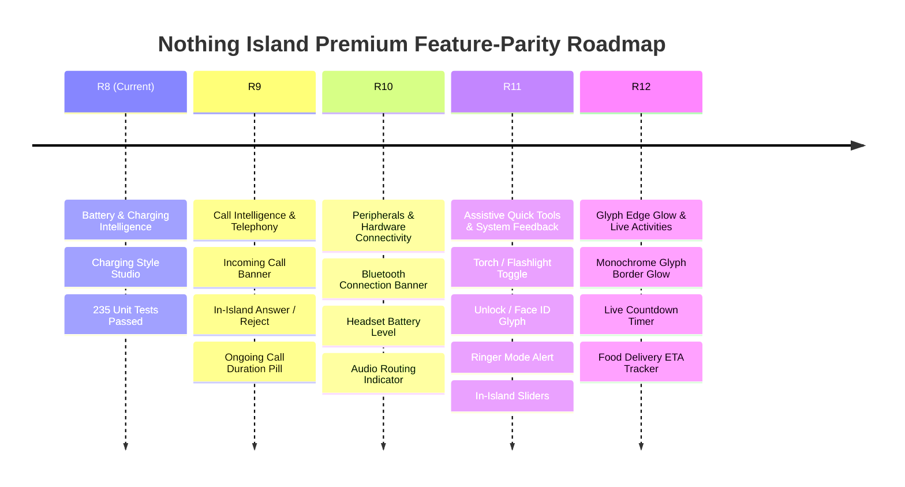

# Nothing Island — Premium Feature-Parity Implementation Roadmap
**Target Platform:** Nothing Phone (4a), Android 17 / API 37  
**Current Baseline:** Accepted Checkpoint R8 (Battery & Charging Intelligence, 235 Passing Unit Tests)  
**Architectural Invariant:** Strict Single-Overlay Architecture (Layer 24000, `TYPE_ACCESSIBILITY_OVERLAY`), Zero Ads, Zero Bloat  
**Date:** November 6, 2026  

---

## 1. Executive Implementation Strategy

Based on the static reverse-engineering audit of Dynamic Notch (v6.60) and Dynamic Island Pro (v1.9.2), Nothing Island already commands architectural and interaction depth in notification history, gesture dismissal, media seeking, and charging telemetry.

To achieve complete commercial feature parity while preserving Nothing OS's minimalist aesthetic, we structure the remaining 25 addressable feature gaps into **four sequential, zero-regression release milestones**:

---

## 2. Release Milestone Specifications

---

### Milestone R9: Call Intelligence & Telephony Integration
**Priority:** 1 (Highest User Value)  
**Target Parity Matrix Gaps:** #25 (Incoming Call Pill), #26 (In-Island Answer/Reject), #27 (Active Call Duration Timer), #28 (In-Island Speakerphone Toggle), #29 (Call Screening & Post-Call Summary)  
**Objective:** Seamless incoming and ongoing phone call management docked directly onto the front camera cutout.

#### Key Deliverables:
1. **Telephony Interception Engine:**
   - Implement `IslandCallListenerService` / `TelephonyCallback` observing `TelephonyManager.CALL_STATE_RINGING`, `CALL_STATE_OFFHOOK`, and `CALL_STATE_IDLE`.
   - Contact resolution helper resolving incoming numbers to contact display names via `ContactsContract`.
2. **Incoming Call Pill (Compact & Expanded):**
   - High-priority overlay preemption in `IslandPriorityManager`.
   - Displays caller name, formatted phone number, and phone icon.
   - Dual action buttons: Red circular Reject (`TelecomManager.endCall()`) and White circular Answer (`TelecomManager.acceptRingingCall()`).
3. **Ongoing Call Timer Pill:**
   - When call is accepted, transitions to a compact call indicator showing contact name and live elapsed timer (`00:00`).
   - Tapping expands the card showing mute toggle and speakerphone toggle (`AudioManager.setSpeakerphoneOn()`).
4. **Call Termination & Auto-Collapse:**
   - Clean return to previous state (Dashboard, Music, or Idle) within 2.5 seconds of call termination.

#### Verification & Quality Gates:
- Unit tests for incoming call priority arbitration against active music and notifications.
- Physical device simulation of incoming and accepted calls on Nothing Phone (4a).
- Strict verification that high-priority emergency calls cannot be blocked or orphaned.

---

### Milestone R10: Peripherals & Hardware Connectivity
**Priority:** 2  
**Target Parity Matrix Gaps:** #30 (Bluetooth Device Connection Banner), #31 (Bluetooth Headset Battery Level)  
**Objective:** Instant, dynamic visual feedback when wireless headphones or audio accessories connect or disconnect.

#### Key Deliverables:
1. **Bluetooth State Receiver:**
   - Register `BluetoothDevice.ACTION_ACL_CONNECTED` and `ACTION_ACL_DISCONNECTED`.
   - Query connected device friendly name (`BluetoothDevice.getName()`) and device class (`BluetoothClass.Device.AUDIO_VIDEO_HEADPHONES`, `WEARABLE_HEADSET`).
2. **Bluetooth Connection Banner:**
   - Dynamic 200dp -> 260dp expansion upon connection.
   - Displays customized audio glyph (earbud / headphone icon), device name (e.g. *"Nothing Ear (2)"*, *"AirPods"*), and connected status.
   - Auto-dismisses after 3.5 seconds with smooth spring interpolation.
3. **Headset Battery Telemetry:**
   - Reads `BluetoothDevice.EXTRA_BATTERY_LEVEL` or queries `BluetoothHeadset` GATT battery service.
   - Renders battery percentage dot alongside device name.
4. **Audio Routing Alert:**
   - Brief indicator when audio playback seamlessly switches between device speaker and Bluetooth headset.

#### Verification & Quality Gates:
- Verify runtime permissions handling for `android.permission.BLUETOOTH_CONNECT` on Android 17.
- Physical connection test with Nothing Ear or compatible Bluetooth audio accessories.

---

### Milestone R11: Assistive Quick Tools & System Hardware Feedback
**Priority:** 3  
**Target Parity Matrix Gaps:** #13 (App Blocklist/Filter), #21 (Low Battery Warning UI), #32 (Unlock / Face ID Glyph), #33 (Ringer Switch Feedback), #34 (Airplane Mode Alert), #36 (Assistive Quick Action Bar), #37 (Torch / Flashlight Toggle), #38 (Quick Camera Launch), #39 (Embedded QR Scanner), #40 (In-Island Volume/Brightness Sliders), #41 (Multi-Action Gesture Mapping)  
**Objective:** High-utility quick controls and momentary system hardware feedback directly inside the Nothing Island ecosystem.

#### Key Deliverables:
1. **Low Battery Warning UI (#21):**
   - Renders compact warning capsule when battery drops below 20%.
2. **Device Unlock & Face ID Glyph (#32):**
   - Monitor `Intent.ACTION_USER_PRESENT`.
   - Brief 1.5-second dot-matrix padlock unlocking animation in the compact cutout upon screen wake.
3. **Ringer & Sound Profile Feedback (#33) & Airplane Mode (#34):**
   - Monitor `AudioManager.RINGER_MODE_CHANGED_ACTION` and `ACTION_AIRPLANE_MODE_CHANGED`.
   - Displays clean Nothing OS glyph for Silent, Vibrate, or Ring mode with 2-second auto-collapse.
4. **Assistive Quick Tools Dashboard (#36-#40):**
   - Add a 5th navigable tab or pull-down tray in the expanded card:
     - **Torch / Flashlight (#37):** One-tap LED toggle using `CameraManager.setTorchMode()`.
     - **Quick Camera (#38):** Launching front or rear camera intent.
     - **In-Island Volume Slider (#40):** Interactive audio stream volume scrub bar.
     - **Embedded QR Scanner (#39):** Quick launch viewfinder for scanning QR codes.
     - **System Shortcuts:** Direct triggers for Lock Screen (`GLOBAL_ACTION_LOCK_SCREEN`) and Screenshot (`GLOBAL_ACTION_TAKE_SCREENSHOT`).
5. **Notification Blocklist & Custom Gestures (#13, #41):**
   - App blocklist settings and multi-touch gesture mappings.

#### Verification & Quality Gates:
- Verify CameraManager torch release on background kill.
- Ensure volume slider gestures do not conflict with horizontal activity switching.

---

### Milestone R12: Glyph Edge Glow & Dynamic Live Activities
**Priority:** 4  
**Target Parity Matrix Gaps:** #35 (Live Timer/Stopwatch Countdown), #42 (Monochrome Glyph Border Glow), #43 (Adaptive Notch Theme by App Color), #45 (Food Delivery & Cab ETA Tracking), #47 (StandBy Mode / AOD Clock)  
**Objective:** Iconic Nothing-styled edge lighting and live tracking activities.

#### Key Deliverables:
1. **Nothing OS Monochrome Glyph Border Glow (#42):**
   - Re-imagines the commercial "rainbow RGB border" as an authentic Nothing design motif: a sleek, pulsating white or red glyph outline tracing the punch-hole perimeter during notifications, charging, or call rings.
   - Configurable pulse speed and intensity in Settings.
2. **Live Countdown Timer & Stopwatch (#35):**
   - Intercept ongoing timer notifications (`Notification.CATEGORY_PROGRESS` or standard clock apps).
   - Display live ticking seconds countdown in the compact capsule with pause/cancel controls on tap.
3. **Live Food Delivery & Cab Tracking (#45):**
   - Intercept and parse live order notifications from major delivery platforms (Swiggy, Zomato, Uber, Blinkit).
   - Display a dynamic progress bar showing dispatch, transit, and arrival ETA.
4. **Adaptive App Color (#43) & StandBy Clock (#47):**
   - Dynamic accent border based on foreground app palette and horizontal charging clock display.

---

### Deferred / Cloud-Dependent Features (Independent Scope)
**Target Parity Matrix Gaps:** #44 (Live Sports Scores), #46 (Live Weather Forecasts), #49 (Ask AI LLM Chatbot)  
**Status:** Deferred due to external cloud API requirements (CricAPI, API-Football, Open-Meteo, Groq/Gemini API keys) and background battery polling overhead.

---

## 3. Engineering Constraints & Invariants

All future roadmap milestones must adhere to the core Nothing Island design principles:

1. **Single-Overlay Invariant (Layer 24000):**
   - All new visual interfaces (calls, Bluetooth, assistive tools, glyph borders) must render **inside the single existing `IslandAccessibilityService` overlay**.
   - Absolutely no secondary overlay windows or detached floating services.
2. **Zero Advertisements, Zero Tracking:**
   - Maintain 100% clean, privacy-first, open-source codebase.
3. **Nothing OS Design Authenticity:**
   - Strict adherence to monochrome palette (`#000000`, `#FFFFFF`, `#1C1C1E`, `#D71921` accent).
   - Dot-matrix typography and minimalist geometric glyphs.
4. **Test-Driven Reliability:**
   - Every new state manager and priority policy must accompany comprehensive unit test suites maintaining >200 passing tests.
   - Zero regressions on accepted R7.1.1 and R8 baselines.
