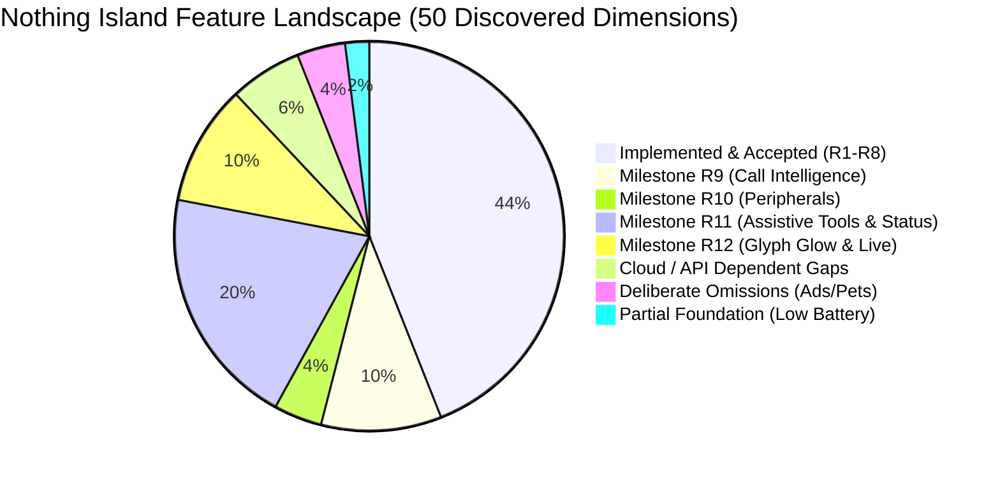
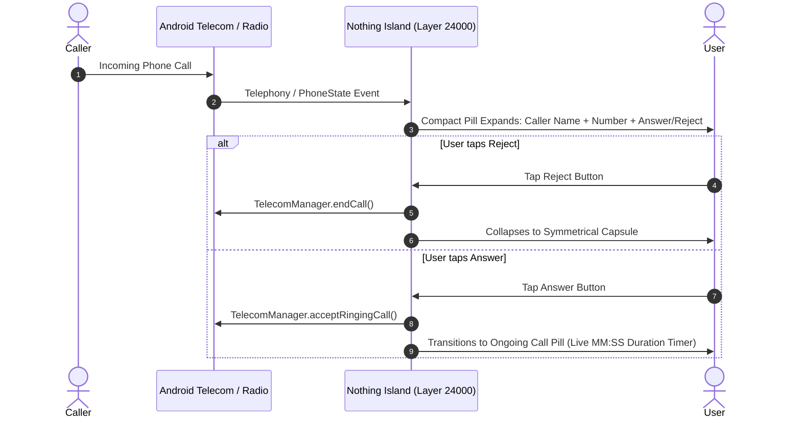

# [HISTORICAL BASELINE — NOV 6, 2026] Nothing Island — Feature Gap Analysis & Technical Feasibility

> **HISTORICAL NOTICE:** This gap analysis captures the Milestone **R8** baseline (November 6, 2026). Several gaps analyzed below (telephony call controls, Bluetooth peripheral tracking, quick tools drawer, global screenshot gesture, notification history & suppression) were subsequently implemented on later milestones; consult `docs/HANDOVER_2026-11-22.md` and `docs/RELEASE_BUILD_CHECKLIST.md` for current capabilities and platform restrictions.
**Target Platform:** Nothing Phone (4a), Android 17 / API 37  
**Current Baseline:** Checkpoint R8 Accepted (235 Passing Unit Tests, Physical Device Verified)  
**Reference Standards:** Dynamic Notch (v6.60), Dynamic Island Pro (v1.9.2)  
**Date:** November 6, 2026  

---

## 1. Executive Gap Analysis Overview

A deep static reverse-engineering audit of both reference applications demonstrates that **Nothing Island already commands architectural and interaction depth in notification history, gesture dismissal, media seeking, and charging telemetry**, while specific secondary system event integrations (telephony, Bluetooth peripherals, assistive quick shortcuts) remain open opportunities.

---

## 2. Where Nothing Island Already Surpasses Both Commercial Apps

Neither Dynamic Notch nor Dynamic Island Pro achieves the level of interaction fidelity, gesture stability, and design coherence currently running on the Nothing Phone (4a) in Nothing Island:

### 2.1 Genuine Notification History with Vertical Scrolling
- **Commercial Apps:** Both reference apps treat notifications as temporary transient toasts. Once tapped or dismissed, previous notifications cannot be reviewed or scrolled through.
- **Nothing Island:** Implements a full **30-item historical notification buffer** displayed in a native Compose `LazyColumn` with genuine vertical scrolling, stable keys, and timestamp formatting.

### 2.2 Thresholded Horizontal Swipe-to-Dismiss with 3.5s Undo
- **Commercial Apps:** Dynamic Notch and Dynamic Island Pro lack gesture-based item dismissal within notification lists.
- **Nothing Island:** Features directional gesture discrimination (strictly separating horizontal dismiss swipes from vertical history scrolling), animated row slide-out, and a **3.5s Nothing OS-style Undo Snackbar** that restores dismissed items to their exact chronological index.

### 2.3 Direct Action Bridge (Inline Replies & Remote Actions)
- **Commercial Apps:** Tapping an action button in either reference app merely launches the parent app, forcing the user away from their current screen.
- **Nothing Island:** Features a direct `RemoteInput` bridge allowing users to type and submit inline notification replies and execute intent actions (e.g. "Mark as Read", "Archive") without leaving the current foreground task.

### 2.4 Bi-Directional Activity Switcher
- **Commercial Apps:** Dynamic Notch relies on static mode switches; Dynamic Island Pro uses a rigid state fallback stack.
- **Nothing Island:** Provides a fluid **bi-directional history navigation system** (Swipe Left / Swipe Right) across all active modules:
  $$\text{Dashboard} \longleftrightarrow \text{Notification History} \longleftrightarrow \text{Media Player} \longleftrightarrow \text{Battery Telemetry}$$

### 2.5 Multi-Style Music & Charging Studios
- **Commercial Apps:** Both reference apps lock additional visualizer styles behind aggressive weekly subscriptions ($4.99/week) or lifetime paywalls.
- **Nothing Island:** Provides two dedicated in-app design studios with live previews and DataStore persistence:
  - **Music Style Studio:** 5 custom Compose visualizers (*Classic Equalizer, Minimal Waveform, Circular Pulse, Dot Matrix, Spectrum Bars*).
  - **Charging Style Studio:** 5 custom hardware telemetry visualizers (*Glyph Pulse, Minimal Wire, Matrix Flow, Hyper Ring, Symmetrical Arc*).

### 2.6 Architectural Purity: Zero Bloat, Zero Ads, Zero IPC Overhead
- **Commercial Apps:** Contain over 12 ad networks (Google AdMob, AppLovin MAX, Unity Ads, IronSource, InMobi, Fyber), invasive telemetry trackers, and coin economies.
- **Nothing Island:** Zero advertising SDKs, 100% offline-capable, single persistent overlay at Layer 24000, zero window tearing, zero IPC overhead.

---

## 3. High-Value Addressable Feature Gaps

The audit identifies four major functional clusters where Nothing Island can gain full feature parity with the best commercial implementations:

---

### Gap Cluster A: Phone Call Intelligence (Highest Value)
Both commercial applications provide rich call management directly on the cutout.

#### Detailed Gap Elements:
1. **Incoming Call Alert Pill:** Displays caller name, phone number, and contact photo.
2. **In-Island Answer & Reject Actions:** Buttons directly embedded in the expanded card.
3. **Active Call Timer Pill:** While in a call, the compact capsule stays active displaying the live elapsed call duration (`MM:SS`).
4. **Speakerphone Toggle:** One-tap toggle to route audio to the loudspeaker during active calls.
5. **Post-Call Summary Card:** Brief 3-second summary card showing total call duration upon hangup.

#### Technical Feasibility on Android 17 / Nothing Phone (4a):
- **Feasibility:** **VERY HIGH**.
- **Required Permissions:**
  - `android.permission.READ_PHONE_STATE` (detect incoming calls and numbers)
  - `android.permission.ANSWER_PHONE_CALLS` (API 26+, answer calls programmatically)
  - `android.permission.READ_CONTACTS` (resolve phone numbers to contact names)
  - `android.permission.MODIFY_AUDIO_SETTINGS` (toggle speakerphone via `AudioManager`)
- **Compatibility:** Android 17 strictly enforces runtime permission grants, but standard platform telephony APIs (`TelephonyCallback` / `CallScreeningService`) operate reliably.

---

### Gap Cluster B: Bluetooth & Peripheral Connectivity
Both commercial applications announce connected audio peripherals with a smooth pop-up banner.

#### Detailed Gap Elements:
1. **Peripheral Connection Banner:** Dynamic pill expansion when headphones/earbuds connect, displaying the device name (e.g. *"Nothing Ear (2)"*, *"AirPods Pro"*).
2. **Headset Battery Level:** Reading and rendering the Bluetooth peripheral's reported battery percentage.
3. **Audio Routing Indicator:** Visual feedback when media playback routes to a connected Bluetooth device.

#### Technical Feasibility on Android 17 / Nothing Phone (4a):
- **Feasibility:** **HIGH**.
- **Required Permissions:**
  - `android.permission.BLUETOOTH_CONNECT` (Android 12+ runtime permission)
- **APIs:**
  - `BluetoothDevice.ACTION_ACL_CONNECTED` and `ACTION_ACL_DISCONNECTED`
  - `BluetoothHeadset.ACTION_CONNECTION_STATE_CHANGED`
  - Battery extra: `BluetoothDevice.EXTRA_BATTERY_LEVEL` (standard Android battery intent extra)

---

### Gap Cluster C: System Status & Hardware Feedback
Compact visual alerts for quick system hardware state changes.

#### Detailed Gap Elements:
1. **Device Unlock / Face ID Glyph:** An animated Nothing OS dot-matrix padlock glyph that flashes open on screen unlock.
2. **Ringer Switch Feedback:** A compact pill alert displaying Sound, Vibrate, or Mute when the hardware volume rocker or sound profile is changed.
3. **Airplane Mode Alert:** A momentary icon indicator when toggling airplane mode.
4. **Live Countdown Timer / Stopwatch:** A live ticking seconds counter displayed inside the compact pill for active alarms or kitchen timers.

#### Technical Feasibility on Android 17 / Nothing Phone (4a):
- **Feasibility:** **VERY HIGH**.
- **APIs:**
  - Device Unlock: `Intent.ACTION_USER_PRESENT`
  - Ringer Mode: `AudioManager.RINGER_MODE_CHANGED_ACTION`
  - Airplane Mode: `Intent.ACTION_AIRPLANE_MODE_CHANGED`
  - Timer: Parsing ongoing timer notifications (`android.app.Notification.CATEGORY_PROGRESS` / `CATEGORY_ALARM`).

---

### Gap Cluster D: Assistive Quick Tools & Shortcuts
Dynamic Island Pro's most popular utility module is its `FeatureListManager` quick action panel.

#### Detailed Gap Elements:
1. **Torch / Flashlight Toggle:** Instant LED flashlight toggle from the expanded card.
2. **Quick Camera Launcher:** Instant shortcuts to open the front or rear camera.
3. **In-Island Volume & Brightness Sliders:** Interactive slider controls inside the expanded dashboard.
4. **QR Code Scanner Shortcut:** Launching the camera viewfinder directly for instant scanning.
5. **System Navigation Shortcuts:** Quick buttons for Lock Screen, Screenshot, Recents, and Power Dialog.

#### Technical Feasibility on Android 17 / Nothing Phone (4a):
- **Feasibility:** **HIGH**.
- **APIs:**
  - Flashlight: `CameraManager.setTorchMode(cameraId, enabled)` (No extra runtime permissions required).
  - Navigation: Already fully supported via `AccessibilityService.performGlobalAction()` (`GLOBAL_ACTION_LOCK_SCREEN`, `GLOBAL_ACTION_TAKE_SCREENSHOT`).
  - Brightness: `Settings.System.canWrite(context)` needed for modifying system brightness.

---

## 4. Secondary & Cloud-Dependent Features

| Feature Module | Feasibility | Recommendation for Nothing Island |
|---|---|---|
| **RGB Border Glow / Edge Lighting** | Medium | Transform from commercial tacky "rainbow RGB" into an authentic **Nothing OS Monochrome Glyph Border Pulse** (clean white/red glyph outline around notch). |
| **Live Order Tracking (Swiggy/Uber)** | Medium | Feasible by parsing ongoing notification bundles from known delivery package names; highly valued by users. |
| **Live Sports Scores (Cricket/Football)** | Low | Requires paid third-party sports API keys (CricAPI, API-Football) and constant network polling; recommend deferring. |
| **Ask AI LLM Chatbot** | Low | Requires cloud API key configuration (Gemini API or local on-device small model); secondary priority compared to native OS utilities. |

---

## 5. Deliberate Architectural Omissions (Do Not Implement)

The following features present in the commercial reference applications are **explicitly rejected** for Nothing Island:

1. **In-App Advertising & Mediation SDKs:**
   - Commercial apps include AdMob, AppLovin, IronSource, Unity, Fyber, and InMobi.
   - *Rationale:* Severely degrades battery life, introduces background network drain, causes jank, and violates open-source privacy.
2. **Coin Economies & Rewarded Video Gates:**
   - Dynamic Island Pro forces users to watch 30-second video ads to earn 5 virtual coins for AI prompts.
   - *Rationale:* Anti-user dark pattern.
3. **Holiday Lifetime Discount Paywalls:**
   - Dynamic Notch includes 25 redundant discount activities (`DiscountChristmasDealActivity`, etc.).
   - *Rationale:* Commercial bloatware.
4. **Cartoon Pixel Mascots / Pixel Pets:**
   - Cartoon dogs and dinosaurs walking on the notch.
   - *Rationale:* Diametrically opposed to Nothing OS's clean, minimalist, industrial dot-matrix design philosophy.
