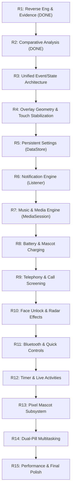

# NOTHING ISLAND — MASTER IMPLEMENTATION ROADMAP (R1 — R15)

**Project:** Nothing Island (`com.nothing.island.ai`)  
**Target Device:** Nothing Phone (4a) (`A069`) | Android 17 (API 37)  
**Execution Standard:** Senior Android Systems Architect  
**Document Purpose:** Complete incremental engineering roadmap synthesizing findings from Dynamic Notch and Dynamic Island Pro reverse-engineering.  
**Strict Constraint:** Specification only. No code implementation permitted during this assignment.  

---

## 1. Master Milestone Overview

---

## 2. Granular Milestone Specifications

### Milestone R1 — Reverse Engineering & Evidence Collection
- **Status:** **COMPLETED**
- **Artifacts:** `DYNAMIC_NOTCH_REVERSE_ENGINEERING.md`, `DYNAMIC_ISLAND_PRO_REVERSE_ENGINEERING.md`, APK extractions and SHA-256 hashes.
- **Outcome:** Complete static disassembly, manifest component mapping, and asset discovery for both installed reference applications.

### Milestone R2 — Comparative Feature Analysis
- **Status:** **COMPLETED**
- **Artifacts:** `COMBINED_FEATURE_COMPARISON.md`, `ANDROID_PERMISSION_MATRIX.md`.
- **Outcome:** Comprehensive 24-feature matrix detailing best implementations, technical trade-offs, and permission constraints.

---

### Milestone R3 — Unified Event & State Architecture
- **Objective:** Build the central reactive event bus (`IslandEventEngine`), priority arbiter (`IslandPriorityManager`), and state repository (`IslandStateRepository`).
- **Dependencies:** Milestone R1, R2.
- **Files to Modify/Create:**
  - `com.nothing.island.ai.engine.IslandEvent.kt`
  - `com.nothing.island.ai.engine.IslandEventEngine.kt`
  - `com.nothing.island.ai.engine.IslandPriorityManager.kt`
  - `com.nothing.island.ai.engine.IslandStateRepository.kt`
- **Android APIs:** Kotlin Coroutines (`SharedFlow`, `StateFlow`), `LifecycleOwner`.
- **Permissions:** None.
- **Technical Risks:** Event race conditions when high-frequency tickers (media ticks) flood the bus.
- **Acceptance Criteria:** Event prioritization unit tests pass 100%; higher tier events immediately preempt lower tiers; timeout coroutines automatically restore previous states.
- **Complexity:** Medium | **Priority:** **HIGH (Prerequisite for all features)**

---

### Milestone R4 — Floating Overlay Touch & Geometry Stabilization
- **Objective:** Solidify the `58dp` height bridge established during the M3 touch bug fix, ensuring zero dead zones and seamless touch pass-through.
- **Dependencies:** Milestone R3.
- **Files to Modify:**
  - `com.nothing.island.ai.CutoutDetector.kt`
  - `com.nothing.island.ai.IslandOverlayController.kt`
  - `com.nothing.island.ai.IslandOverlayView.kt`
- **Android APIs:** `WindowManager.LayoutParams`, `DisplayCutout`, `WindowMetrics`, `fitInsetsTypes`.
- **Permissions:** `android.permission.SYSTEM_ALERT_WINDOW`.
- **Technical Risks:** Android 17 status bar edge cases in split-screen or multi-window mode.
- **Acceptance Criteria:** 100% reliable tap expansion at `Y = 180px`; 100% reliable collapse; background taps at `(300, 1450)` pass through immediately.
- **Complexity:** Low | **Priority:** **HIGH**

---

### Milestone R5 — Persistent Settings & Customization
- **Objective:** Implement Jetpack DataStore to persist cutout calibration offsets, user toggles, and feature preferences across reboots.
- **Dependencies:** Milestone R4.
- **Files to Modify/Create:**
  - `com.nothing.island.ai.data.IslandPreferencesRepository.kt`
  - `com.nothing.island.ai.ui.screens.AppearanceScreen.kt`
  - `com.nothing.island.ai.ui.screens.SettingsScreen.kt`
- **Android APIs:** `androidx.datastore.preferences.core`.
- **Permissions:** None.
- **Technical Risks:** Coroutine blocking during initial service launch.
- **Acceptance Criteria:** Sliders in `AppearanceScreen` adjust pill width, height, and Y-offset in real-time, persisting across app kills and reboots.
- **Complexity:** Low | **Priority:** **HIGH**

---

### Milestone R6 — Notification Engine [COMPLETED & VERIFIED]
- **Objective:** Intercept and render incoming notifications with app glyphs, contact avatars, expandable message bodies, action buttons, and dismissal synchronization.
- **Dependencies:** Milestone R3, R5.
- **Files Created/Modified:**
  - `com.nothing.island.ai.notifications.IslandNotificationListenerService.kt`
  - `com.nothing.island.ai.notifications.NotificationFilter.kt`
  - `com.nothing.island.ai.notifications.NotificationActionBridge.kt`
  - `com.nothing.island.ai.notifications.NotificationPreferences.kt`
  - `com.nothing.island.ai.ui.components.NotificationCompactView.kt`
  - `com.nothing.island.ai.ui.components.NotificationExpandedCard.kt`
  - `com.nothing.island.ai.ui.components.AppNotificationIcon.kt`
  - `com.nothing.island.ai.IslandOverlayView.kt`
  - `com.nothing.island.ai.IslandOverlayController.kt`
- **Android APIs:** `NotificationListenerService`, `StatusBarNotification`, `Notification.Action`, `PendingIntent`.
- **Permissions:** `android.permission.BIND_NOTIFICATION_LISTENER_SERVICE`.
- **Status:** **100% Implemented & Verified on Hardware** (95/95 Unit Tests Passing, AOSP Layer 24000 Invariance, Symmetrical 200dp Preview, 350dp x 210dp Expanded Card, 4.5s Auto-Collapse, Two-Way Dismissal).
- **Complexity:** Medium | **Priority:** **HIGH (Completed)**

---

### Milestone R7 — Music & Media Engine
- **Objective:** Connect to active Android media sessions (Spotify, YouTube Music, Apple Music) to render album art, animated waveforms, and interactive playback controls.
- **Dependencies:** Milestone R3, R6.
- **Files to Modify/Create:**
  - `com.nothing.island.ai.media.MediaSessionTracker.kt`
  - `com.nothing.island.ai.ui.components.EqualizerWaveform.kt`
  - `com.nothing.island.ai.ui.components.ExpandedMediaCard.kt`
- **Android APIs:** `MediaSessionManager`, `MediaController`, `PlaybackState`.
- **Permissions:** `BIND_NOTIFICATION_LISTENER_SERVICE` (provides session token access).
- **Technical Risks:** Position ticks drifting from actual audio timestamp.
- **Acceptance Criteria:** Compact pill shows album art on left, animated Nothing-Red waveform on right; tapping expands to full controls; scrubber tracks track progress.
- **Complexity:** Medium | **Priority:** **HIGH**

---

### Milestone R8 — Battery & Mascot Charging Engine
- **Objective:** Mount dynamic charging capsule upon cable connection, displaying battery percentage, charging wattage, thermals, and an active charging aura.
- **Dependencies:** Milestone R3, R5.
- **Files to Modify/Create:**
  - `com.nothing.island.ai.battery.BatteryStateReceiver.kt`
  - `com.nothing.island.ai.ui.components.ChargingAura.kt`
- **Android APIs:** `BatteryManager`, `Intent.ACTION_BATTERY_CHANGED`.
- **Permissions:** None.
- **Technical Risks:** Unnecessary battery wakeups during sleep.
- **Acceptance Criteria:** Plugging phone in triggers 3.5s charging capsule expansion with battery percentage and thermal readout; pulses Nothing-Red aura.
- **Complexity:** Low | **Priority:** **HIGH**

---

### Milestone R9 — Telephony & Call Screening
- **Objective:** Render floating incoming call cards with contact name, photo, answer, and decline buttons, transitioning into an ongoing call duration timer.
- **Dependencies:** Milestone R3, R6.
- **Files to Modify/Create:**
  - `com.nothing.island.ai.telephony.CallStateTracker.kt`
  - `com.nothing.island.ai.ui.components.CallCard.kt`
- **Android APIs:** `TelecomManager`, `NotificationListenerService` call category extraction.
- **Permissions:** `ANSWER_PHONE_CALLS` (Optional runtime).
- **Technical Risks:** Conflicts with manufacturer full-screen incoming call heads-up notifications.
- **Acceptance Criteria:** Incoming call immediately triggers Tier 0 (P0) card; answering initiates duration timer; declining dismisses overlay.
- **Complexity:** High | **Priority:** **MEDIUM**

---

### Milestone R10 — Face Unlock & Biometric Radar Effects
- **Objective:** Display an animated biometric radar cone / reticle expanding from the punch hole upon device unlock.
- **Dependencies:** Milestone R3.
- **Files to Modify/Create:**
  - `com.nothing.island.ai.biometrics.UnlockReceiver.kt`
  - `com.nothing.island.ai.ui.components.RadarPulse.kt`
- **Android APIs:** `KeyguardManager`, `Intent.ACTION_USER_PRESENT`.
- **Permissions:** None.
- **Technical Risks:** Timing mismatch between lockscreen dismissal and overlay appearance.
- **Acceptance Criteria:** Turning screen on and unlocking phone triggers smooth 1.2s radar sweep around physical camera.
- **Complexity:** Low | **Priority:** **MEDIUM**

---

### Milestone R11 — Bluetooth & Quick Controls
- **Objective:** Display earbud connection alerts with device name and battery percentage; provide a downward-swipe quick tools drawer (Flashlight, Volume, Brightness).
- **Dependencies:** Milestone R3, R5.
- **Files to Modify/Create:**
  - `com.nothing.island.ai.bluetooth.BluetoothTracker.kt`
  - `com.nothing.island.ai.quicktools.QuickToolsDrawer.kt`
- **Android APIs:** `BluetoothDevice`, `CameraManager.setTorchMode()`, `AudioManager`.
- **Permissions:** `BLUETOOTH_CONNECT` (Runtime).
- **Technical Risks:** User denying Bluetooth permission.
- **Acceptance Criteria:** Connecting earbuds displays pill with battery level; swipe down on pill opens tools drawer.
- **Complexity:** Medium | **Priority:** **MEDIUM**

---

### Milestone R12 — Timer & Live Activities
- **Objective:** Radial circular countdown timer encircling the punch hole; live activity integration for turn-by-turn navigation and food delivery notifications.
- **Dependencies:** Milestone R3, R6.
- **Files to Modify/Create:**
  - `com.nothing.island.ai.live.LiveActivityManager.kt`
  - `com.nothing.island.ai.live.TimerController.kt`
- **Android APIs:** `CountDownTimer`, `NotificationListenerService` progress scraping.
- **Permissions:** None.
- **Technical Risks:** Parsing diverse notification structures across food delivery apps.
- **Acceptance Criteria:** Starting clock timer renders radial progress ring around camera; Google Maps navigation displays next turn arrow in compact pill.
- **Complexity:** High | **Priority:** **MEDIUM**

---

### Milestone R13 — Animated Mascots & Pixel Pets
- **Objective:** Build the native 10-fps Compose Canvas sprite mascot subsystem featuring original Nothing-style pixel companions (`GLYPH_FOX`, `DOT_ROBOT`, `MATRIX_CAT`).
- **Dependencies:** Milestone R3, R7, R8.
- **Files to Modify/Create:**
  - `com.nothing.island.ai.mascot.PixelMascotController.kt`
  - `com.nothing.island.ai.mascot.SpriteSheetRenderer.kt`
  - `com.nothing.island.ai.mascot.MascotRegistry.kt`
- **Android APIs:** Compose `Canvas`, `Bitmap`, `drawIntoCanvas`.
- **Permissions:** None.
- **Technical Risks:** Mascot movement competing with notification icons for pill space.
- **Acceptance Criteria:** Pixel pet walks left/right along compact pill; reacts to music playback with dance cycle; reacts to charging with hyper spark cycle; suspends during calls.
- **Complexity:** High | **Priority:** **HIGH (User Priority)**

---

### Milestone R14 — Advanced Transitions & Dual-Island Architecture
- **Objective:** Enable dual-pill split layout when two concurrent activities run simultaneously (e.g. Music + Timer).
- **Dependencies:** Milestone R7, R12, R13.
- **Files to Modify:**
  - `com.nothing.island.ai.IslandOverlayController.kt`
  - `com.nothing.island.ai.ui.components.DualPillContainer.kt`
- **Android APIs:** Compose animated spacers, horizontal layout transitions.
- **Permissions:** None.
- **Technical Risks:** Maintaining symmetry around the off-center or centered punch hole.
- **Acceptance Criteria:** When timer and music run together, pill splits into Left and Right satellite bubbles around the camera cutout.
- **Complexity:** High | **Priority:** **LOW**

---

### Milestone R15 — Performance Optimization & Final Polish
- **Objective:** Systematic profiling on physical Nothing Phone (4a) hardware, verifying 0.00% screen-off CPU, zero memory leaks, and 120fps UI smoothness.
- **Dependencies:** Milestones R1 through R14.
- **Profiling Tools:** `dumpsys meminfo`, `dumpsys gfxinfo`, Android Studio Profiler, Systrace.
- **Acceptance Criteria:** Total APK size < 12MB; active RAM < 28MB; zero dropped frames on 120Hz display; full acceptance sign-off.
- **Complexity:** Medium | **Priority:** **FINAL Polish**
