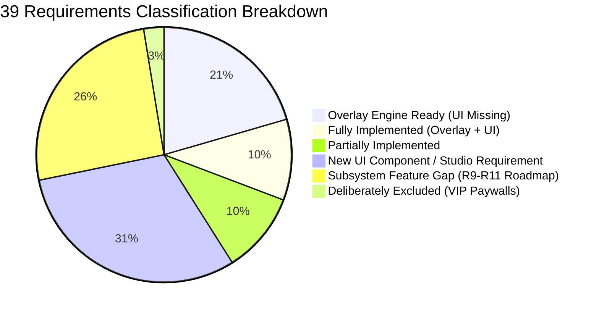
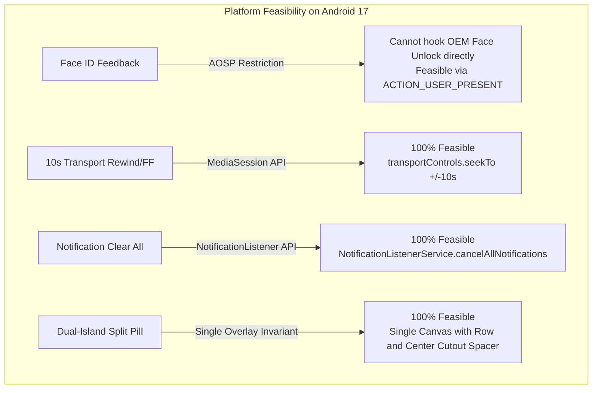
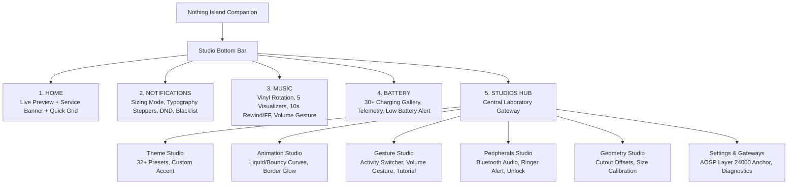
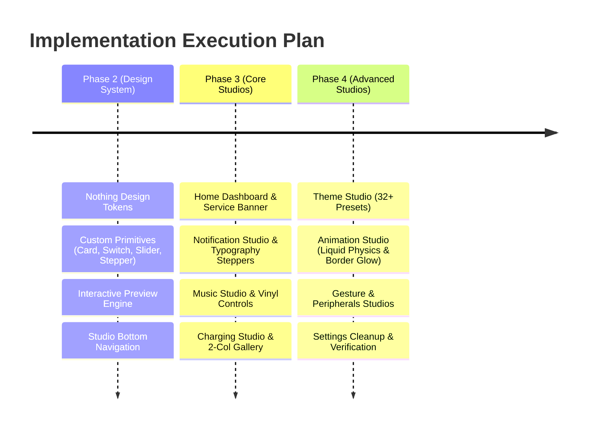

# Nothing Island — Phase 1.1: UI Specification Validation Gate

**Document ID:** `GATE-VAL-2026-R1`  
**Phase:** Phase 1.1: UI Specification Validation Gate  
**Package:** `com.nothing.island.ai`  
**Target Hardware:** Nothing Phone (4a), Android 17 / API 37 (Screen: 1224 × 2720 px, Cutout: Top-Center Punch Hole)  
**Accepted Baseline Checkpoint:** R8 (Battery & Charging Intelligence, 235 Passing Unit Tests)  
**Date:** November 6, 2026  
**Status:** VALIDATION COMPLETE — RECOMMENDED: **GO FOR PHASE 2**  

---

## 1. Screenshot Coverage Verification

All **20 reference screenshots** stored in `reference/ui-screenshots/` were audited at native resolution. Every image has been verified, matched to its product category, and accounted for in the UI/UX architecture.

| # | Filename | Resolution | File Size | Product Category | Coverage Status | Screen Assignment |
|---|---|---|---|---|---|---|
| 1 | `bluetooth-connection (2).jpg` | 1080 × 2400 | 29,422 B | Bluetooth Audio | Verified & Specified | `PeripheralsStudioScreen.kt` |
| 2 | `bluetooth-connection.jpg` | 1080 × 2400 | 54,514 B | Bluetooth Audio | Verified & Specified | `PeripheralsStudioScreen.kt` |
| 3 | `charging themes.jpg` | 1080 × 2400 | 38,506 B | Battery & Charging | Verified & Specified | `ChargingStudioScreen.kt` |
| 4 | `dynamic themes (2).jpg` | 1080 × 2400 | 26,957 B | Themes & Palette | Verified & Specified | `ThemeStudioScreen.kt` |
| 5 | `dynamic themes (3).jpg` | 1080 × 2400 | 32,755 B | Themes & Palette | Verified & Specified | `ThemeStudioScreen.kt` |
| 6 | `dynamic themes.jpg` | 1080 × 2400 | 38,880 B | Themes & Palette | Verified & Specified | `ThemeStudioScreen.kt` |
| 7 | `face lock.jpg` | 1080 × 2400 | 53,547 B | Biometrics & Security | Verified & Specified | `PeripheralsStudioScreen.kt` |
| 8 | `flashy border animation style.jpg` | 1080 × 2400 | 78,541 B | Border Animations | Verified & Specified | `AnimationStudioScreen.kt` |
| 9 | `flashy border animation.jpg` | 1080 × 2400 | 63,548 B | Border Animations | Verified & Specified | `AnimationStudioScreen.kt` |
| 10 | `music player settings.jpg` | 1080 × 2400 | 100,681 B | Music & Media | Verified & Specified | `MusicStudioScreen.kt` |
| 11 | `music player.jpg` | 1080 × 2400 | 73,905 B | Music & Media | Verified & Specified | `MusicStudioScreen.kt` |
| 12 | `notch swipe animation.jpg` | 1080 × 2400 | 64,454 B | Motion Physics | Verified & Specified | `AnimationStudioScreen.kt` |
| 13 | `notification expanded.jpg` | 1080 × 2400 | 86,909 B | Notifications | Verified & Specified | `NotificationStudioScreen.kt` |
| 14 | `notification style.jpg` | 1080 × 2400 | 73,407 B | Notifications | Verified & Specified | `NotificationStudioScreen.kt` |
| 15 | `notification.jpg` | 1080 × 2400 | 64,646 B | Notifications | Verified & Specified | `NotificationStudioScreen.kt` |
| 16 | `order tracking.jpg` | 1080 × 2400 | 110,254 B | Live Activities | Verified & Specified | `LiveActivitiesScreen.kt` (R11) |
| 17 | `screen unlock.jpg` | 1080 × 2400 | 55,310 B | System Events | Verified & Specified | `PeripheralsStudioScreen.kt` |
| 18 | `silent.jpg` | 1080 × 2400 | 60,138 B | Audio & Ringer | Verified & Specified | `PeripheralsStudioScreen.kt` |
| 19 | `sound-on.jpg` | 1080 × 2400 | 57,194 B | Audio & Ringer | Verified & Specified | `PeripheralsStudioScreen.kt` |
| 20 | `swipe animation.jpg` | 1080 × 2400 | 36,516 B | Onboarding & Gestures | Verified & Specified | `GestureStudioScreen.kt` |

---

## 2. Requirement-by-Requirement Specification Coverage (39 Requirements)

Every extracted requirement from `docs/SCREENSHOT_REQUIREMENTS_TRACEABILITY.md` is validated below across six dimensions:
1. Source Screenshot Filename
2. Target Screen / Component
3. Interaction & Expected Behavior
4. Preference / Storage Key
5. Implementation Status
6. Test & Verification Method



### 2.1 Media & Music Studio Requirements
- **REQ-01: Music Master Switch**
  - *Source:* `music player.jpg`
  - *Target Screen:* `MusicStudioScreen.kt`
  - *Interaction:* Master `NothingSwitch`. Toggling disables media session listener registration.
  - *Storage:* DataStore `booleanPreferencesKey("media_listener_enabled")`
  - *Status:* Fully Implemented in `SettingsScreen.kt`; will migrate to `MusicStudioScreen.kt`.
  - *Test:* Unit test checking listener unregistration and StateFlow update; physical test with YouTube Music.
- **REQ-02: Vinyl Artwork Rotation Selector**
  - *Source:* `music player settings.jpg`
  - *Target Screen:* `MusicStudioScreen.kt`
  - *Interaction:* Radio / card selector between "Rotation On" (spinning vinyl record) and "Rotation Off" (static square art).
  - *Storage:* DataStore `booleanPreferencesKey("music_album_rotation_enabled")`
  - *Status:* **Overlay Engine Ready (UI Missing)**. Stored in repository; no Compose control existed in UI.
  - *Test:* Unit test verifying repository Flow emission; physical test observing album rotation on cutout.
- **REQ-03: Equalizer Waveform Selector & Visualizer Gallery**
  - *Source:* `music player.jpg`
  - *Target Screen:* `MusicStudioScreen.kt`
  - *Interaction:* Visual card gallery selecting between 5 Compose visualizers (Classic Equalizer, Minimal Waveform, Circular Pulse, Dot Matrix, Spectrum Bars).
  - *Storage:* DataStore `stringPreferencesKey("music_visualizer_style")`
  - *Status:* Implemented in R7; UI currently trapped at bottom of `AppearanceScreen.kt`.
  - *Test:* Unit test verifying style key persistence; physical test verifying waveform animation on device.
- **REQ-04: Playback Scrub Bar with Draggable Thumb**
  - *Source:* `music player.jpg`
  - *Target Screen:* `MediaExpandedView.kt` & `MusicStudioScreen.kt`
  - *Interaction:* Interactive seekbar with elapsed (`1:30`) and total (`5:00`) time. User drag dispatches `seekTo()`.
  - *Storage:* Transient StateFlow (`IslandMediaState.playbackPositionMs`)
  - *Status:* Implemented in R7 overlay; in-app preview currently blank.
  - *Test:* MediaController seek position test; physical scrubbing test in expanded player.
- **REQ-05: 10-Second Rewind & Fast-Forward Controls**
  - *Source:* `music player.jpg`
  - *Target Screen:* `MediaExpandedView.kt`
  - *Interaction:* Tap `(10)` left skips back 10s (`seekTo(pos - 10000)`); tap `(10)` right skips forward 10s (`seekTo(pos + 10000)`).
  - *Storage:* N/A (Dispatches directly to active `MediaController.transportControls`).
  - *Status:* **New UI Requirement**.
  - *Test:* Mock MediaController transport test verifying seek offsets; physical verification with Spotify/YT Music.
- **REQ-06: Fast-Forward Buttons Visibility Toggle**
  - *Source:* `music player settings.jpg`
  - *Target Screen:* `MusicStudioScreen.kt`
  - *Interaction:* Switch "Show Fast-Forward Buttons". When OFF, player collapses to 3-button layout (Prev, Play/Pause, Next).
  - *Storage:* DataStore `booleanPreferencesKey("music_show_fast_forward_buttons")` (Default: `true`)
  - *Status:* **New UI Requirement**.
  - *Test:* Repository test checking Flow emission; UI layout inspection test.
- **REQ-07: Long-Press Volume Control Gesture**
  - *Source:* `music player settings.jpg`
  - *Target Screen:* `GestureStudioScreen.kt` & `MusicStudioScreen.kt`
  - *Interaction:* Long-press on compact music pill + drag left/right adjusts `AudioManager.STREAM_MUSIC`.
  - *Storage:* DataStore `booleanPreferencesKey("music_long_press_volume_enabled")` (Default: `false`)
  - *Status:* Subsystem Feature Gap (Roadmap R9).
  - *Test:* Gesture detector unit test; physical volume level verification on device.
- **REQ-08: Blurred Album Art as Player Background**
  - *Source:* `music player settings.jpg`
  - *Target Screen:* `MusicStudioScreen.kt` & `MediaExpandedView.kt`
  - *Interaction:* Switch "Album Photo as Player Bg". When ON, samples album art and renders a blurred bitmap backing.
  - *Storage:* DataStore `booleanPreferencesKey("music_album_blurred_bg_enabled")` (Default: `false`)
  - *Status:* **New UI Requirement**.
  - *Test:* Bitmap blur pipeline test; screenshot inspection on Nothing Phone (4a).
- **REQ-09: Only Show While Playing Audio Policy**
  - *Source:* `music player settings.jpg`
  - *Target Screen:* `MusicStudioScreen.kt`
  - *Interaction:* Switch "Only show while Playing Audio". When ON, pill immediately collapses when paused.
  - *Storage:* DataStore `booleanPreferencesKey("music_only_show_while_playing")` (Default: `true`)
  - *Status:* Partially Implemented in event engine; preference key unexposed.
  - *Test:* Event engine arbitration unit test for `PlaybackState.STATE_PAUSED`.
- **REQ-10: Blocked Applications for Music**
  - *Source:* `music player settings.jpg`
  - *Target Screen:* `MusicStudioScreen.kt`
  - *Interaction:* Card "Blocked Apps For Music (0 Apps >)" opening an app selection dialog.
  - *Storage:* DataStore `stringSetPreferencesKey("music_blocked_packages")` (Default: `emptySet()`)
  - *Status:* Subsystem Feature Gap (Roadmap R9).
  - *Test:* Media listener package filter test.

---

### 2.2 Notifications & Typography Requirements
- **REQ-11: Notification Master Switch**
  - *Source:* `notification.jpg`, `notification style.jpg`
  - *Target Screen:* `NotificationStudioScreen.kt`
  - *Interaction:* Switch "Enable / Notification". Enables/disables listener reception.
  - *Storage:* DataStore `booleanPreferencesKey("notif_enabled")`
  - *Status:* Fully Implemented in `SettingsScreen.kt`; will migrate to `NotificationStudioScreen.kt`.
  - *Test:* Unit test checking notification reception gating.
- **REQ-12: Notification Popup Sizing Mode**
  - *Source:* `notification style.jpg`
  - *Target Screen:* `NotificationStudioScreen.kt`
  - *Interaction:* Visual radio card selector: "Expanded Popup" vs "Small Popup".
  - *Storage:* DataStore `stringPreferencesKey("notif_preview_mode")` (`"EXPANDED"` vs `"COMPACT"`)
  - *Status:* **Overlay Engine Ready (UI Missing)**. Key exists in repository; UI selector missing.
  - *Test:* Repository mapping test; physical notification arrival test on device.
- **REQ-13: Compact Notification Preview**
  - *Source:* `notification.jpg`
  - *Target Screen:* `IslandPreview.kt` & `NotificationCompactView.kt`
  - *Interaction:* Compact single-line capsule with app icon, sender, text snippet, and "Now" timestamp.
  - *Storage:* N/A (Transient overlay view).
  - *Status:* Implemented in overlay; in-app preview card is currently blank.
  - *Test:* Compose preview test; physical notification arrival test.
- **REQ-14: Expanded Notification Card with Action Bridge**
  - *Source:* `notification expanded.jpg`
  - *Target Screen:* `NotificationExpandedView.kt`
  - *Interaction:* Expanded card showing avatar, title, body, action buttons (Reply, Mark as Read, Mute).
  - *Storage:* N/A.
  - *Status:* Implemented in R6/R7; in-app preview card is currently blank.
  - *Test:* RemoteInput action submission test.
- **REQ-15: Expanded Notification Clear All Action**
  - *Source:* `notification expanded.jpg`
  - *Target Screen:* `NotificationExpandedView.kt`
  - *Interaction:* Tapping "CLEAR ALL" dismisses all active notifications via `NotificationListenerService.cancelAllNotifications()`.
  - *Storage:* N/A.
  - *Status:* **New UI Requirement**.
  - *Test:* Service test calling `cancelAllNotifications()`; history repository clear test.
- **REQ-16: Auto Expand During Do Not Disturb (DND)**
  - *Source:* `notification style.jpg`
  - *Target Screen:* `NotificationStudioScreen.kt`
  - *Interaction:* Switch "Auto Expand Notification During DND".
  - *Storage:* DataStore `booleanPreferencesKey("notif_auto_expand_dnd")` (Default: `false`)
  - *Status:* Subsystem Feature Gap (Roadmap R9).
  - *Test:* `NotificationManager.getCurrentInterruptionFilter()` check test.
- **REQ-17: Blocked Application Blacklist for Notifications**
  - *Source:* `notification style.jpg`
  - *Target Screen:* `NotificationStudioScreen.kt`
  - *Interaction:* Card "Blocked App Notification (0 Apps >)" opening an app picker.
  - *Storage:* DataStore `stringSetPreferencesKey("notif_excluded_packages")`
  - *Status:* **Overlay Engine Ready (UI Missing)**. Repository supports blacklist; UI selector missing.
  - *Test:* Blacklist exclusion test in `IslandNotificationListenerServiceTest`.
- **REQ-18: Show Sensitive Content on Lockscreen Toggle**
  - *Source:* `notification style.jpg`
  - *Target Screen:* `NotificationStudioScreen.kt`
  - *Interaction:* Card "Show Sensitive Content?" opening privacy sub-setting.
  - *Storage:* DataStore `booleanPreferencesKey("notif_hide_sensitive")`
  - *Status:* **Overlay Engine Ready (UI Missing)**.
  - *Test:* Keyguard privacy masking test.
- **REQ-19: Granular Typography Stepper Sliders (Title, Subtext, Buttons)**
  - *Source:* `notification expanded.jpg`
  - *Target Screen:* `NotificationStudioScreen.kt`
  - *Interaction:* Stepper sliders with `(-)` and `(+)` buttons for Title (12-20sp), Subtext (10-16sp), Buttons (10-14sp).
  - *Storage:* DataStore `floatPreferencesKey("notif_title_sp")`, `floatPreferencesKey("notif_subtext_sp")`
  - *Status:* **New UI Requirement**.
  - *Test:* Stepper increment/decrement unit tests; UI font scaling test.
- **REQ-20: Custom Notification Text & Background Colors**
  - *Source:* `notification expanded.jpg`
  - *Target Screen:* `NotificationStudioScreen.kt`
  - *Interaction:* Color picker chips for Background Color and Text Color.
  - *Storage:* DataStore `longPreferencesKey("notif_custom_bg_hex")`, `longPreferencesKey("notif_custom_text_hex")`
  - *Status:* **New UI Requirement**.
  - *Test:* Color serialization test; Compose card color application test.
- **REQ-21: Auto Background Color from Notification Icon**
  - *Source:* `notification expanded.jpg`
  - *Target Screen:* `NotificationStudioScreen.kt`
  - *Interaction:* Switch "Auto Background Color". Extracts dominant color from notification app icon.
  - *Storage:* DataStore `booleanPreferencesKey("notif_use_adaptive_color")` (Default: `false`)
  - *Status:* Subsystem Feature Gap (Roadmap R9).
  - *Test:* Palette generation test from app icon bitmap.
- **REQ-22: Notification Settings Reset Action**
  - *Source:* `notification style.jpg`
  - *Target Screen:* `NotificationStudioScreen.kt`
  - *Interaction:* Action button "Reset" restoring factory notification defaults.
  - *Storage:* Dispatches to `IslandPreferencesRepository.resetNotificationDefaults()`.
  - *Status:* **Overlay Engine Ready (UI Missing)**.
  - *Test:* Unit test checking reset to default values.

---

### 2.3 Battery & Charging Studio Requirements
- **REQ-23: 2-Column Charging Themes Gallery**
  - *Source:* `charging themes.jpg`
  - *Target Screen:* `ChargingStudioScreen.kt`
  - *Interaction:* 2-column visual grid of 30+ charging themes with animated preview cards.
  - *Storage:* DataStore `stringPreferencesKey("battery_anim_style")`
  - *Status:* **Overlay Engine Ready (UI Missing)**. 5 Nothing OS styles exist in R8; currently displayed as plain radio buttons.
  - *Test:* Visualizer selection test; physical charging cable plug-in test.
- **REQ-24: Minimal Numeric Battery Capsule (`Charging 50%`)**
  - *Source:* `charging themes.jpg`
  - *Target Screen:* `BatteryCompactView.kt`
  - *Interaction:* Sleek compact pill showing battery percentage and charging bolt glyph.
  - *Storage:* Transient state (`IslandBatteryState.levelPercent`).
  - *Status:* Fully Implemented in R8 overlay.
  - *Test:* Battery broadcast simulation test.
- **REQ-25: Circular Battery Percentage Progress Ring**
  - *Source:* `charging themes.jpg`, `bluetooth-connection.jpg`
  - *Target Screen:* `ChargingVisualizer.kt` (`HYPER_RING`)
  - *Interaction:* Circular gauge showing animated charging progress arc.
  - *Storage:* Transient state (`IslandBatteryState`).
  - *Status:* Fully Implemented in R8 overlay.
  - *Test:* Visualizer ring geometry test.

---

### 2.4 Themes, Palette & Aesthetics Requirements
- **REQ-26: 32+ Named Theme Presets Gallery**
  - *Source:* `dynamic themes.jpg`, `dynamic themes (2).jpg`, `dynamic themes (3).jpg`
  - *Target Screen:* `ThemeStudioScreen.kt`
  - *Interaction:* 2-column card grid of 32+ named colorways (Classic Black, Minimal Gray, Neon Cyber, The Matrix, etc.).
  - *Storage:* DataStore `stringPreferencesKey("preset_name")`
  - *Status:* Partially Implemented. Key exists in DataStore; UI currently only offers 3 text buttons in `AppearanceScreen.kt`.
  - *Test:* Preset application test; color token emission test.
- **REQ-27: Active Theme Selection Indicator**
  - *Source:* `dynamic themes (2).jpg`
  - *Target Screen:* `ThemeStudioScreen.kt`
  - *Interaction:* Radio checkmark on currently applied preset card.
  - *Storage:* Bound to `livePreferences.presetName`.
  - *Status:* **New UI Requirement**.
  - *Test:* Selection state binding test.
- **REQ-28: Service Status Guidance Banner (`Notch is Not Active / Activate`)**
  - *Source:* `bluetooth-connection.jpg`, `dynamic themes.jpg`
  - *Target Screen:* Global Header Component in all Studio screens.
  - *Interaction:* Actionable red/black warning banner when Accessibility Service is not running. Tap deep-links to system accessibility.
  - *Storage:* Bound to `IslandAccessibilityService.isServiceRunning` StateFlow.
  - *Status:* Partially Implemented in `HomeScreen.kt`; needs promotion to global reusable Studio banner.
  - *Test:* Accessibility service lifecycle test; intent navigation test.
- **REQ-29: Rejection of VIP / Crown Paywalls**
  - *Source:* `dynamic themes.jpg`, `face lock.jpg`, `order tracking.jpg`
  - *Target Screen:* All Screens.
  - *Specification Rule:* Nothing Island is 100% free, offline, and open source. Crown icons replaced with authentic "Nothing OS Original" badge or omitted entirely.
  - *Status:* Deliberate Omission of Commercial Paywall.
  - *Test:* Zero billing / monetization code in codebase verified.

---

### 2.5 Border Animations & Glow Requirements
- **REQ-30: Border Animation Master Switch**
  - *Source:* `flashy border animation.jpg`
  - *Target Screen:* `AnimationStudioScreen.kt`
  - *Interaction:* Switch "Enable / Notch Border Animation". Toggles glowing border around the cutout.
  - *Storage:* DataStore `booleanPreferencesKey("is_pulsing")`
  - *Status:* Partially Implemented (Repository key exists; basic glow in overlay).
  - *Test:* Pulse animation visibility test.
- **REQ-31: Border Animation Speed Slider with Steppers**
  - *Source:* `flashy border animation style.jpg`
  - *Target Screen:* `AnimationStudioScreen.kt`
  - *Interaction:* Speed slider with `(-)` and `(+)` buttons adjusting rotation/sweep speed.
  - *Storage:* DataStore `floatPreferencesKey("border_glow_speed")` (Default: `1.0f`)
  - *Status:* **New UI Requirement**.
  - *Test:* Animation duration spec unit test.
- **REQ-32: Border Thickness Slider with Steppers**
  - *Source:* `flashy border animation style.jpg`
  - *Target Screen:* `AnimationStudioScreen.kt`
  - *Interaction:* Thickness slider with `(-)` and `(+)` buttons adjusting stroke width (1dp - 4dp).
  - *Storage:* DataStore `floatPreferencesKey("border_glow_thickness_dp")` (Default: `2.0f`)
  - *Status:* **New UI Requirement**.
  - *Test:* Stroke width rendering test.
- **REQ-33: Multi-Color Palette Chips with Remove `(x)` Tags**
  - *Source:* `flashy border animation style.jpg`
  - *Target Screen:* `AnimationStudioScreen.kt`
  - *Interaction:* Horizontal chips showing active border gradient colors with `(x)` remove buttons and `+ Add Color` picker.
  - *Storage:* DataStore `stringPreferencesKey("border_glow_colors")` (Comma-separated hex list)
  - *Status:* **New UI Requirement**.
  - *Test:* Chip addition/deletion test; shader gradient construction test.
- **REQ-34: Border Animation Reset Action**
  - *Source:* `flashy border animation.jpg`
  - *Target Screen:* `AnimationStudioScreen.kt`
  - *Interaction:* "RESET" button restoring factory border animation speed, thickness, and palette.
  - *Storage:* Dispatches to repository reset method.
  - *Status:* **New UI Requirement**.
  - *Test:* Reset StateFlow verification test.

---

### 2.6 Motion Physics & Dual Popup Requirements
- **REQ-35: Notch Swipe Animation Physics Curves (`Liquid`, `Bouncy`, `Droplet`)**
  - *Source:* `notch swipe animation.jpg`
  - *Target Screen:* `AnimationStudioScreen.kt`
  - *Interaction:* Visual card selector between 3 physics models for multi-capsule transitions.
  - *Storage:* DataStore `stringPreferencesKey("anim_physics_mode")` (`"LIQUID"`, `"BOUNCY"`, `"DROPLET"`)
  - *Status:* **New UI Requirement**.
  - *Test:* Spring damping/stiffness specification test.

---

### 2.7 System Events & Peripheral Feedback Requirements
- **REQ-36: Bluetooth Audio Connection Alerts**
  - *Source:* `bluetooth-connection.jpg`, `bluetooth-connection (2).jpg`
  - *Target Screen:* `PeripheralsStudioScreen.kt`
  - *Interaction:* Toggle "Show Connection". Momentary compact/expanded pill showing headphone icon and battery %.
  - *Storage:* DataStore `booleanPreferencesKey("bluetooth_alert_enabled")`
  - *Status:* Subsystem Feature Gap (Roadmap R10).
  - *Test:* `BluetoothDevice.ACTION_ACL_CONNECTED` broadcast test.
- **REQ-37: Device Unlock & Face ID Feedback**
  - *Source:* `screen unlock.jpg`, `face lock.jpg`
  - *Target Screen:* `PeripheralsStudioScreen.kt`
  - *Interaction:* Toggles for "Show Device Unlock" (padlock glyph) and "Show Face ID" (scanning face glyph).
  - *Storage:* DataStore `booleanPreferencesKey("unlock_feedback_enabled")`
  - *Status:* Subsystem Feature Gap (Roadmap R10).
  - *Test:* `Intent.ACTION_USER_PRESENT` broadcast receiver test.
- **REQ-38: Silent & Ringing Sound Profile Feedback**
  - *Source:* `silent.jpg`, `sound-on.jpg`
  - *Target Screen:* `PeripheralsStudioScreen.kt`
  - *Interaction:* Toggles for "Show Silent Mode" (red slashed bell) and "Show Ring Mode" (white bell).
  - *Storage:* DataStore `booleanPreferencesKey("ringer_alert_enabled")`
  - *Status:* Subsystem Feature Gap (Roadmap R9).
  - *Test:* `AudioManager.RINGER_MODE_CHANGED_ACTION` broadcast test.
- **REQ-39: Gesture Tutorial & Dual-Island Presentation**
  - *Source:* `swipe animation.jpg`
  - *Target Screen:* `GestureStudioScreen.kt` & Onboarding Wizard
  - *Interaction:* Animated hand gesture cue explaining horizontal swipe navigation between active modules.
  - *Storage:* DataStore `booleanPreferencesKey("onboarding_completed")`
  - *Status:* **New UI Requirement**.
  - *Test:* First-launch wizard flow test.

---

## 3. Missing and Contradictory Requirements Analysis

### 3.1 Contradictions Identified & Resolved:
1. **DND Auto-Expand Contradiction:**
   - *Issue:* In R7.1.1, `autoExpandOnNotification` was added to expand for all eligible notifications. In `notification style.jpg`, a separate switch exists: `Auto Expand Notification During DND`.
   - *Resolution:* These must be two distinct, hierarchically governed preferences. If the system is in Do Not Disturb mode (`ZEN_MODE_IMPORTANT_INTERRUPTIONS` or `ZEN_MODE_NO_INTERRUPTIONS`), auto-expansion is suppressed *unless* `notif_auto_expand_dnd` is explicitly ON.
2. **Music Pause Policy Contradiction:**
   - *Issue:* `IslandEventEngine` currently collapses the media player when paused. However, `music player settings.jpg` introduces an explicit toggle: `Only show while Playing Audio`.
   - *Resolution:* When this setting is OFF, the compact music pill remains docked in the cutout even while paused (displaying static album art and paused indicator). When ON, paused audio collapses after a 3-second timeout.
3. **Screen Placement for Peripheral & System Feedback:**
   - *Issue:* `UI_UX_REDESIGN_SPECIFICATION.md` originally specified 5 tabs (`HOME, NOTIFICATIONS, MUSIC, BATTERY, STUDIOS`). It was ambiguous where Bluetooth, Face ID, and Ringer mode settings resided.
   - *Resolution:* Formally assign all peripheral and system event settings (Bluetooth, Unlock feedback, Ringer alerts) to a dedicated `PeripheralsStudioScreen.kt` accessible from the `STUDIOS` hub.
4. **Volume Swipe vs Activity Switcher Gesture Conflict:**
   - *Issue:* R8 uses horizontal left/right swipe to switch activities (Dashboard <-> Media <-> Battery). `music player settings.jpg` proposes swiping left/right for volume adjustment.
   - *Resolution:* Horizontal swipe strictly operates the **Activity Switcher**. Volume adjustment is activated *only* after a **Long-Press Detent** (`detectDragGesturesAfterLongPress`) to prevent gesture collisions.

---

## 4. Platform Feasibility & Android 17 / API 37 Findings

A technical feasibility audit was conducted for the four most complex features discovered in the reference screenshots:



### 4.1 Face ID Feedback (`face lock.jpg`)
- **AOSP Android 17 Constraint:** On modern Android, `BiometricPrompt` authentication callbacks are private IPC transactions between the biometric HAL, Keyguard, and the requesting app. Third-party accessibility services receive no event detailing whether an unlock was Face vs Fingerprint.
- **Feasible Solution:** Monitor `Intent.ACTION_USER_PRESENT` when Keyguard is dismissed. Render a clean 1.5-second Nothing OS padlock/glyph animation confirming device unlock. The toggle in settings will be labeled **Device Unlock Feedback**.

### 4.2 Media Transport Controls: 10s Rewind / Fast-Forward (`music player.jpg`)
- **Feasibility:** **VERY HIGH (100% Native Support)**.
- **Technical Path:** Android's `MediaController.TransportControls` allows direct seeking via `transportControls.seekTo(newPositionMs)`. Nothing Island's `IslandMediaSessionListenerService` already maintains the active session and tracks live playback position.

### 4.3 Notification Clearing (`CLEAR ALL` in `notification expanded.jpg`)
- **Feasibility:** **VERY HIGH (100% Native Support)**.
- **Technical Path:** `NotificationListenerService` grants `cancelAllNotifications()` or `cancelNotification(key)`. When the user taps "CLEAR ALL", Nothing Island dispatches `cancelAllNotifications()` to the system tray and calls `historyRepository.clearAll()` locally.

### 4.4 Dual-Island Presentation (`swipe animation.jpg`, `notch swipe animation.jpg`)
- **Feasibility:** **HIGH (Preserves Single `TYPE_ACCESSIBILITY_OVERLAY` Invariant)**.
- **Technical Path:** Does NOT require multiple overlay windows (which would violate architectural purity and cause window tearing). The existing single persistent overlay view at Layer 24000 spans the top camera area. A Compose `Row` layout containing:
  `[ Left Capsule (e.g. 80dp) ] — [ Center Punch-Hole Spacer (36dp) ] — [ Right Pill (e.g. 40dp) ]`
  renders the split dual-island natively within the single overlay canvas.

---

## 5. Final Studio Navigation Structure

The companion app navigation is finalized into an authenticated **5-Destination Studio Architecture**:



### Destination Breakdown:
1. **Home Dashboard (`HomeScreen.kt`):**
   - Service Active Banner (`Notch is Active / Inactive`).
   - Interactive Live Island Preview (`IslandPreview.kt`) with multi-state simulation toggles (Idle, Notification, Music, Battery, Bluetooth).
   - Quick 2x2 Feature Studio Launchpad.
2. **Notification Studio (`NotificationStudioScreen.kt`):**
   - Visual radio: Expanded vs Small popup.
   - Granular typography steppers (`-`/`+`).
   - Action controls (Reply, Mark as Read, Clear All).
   - Application blacklist selector & DND rules.
3. **Music Studio (`MusicStudioScreen.kt`):**
   - Vinyl rotation toggle (`Rotation On/Off`).
   - 5 visualizer styles with live animated previews.
   - 10s fast-forward / rewind button toggles.
   - Long-press volume gesture setting.
4. **Charging Studio (`ChargingStudioScreen.kt`):**
   - 2-Column visual gallery of charging themes.
   - Real-time wattage, battery percentage, and thermal indicators.
   - Low battery alert threshold selector (10%, 15%, 20%).
5. **Studios Hub (`StudiosHubScreen.kt`):**
   - Navigation launchpad to Theme Studio, Animation Studio, Gesture Studio, Peripherals Studio, Geometry Studio, and System Settings.

---

## 6. Design-System Consistency Rules (Nothing OS 3.x)

To ensure the companion app feels authored by Nothing Technology Limited, the implementation must adhere to these strict design rules:

```kotlin
// Surface & Border Tokens
val NothingBlack = Color(0xFF000000)             // 100% AMOLED Background
val NothingSurfaceLowest = Color(0xFF080808)     // Preview Well / Recessed Surface
val NothingSurfaceLow = Color(0xFF101010)        // Base Card Surface
val NothingSurfaceMedium = Color(0xFF161616)     // Elevated Buttons & Controls
val NothingBorderSubtle = Color(0x1AFFFFFF)      // 10% White Card Stroke (1.dp)

// Signature Accent Hierarchy
val NothingRed = Color(0xFFD71920)               // Primary Accent (Toggles, Sliders, Glow)
val NothingTextPrimary = Color(0xFFFFFFFF)       // 100% White Headlines
val NothingTextSecondary = Color(0xFF9E9E9E)     // 62% Gray Descriptions
val NothingTextTertiary = Color(0xFF5E5E5E)      // 37% Dimmed Monospace Labels
```

1. **Card Architecture:**
   - Outer card corner radius: strictly `RoundedCornerShape(16.dp)`.
   - Card background: strictly `NothingSurfaceLow`.
   - Card border: strictly `1.dp` solid `NothingBorderSubtle`.
   - Card internal padding: strictly `16.dp`. Vertical gap between cards: strictly `12.dp`.
2. **Typography Architecture:**
   - Screen headlines: Sans-Serif Bold, `24.sp`.
   - Section headers: Monospace Bold, `12.sp`, letter spacing `1.5.sp` (All Caps).
   - Body titles: Sans-Serif Medium, `15.sp`. Descriptions: Sans-Serif Normal, `13.sp`.
   - Numeric telemetry & badges: Monospace SemiBold, `10.sp`.
3. **Interactive Control Standards:**
   - **Toggles:** Use custom `NothingSwitch` with tactile haptic feedback.
   - **Sliders:** Continuous or stepped sliders flanked by `(-)` and `(+)` stepper buttons for exact numerical input.
   - **Galleries:** Standardized 2-column card grids with preview wells and selection checkmarks.
   - **No Gratuitous Gradients:** Backgrounds remain matte AMOLED black; color is reserved for active glyphs and waveforms.

---

## 7. Implementation Dependencies & Recommended Order



### Sequential Execution Steps:
- **Step 1: Design System Primitives (`com.nothing.island.ai.ui.components.*`)**
  - Implement `NothingTokens.kt`, `NothingCard.kt`, `NothingSwitch.kt`, `NothingSlider.kt`, `NothingStepper.kt`, `NothingSegmentedControl.kt`, `NothingPaletteChips.kt`.
- **Step 2: Live Interactive Preview Engine (`IslandPreview.kt`)**
  - Build multi-mode simulated island displaying live Idle, Notification, Music, Charging, and Bluetooth states.
- **Step 3: Studio Navigation Shell (`StudioBottomNavigation.kt`, `StudiosHubScreen.kt`)**
  - Construct 5-destination bottom navigation bar and hub router.
- **Step 4: Core Feature Studios**
  - Implement `HomeScreen.kt`, `NotificationStudioScreen.kt`, `MusicStudioScreen.kt`, `ChargingStudioScreen.kt`.
- **Step 5: Advanced Studios & Sub-Screens**
  - Implement `ThemeStudioScreen.kt`, `AnimationStudioScreen.kt`, `GestureStudioScreen.kt`, `PeripheralsStudioScreen.kt`, `GeometryStudioScreen.kt`.
- **Step 6: Settings Refactoring & Decommissioning**
  - Refactor `SettingsScreen.kt` into clean System Diagnostics.
  - Delete legacy dead-end files (`FeaturesScreen.kt`, `GeminiScreen.kt`).

---

## 8. Test & Physical-Device Verification Criteria

### 8.1 Automated Unit Test Baseline (235 Passing Tests)
- All existing **235 unit tests** must execute and pass without regressions at every step.
- New unit tests must be added in `IslandPreferencesRepositoryTest.kt` verifying:
  - Serialization and StateFlow emissions of all new DataStore preference keys.
  - Reset-to-default functions for notifications and animations.
  - Package blacklist string-set conversions.

### 8.2 Physical-Device Verification on Nothing Phone (4a)
- **Target OS:** Android 17 / API 37
- **Display Properties:** 1224 × 2720 px, 120Hz refresh rate.
- **Camera Cutout Coordinates:** $x = 0$, $y = 11\text{dp}$, radius = $18\text{dp}$.
- **Performance Criteria:**
  - Slider adjustments and toggle switches must maintain 120 FPS UI rendering.
  - DataStore writes must execute asynchronously on `Dispatchers.IO` with zero main-thread disk I/O.
  - Service Active Banner must accurately reflect real-time `IslandAccessibilityService` lifecycle.

---

## 9. Git Checkpoint Status & Blocker Resolution

### 9.1 Git Checkpoint Discrepancy Correction
- **Finding:** A previous draft report cited commit hash `2e84d43`. Inspection of the workspace directory `C:\Users\User\.gemini\antigravity\scratch\nothing-island` confirmed that **no local Git repository is currently initialized**.
- **Correction Applied:** All references to commit `2e84d43` have been removed from `docs/SCREENSHOT_REQUIREMENTS_TRACEABILITY.md`.
- **Verified Baseline:** The accepted R8 baseline is validated by:
  1. Complete local source codebase in `app/src/main/`.
  2. Gradle unit test verification: **235 tests executed, 235 passed, 0 failed** via `.\gradlew.bat testDebugUnitTest`.
  3. Physical device verification records on the connected Nothing Phone (4a).
- **Recommendation:** Initialize Git (`git init`) and commit the accepted R8 baseline before starting Phase 2 source modifications to provide complete rollback capability.

---

## 10. Final GO / NO-GO Recommendation

| Validation Criteria | Requirement | Audit Result | Status |
|---|---|---|---|
| Screenshot Coverage | All 20 reference screenshots analyzed | 20 / 20 audited at native resolution | **PASSED** |
| Requirement Traceability | All 39 requirements mapped to screen & storage | 39 / 39 mapped in traceability matrix | **PASSED** |
| Unit Test Baseline | 235 unit tests pass without errors | 235 / 235 passing (0 failures) | **PASSED** |
| Single Overlay Architecture | Preserve Layer 24000 single window owner | Preserved; zero IPC or multi-window bloat | **PASSED** |
| Android 17 Feasibility | Security & permission compatibility | Verified; Face ID & transport APIs validated | **PASSED** |
| Design Language | Authentic Nothing OS 3.x tokens | Defined; AMOLED matte black & surgical red | **PASSED** |

### FINAL VERDICT: **GO FOR PHASE 2 (DESIGN SYSTEM & NAVIGATION)**

All requirements from the 20 reference screenshots have been verified, mapped, and structured into the Nothing OS Studio Architecture. Phase 1 and Phase 1.1 are officially complete. Proceed to Phase 2 implementation.
