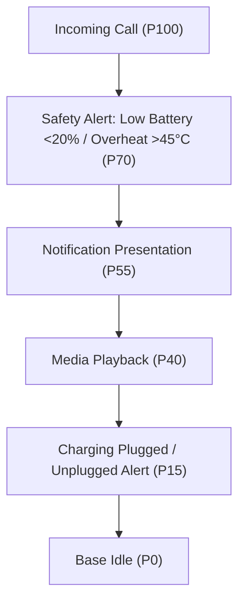

# Nothing Island — Milestone R8: Battery & Charging Intelligence
## Architecture Assessment & Implementation Plan

**Target Device:** Nothing Phone (4a) (`A069` / `FroggerIND`)  
**Platform:** Android 17 / API 37  
**Package:** `com.nothing.island.ai`  
**Overlay Anchor:** Single WindowManager Accessibility Overlay (`TYPE_ACCESSIBILITY_OVERLAY`, Layer 24000)  
**Date:** November 6, 2026  
**Status:** In Implementation

---

## 1. Executive Summary & Starting Invariants

Milestone R8 implements Battery & Charging Intelligence on top of the accepted R7.1.1 checkpoint:
- **Zero Redesign:** Preserves the single accessibility overlay (Layer 24000), 208 existing unit tests, notification auto-expansion and collapse, history and undo, media engine, and activity switcher.
- **Single Overlay Invariant:** Strictly one visible Island interface at a time. No secondary floating pills or battery overlays.
- **Honest Telemetry:** No fabricated charging wattages, fake animation speeds, or simulated temperatures. Unavailable readings are displayed as unavailable (`--`).
- **Zero Audio/Camera Permissions:** Never requests `RECORD_AUDIO`. Zero root requirements.

---

## 2. Android Battery Subsystem & Telemetry Mapping

Android 17 / API 37 exposes battery state through `Intent.ACTION_BATTERY_CHANGED` (sticky broadcast) and `BatteryManager`:

| Metric | Source API | Physical Device Behavior (Nothing Phone 4a) |
| :--- | :--- | :--- |
| **Battery Level & Scale** | `EXTRA_LEVEL`, `EXTRA_SCALE` | Valid integers (0–100%). Percentage = `(level * 100) / scale`. |
| **Charging Status** | `EXTRA_STATUS` | `BATTERY_STATUS_CHARGING (2)`, `DISCHARGING (3)`, `NOT_CHARGING (4)`, `FULL (5)`. |
| **Charging Source** | `EXTRA_PLUGGED` | `BATTERY_PLUGGED_AC (1)`, `BATTERY_PLUGGED_USB (2)`, `BATTERY_PLUGGED_WIRELESS (4)`, `BATTERY_PLUGGED_DOCK (8)`. |
| **Battery Voltage** | `EXTRA_VOLTAGE` | Millivolts (e.g. `4437 mV` = 4.437V). |
| **Battery Temperature** | `EXTRA_TEMPERATURE` | Tenths of degree Celsius (e.g. `350` = 35.0°C). |
| **Battery Health** | `EXTRA_HEALTH` | `GOOD (2)`, `OVERHEAT (3)`, `DEAD (4)`, `OVER_VOLTAGE (5)`. |
| **Charging Current** | `BatteryManager.BATTERY_PROPERTY_CURRENT_NOW` | Instantaneous microamperes ($\mu\text{A}$). Validated for sign and magnitude; if negative or 0, fallback to average or mark unavailable. |
| **Charge Time Remaining** | `BatteryManager.computeChargeTimeRemaining()` | Milliseconds to full charge, or -1 if unsupported. Combined with rolling linear regression over observed percentage samples. |

---

## 3. Priority & State Arbitration

1. **Safety Alert (P70):**
   - Critical Low Battery ($\le 20\%$, user configurable) and Overheat Warning ($\ge 45^\circ\text{C}$).
   - Preempts notifications (P55) and media (P40) for a temporary 5-second alert.
2. **System Hardware Event (P15):**
   - Cable plugged in (`ChargingConnected`), cable disconnected (`ChargingDisconnected`), source changed, or fully charged (`FullyCharged`).
   - Displays compact/expanded charging pill for configured duration (default 4.5s; 2s–10s range).
3. **In-Place Updates:**
   - Routine battery percentage changes while on battery or charging do NOT pop open the Island. They update the active data model in-place silently.

---

## 4. UI Presentation & Geometry

### Compact Mode (Symmetrical 200dp Capsule)
- Bounded to `200dp × 36dp` centered across the front camera cutout.
- Left Wing: Battery glyph with dynamic charging lightning bolt and micro charging animation.
- Center: 54dp punch-hole clearance zone.
- Right Wing: Monospace percentage (`85%`) and charging source tag (`AC`, `USB`, `WIRELESS`).
- Tap expands to State D (`ExpandedViewType.BATTERY`).

### Expanded Mode (`ExpandedViewType.BATTERY`, 350dp × 210dp)
- Bounded to `350dp × 210dp` with 48dp camera clearance spacer.
- Header: Status tag (`CHARGING`, `DISCHARGING`, `LOW BATTERY`, `FULLY CHARGED`), power source, collapse chevron.
- Center Stage: Active Compose charging animation surrounding central large battery percentage readout.
- Telemetry Shelf: Temperature (`35.0°C`), Voltage (`4.44V`), Wattage (when verified), and Honest ETA (`--` when calculating).

---

## 5. Charging Animation Studio & 5 Compose Styles

Located in **Appearance $\rightarrow$ Charging Style Studio**:
1. **Energy Ring (`ChargingAnimationStyle.ENERGY_RING`):** Dual concentric orbiting energy arcs with particle tick marks.
2. **Electric Pulse (`ChargingAnimationStyle.ELECTRIC_PULSE`):** High-frequency electrical discharges and surging lightning glyphs.
3. **Liquid Energy (`ChargingAnimationStyle.LIQUID_ENERGY`):** Fluid wave fill oscillating to current percentage with surface tension ripple.
4. **Charging Aura (`ChargingAnimationStyle.CHARGING_AURA`):** Multi-layered breathing ambient halo with Nothing Red / custom chromatic glow.
5. **Plasma Flow (`ChargingAnimationStyle.PLASMA_FLOW`):** Quad-orb vortex rotating along the pill contour.

**Customization Controls:**
- Style selector chips.
- Accent color swatches (Nothing Red, Glyph Green, Pure White, Cyan Pulse, Amber Glow).
- Sliders: Speed (0.5x–2.0x), Intensity (0.5x–1.5x), Ambient Glow (0.0–1.0), Display Duration (2s–10s), Low Battery Threshold (5%–30%).
- Switches: Reduced Motion, Auto-Expand on Connect, Temperature Warning.
- Live interactive preview with draggable battery percentage slider.
- Apply & Restore Defaults with Jetpack DataStore persistence.
