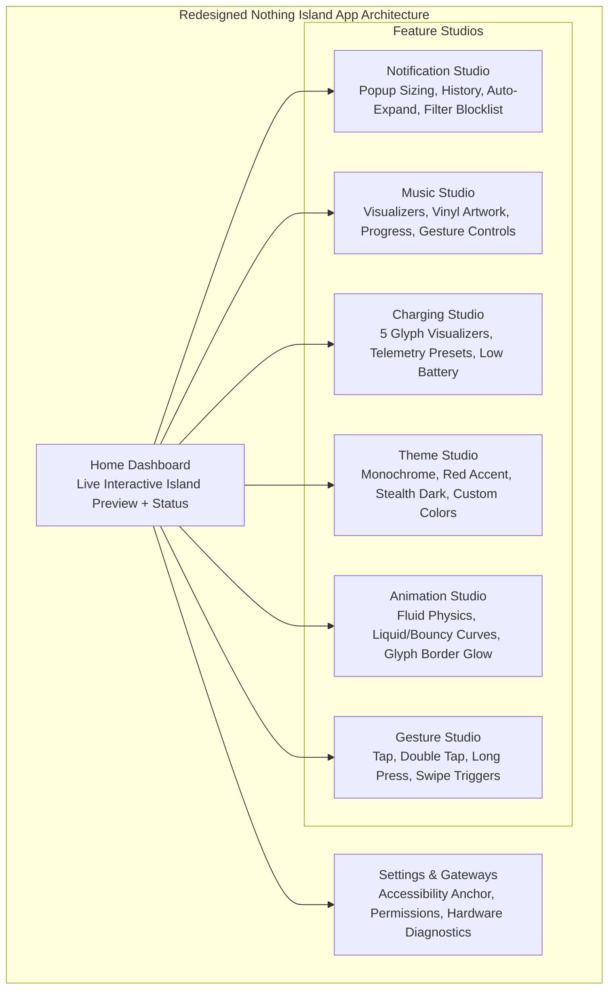
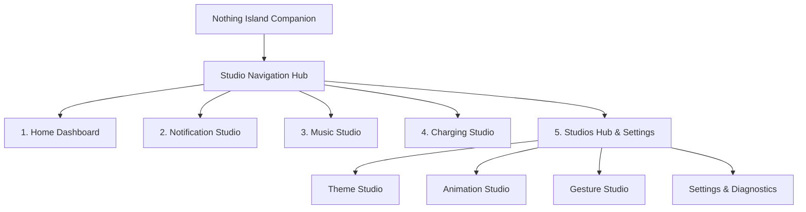
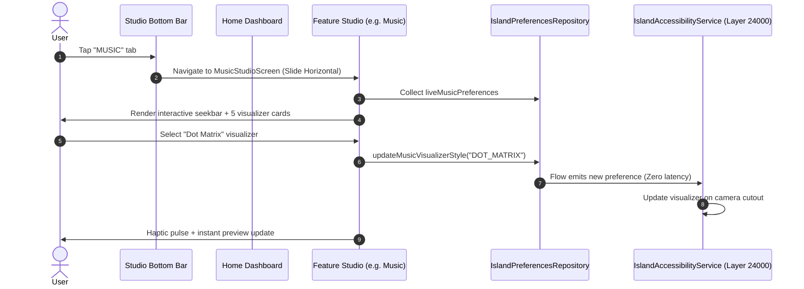
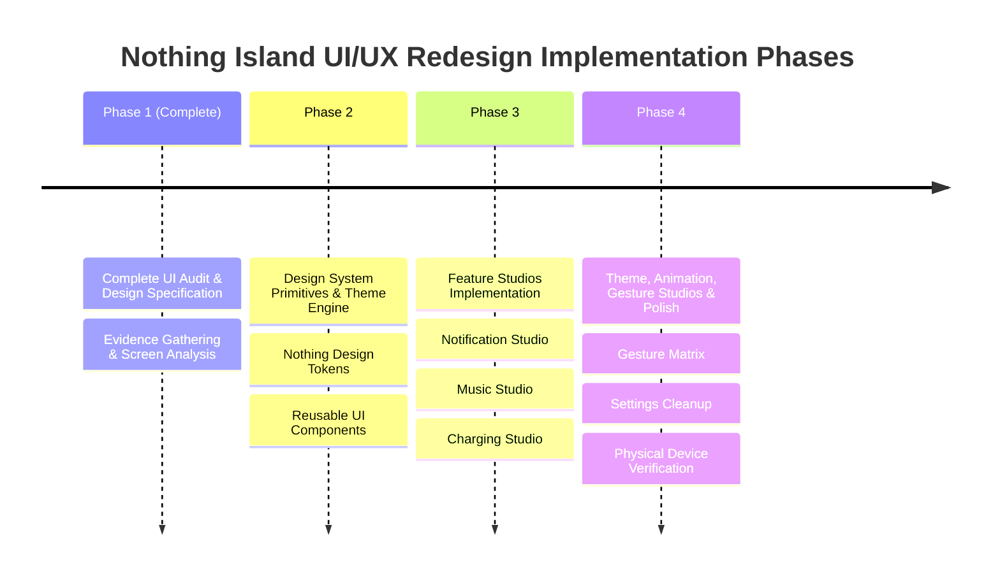

# Nothing Island — UI/UX Redesign Specification
**Document ID:** `SPEC-UIUX-2026-R1`  
**Phase:** Phase 1: Complete UI Audit & Design Specification  
**Package:** `com.nothing.island.ai`  
**Target Hardware:** Nothing Phone (4a), Android 17 / API 37 (Screen: 1224 × 2720, Top-Center Cutout)  
**Baseline Checkpoint:** Accepted R8 (Battery & Charging Intelligence, 235 Unit Tests)  
**Author:** Senior Android UI/UX Architect & Jetpack Compose Specialist  
**Date:** November 6, 2026  

---

## 1. Executive Summary & Design Vision

Nothing Island has achieved exceptional architectural reliability, rock-solid stability at AOSP Layer 24000 (`TYPE_ACCESSIBILITY_OVERLAY`), and deep subsystem integrations across notifications, media playback, and hardware battery telemetry (backed by 235 passing unit tests).

However, a comprehensive physical and source inspection confirms that **the companion in-app configuration UI has fallen behind the overlay engine**:
- Screens are fragmented across legacy development milestones (e.g. `FeaturesScreen` still displays "Milestone 4.2: NOT CONNECTED").
- `AppearanceScreen` has become an overcrowded 483-line dumping ground where geometry sliders, music visualizers, and charging visualizers are stacked into a single, endlessly scrolling column.
- The `Live UI Preview` on both Home and Appearance renders a blank, non-interactive black outline rather than demonstrating actual live notifications, playback waveforms, or charging telemetry.
- Rich persistent preferences already supported in `IslandPreferencesRepository` (e.g. `artworkShape`, `albumRotationEnabled`, `blockedPackages`, `chargingVisualizerIntensity`) have **no UI controls exposed to the user**.

### The Redesign Mission
Transform Nothing Island from a raw developer utility into a **cohesive, museum-grade companion application** that feels natively authored by Nothing Technology Limited. The redesigned interface will adopt an authentic **Nothing OS 3.x industrial design language** (pure AMOLED blacks, dot-matrix typography accents, tactile haptics, monochromatic hierarchy, and surgical Nothing Red highlights) structured into dedicated, purpose-built **Feature Studios**.



---

## 2. Complete UI Audit of Existing Application

A systematic audit was conducted across the source code in `app/src/main/java/com/nothing/island/ai/ui/`, live ADB UI inspection on the connected Nothing Phone (4a), and existing screenshot captures.

### 2.1 Screen-by-Screen Audit Matrix

| Screen File | Current Purpose | Visual & UX Findings | Architectural & Technical Issues | Redesign Verdict |
|---|---|---|---|---|
| [`MainActivity.kt`](file:///C:/Users/User/.gemini/antigravity/scratch/nothing-island/app/src/main/java/com/nothing/island/ai/MainActivity.kt) | App scaffold, tab navigation host | Uses simple 4-tab bottom navigation (`Home, Appearance, Features, Gemini`). Navigates via basic Crossfade. | Hardcoded state toggling legacy `IslandOverlayService` rather than reflecting the real `IslandAccessibilityService`. | **Redesign Navigation**: Migrate to 5-destination Studio Bar with nested sub-screens. |
| [`HomeScreen.kt`](file:///C:/Users/User/.gemini/antigravity/scratch/nothing-island/app/src/main/java/com/nothing/island/ai/ui/screens/HomeScreen.kt) | Dashboard & engine toggle | Prominent "STOP NOTHING ISLAND" button with red border; static "Module Activity Overview" stating notifications and media are "Not connected (M4.2/M4.3)". | Preview island is completely empty (no simulated content); engine toggle triggers background service rather than guiding user to accessibility. | **Complete Redesign**: Transform into real-time device dashboard with interactive preview states. |
| [`AppearanceScreen.kt`](file:///C:/Users/User/.gemini/antigravity/scratch/nothing-island/app/src/main/java/com/nothing/island/ai/ui/screens/AppearanceScreen.kt) | Sizing sliders & styling | Overcrowded 483-line vertical scroll. Five red sliders take up 60% of viewport. Both Music Style Studio and Charging Style Studio are tacked on at the bottom. | Sliders lack direct visual feedback on the live overlay; mixing geometry with visualizers creates cognitive overload. | **Deconstruct**: Split into Geometry Calibration, Music Studio, and Charging Studio. |
| [`FeaturesScreen.kt`](file:///C:/Users/User/.gemini/antigravity/scratch/nothing-island/app/src/main/java/com/nothing/island/ai/ui/screens/FeaturesScreen.kt) | Modules registry | Displays obsolete Milestone 4.2 mock cards marked "NOT CONNECTED" and "PENDING M4/M5". | Completely disconnected from the actual working R6/R7/R8 implementation. Provides zero interactive controls. | **Eliminate / Replace**: Replace with Studio Navigation Hub. |
| [`GeminiScreen.kt`](file:///C:/Users/User/.gemini/antigravity/scratch/nothing-island/app/src/main/java/com/nothing/island/ai/ui/screens/GeminiScreen.kt) | Mock chat interface | Static hardcoded chat message ("Hello! I am the Nothing Island AI companion..."). Inactive mock text field. | Detached from the notch overlay; occupies prime real estate in bottom navigation without functional utility. | **Deprecate from Main Nav**: Move to an optional experimental settings panel. |
| [`SettingsScreen.kt`](file:///C:/Users/User/.gemini/antigravity/scratch/nothing-island/app/src/main/java/com/nothing/island/ai/ui/screens/SettingsScreen.kt) | Permissions & preferences | 625-line single scroll. Monolithic layout mixing developer debug dumps with user toggles. Direct mentions of milestone tags ("R4.6", "M5"). | Only exposes 2 switches for notifications and 2 for battery, ignoring dozens of repository preferences. No visual previews. | **Restructure**: Convert to clean Settings & Hardware Diagnostics view with organized subsections. |
| [`IslandPreview.kt`](file:///C:/Users/User/.gemini/antigravity/scratch/nothing-island/app/src/main/java/com/nothing/island/ai/ui/components/IslandPreview.kt) | Notch preview card | Renders a black phone outline containing an empty capsule. Tap toggles size but shows no icons, text, or content. | Preview does not reflect active music waveforms, charging animations, or notification text. | **Upgrade**: Build dynamic interactive preview engine with state simulation toggles. |
| [`BottomNavigation.kt`](file:///C:/Users/User/.gemini/antigravity/scratch/nothing-island/app/src/main/java/com/nothing/island/ai/ui/components/BottomNavigation.kt) | Bottom tab bar | Text-only pills (`HOME, STYLE, MODULES, AI`) with a small red dot. Tabs clipped at 20dp top radius. | Lacks icons; tab names are ambiguous; navigates to obsolete screens. | **Redesign**: Create a refined Nothing OS bottom bar with geometric icons and clear typography. |

### 2.2 Deep Architectural & UX Defects Identified
1. **Severe Information Fragmentation:** Features implemented across R6, R7, and R8 (Notification Action Bridge, Dismissal Undo, Music Style Studio, Charging Style Studio, Activity Switcher) exist inside the overlay, but the in-app UI does not provide coherent spaces to configure them.
2. **Obsolete Milestone Nomenclature:** The UI is littered with internal developer terms: *"ACCESSIBILITY OVERLAY ANCHOR (R4.6)"*, *"MILESTONE 4.2"*, *"PENDING M4/M5"*. A commercial-grade product must hide internal release tags from users.
3. **Dead-End Navigation:** The bottom navigation bar leads users into dead-end screens (`FeaturesScreen` and `GeminiScreen`) that have no settings or toggles.
4. **Missing Preference Exposure:** `IslandPreferencesRepository` already contains DataStore keys for `ArtworkShape`, `AlbumRotationEnabled`, `BlockedPackages`, `ChargingVisualizerIntensity`, and `NotificationAnimationStyle`, but no user interface exists to modify them.
5. **No Visual Presets or Theming:** Users cannot choose color palettes or theme styles without manually adjusting individual hex values.

---

## 3. Nothing OS Design Language & Component System

To match the industrial aesthetic of the **Nothing Phone (4a)** and Nothing OS 3.x, the UI must adhere to strict visual guidelines:

### 3.1 Color Tokens & Palette Architecture

```kotlin
package com.nothing.island.ai.ui.theme

import androidx.compose.ui.graphics.Color

// Pure AMOLED Blacks & Grayscale Hierarchy
val NothingBlack = Color(0xFF000000)             // 100% True Black Background
val NothingSurfaceLowest = Color(0xFF080808)     // Deep Surface / Preview Well
val NothingSurfaceLow = Color(0xFF101010)        // Base Card Surface
val NothingSurfaceMedium = Color(0xFF161616)     // Elevated Controls / Buttons
val NothingSurfaceHigh = Color(0xFF1F1F1F)       // Pressed / Focused States
val NothingSurfaceHighest = Color(0xFF262626)    // Modals / Sliders Track

// Divider & Border Tokens
val NothingBorderSubtle = Color(0x1AFFFFFF)      // 10% White Border for Cards
val NothingBorderProminent = Color(0x33FFFFFF)   // 20% White Border for Active Elements
val NothingDividerColor = Color(0xFF1C1C1E)

// Nothing Signature Accent Hierarchy
val NothingRed = Color(0xFFD71920)               // Primary Signature Accent
val NothingRedDark = Color(0xFF8A0F14)           // Subtle Accent Backing
val NothingRedGlow = Color(0x33D71920)           // Focused Glow Effect

// Text & Icon Hierarchy
val NothingTextPrimary = Color(0xFFFFFFFF)       // 100% White for Headlines & Titles
val NothingTextSecondary = Color(0xFF9E9E9E)     // 62% Muted Gray for Descriptions
val NothingTextTertiary = Color(0xFF5E5E5E)      // 37% Dimmed for Badges & Timestamps

// Semantic Functional Colors
val NothingSuccessGreen = Color(0xFF30D158)      // System Active / Service Running
val NothingWarningAmber = Color(0xFFFFD60A)      // Low Battery / Warning
val NothingInfoBlue = Color(0xFF0A84FF)          // Bluetooth Connected
```

### 3.2 Typography Hierarchy
Nothing OS typography balances **high-legibility modern sans-serif** for body text and interactive controls with **dot-matrix / monospace styling** for technological telemetry, section badges, and numeric data.

```kotlin
package com.nothing.island.ai.ui.theme

import androidx.compose.material3.Typography
import androidx.compose.ui.text.TextStyle
import androidx.compose.ui.text.font.FontFamily
import androidx.compose.ui.text.font.FontWeight
import androidx.compose.ui.unit.sp

val NothingTypographySystem = Typography(
    // Large Screen Headers (e.g. "NOTIFICATION STUDIO")
    headlineLarge = TextStyle(
        fontFamily = FontFamily.SansSerif,
        fontWeight = FontWeight.Bold,
        fontSize = 24.sp,
        letterSpacing = (-0.5).sp,
        color = NothingTextPrimary
    ),
    // Section Categorization (e.g. "POPUP APPEARANCE")
    titleMedium = TextStyle(
        fontFamily = FontFamily.Monospace,
        fontWeight = FontWeight.Bold,
        fontSize = 12.sp,
        letterSpacing = 1.5.sp,
        color = NothingTextSecondary
    ),
    // Setting Item Titles (e.g. "Automatically Expand")
    bodyLarge = TextStyle(
        fontFamily = FontFamily.SansSerif,
        fontWeight = FontWeight.Medium,
        fontSize = 15.sp,
        letterSpacing = 0.sp,
        color = NothingTextPrimary
    ),
    // Setting Explanations / Descriptions
    bodyMedium = TextStyle(
        fontFamily = FontFamily.SansSerif,
        fontWeight = FontWeight.Normal,
        fontSize = 13.sp,
        lineHeight = 18.sp,
        color = NothingTextSecondary
    ),
    // Status Badges, Chips & Telemetry Numbers
    labelSmall = TextStyle(
        fontFamily = FontFamily.Monospace,
        fontWeight = FontWeight.SemiBold,
        fontSize = 10.sp,
        letterSpacing = 1.2.sp,
        color = NothingTextTertiary
    )
)
```

### 3.3 Core Component Specifications & Design Rules
1. **Surfaces & Radii:**
   - Top-level cards: `RoundedCornerShape(16.dp)`, surface `NothingSurfaceLow`, border `1.dp` in `NothingBorderSubtle`.
   - Interactive buttons / chips: `RoundedCornerShape(12.dp)`, surface `NothingSurfaceMedium`.
   - Status pills / badges: `RoundedCornerShape(50)` (fully circular capsule).
2. **Spacing Grid:**
   - Strict 8dp grid system (`8.dp, 12.dp, 16.dp, 24.dp, 32.dp`).
   - Screen horizontal padding: strictly `16.dp`.
   - Card internal padding: strictly `16.dp`.
   - Vertical gap between cards: `12.dp`.
3. **No Gratuitous Gradients:**
   - Surfaces must remain matte AMOLED black or dark gray.
   - Gradients are permitted only for interactive visualizer waveforms or live audio bars.
4. **Haptic Feedback:**
   - Every toggle switch, segment tab selection, and slider detent must fire subtle tactile feedback (`HapticFeedbackType.TextHandleMove` or `LongPress`).

---

## 4. Proposed Application Structure & Information Architecture

The redesigned application replaces the obsolete 4-tab model with a cohesive **Studio Architecture**:



---

### 4.1 Screen 1: Home Dashboard (`HomeScreen.kt`)
The command center of Nothing Island, providing real-time hardware status, live preview simulation, and quick navigation.

```mermaid
flowchart TD
    subgraph Home Dashboard Layout
        H1[Header: NOTHING ISLAND / NDot Logo + Settings Gear]
        H2[Interactive Live Island Preview Card\nMode Tabs: Idle | Notification | Music | Charging]
        H3[Core Engine Status Banner\nAccessibility Overlay Active Indicator]
        H4[Quick Studio Navigation Grid\n2x2 Grid of Feature Studios]
        H5[Quick Device Calibration\nCutout Offset X/Y Micro-Adjustments]
    end
```

#### Detailed Element Specifications:
1. **App Identity Top Bar:**
   - Left: Nothing Red pulsing dot (`8.dp`) + bold title `"NOTHING ISLAND"` (`18.sp`, SansSerif) + subtitle `"COMPANION OS"` (`10.sp`, Monospace).
   - Right: Circular Settings gear button (`40.dp`) navigating to System Settings.
2. **Interactive Live Island Preview Card:**
   - A dedicated preview surface (`NothingSurfaceLowest`) simulating the top of the Nothing Phone (4a) screen.
   - Contains a segmented preview mode switcher: `[ IDLE | NOTIF | MUSIC | BATTERY ]`.
   - When **IDLE** is selected: Displays compact 200dp capsule aligned to punch-hole.
   - When **NOTIF** is selected: Demonstrates incoming notification card with app badge, sender, message, and Action Bridge buttons.
   - When **MUSIC** is selected: Demonstrates active media player with spinning album art and live equalizer bars.
   - When **BATTERY** is selected: Demonstrates live charging ring with battery percentage.
   - Tapping the preview directly toggles Compact vs Expanded dimensions.
3. **Core Engine Status Banner:**
   - Displays real-time status of `IslandAccessibilityService` (Layer 24000).
   - Green indicator: `"ANCHOR ATTACHED — READY"`.
   - If disabled: A prominent Nothing Red setup card guiding user to Android Accessibility with one tap.
4. **Quick Studio Access Grid:**
   - 2 × 2 card grid linking directly to:
     - **Notifications** (History count, auto-expand status).
     - **Music Player** (Active visualizer style name).
     - **Battery & Charging** (Active charging style, battery level).
     - **Theme & Styling** (Active preset name).

---

### 4.2 Screen 2: Notification Studio (`NotificationStudioScreen.kt`)
Dedicated design laboratory for configuring every facet of notification presentation, auto-expansion, and privacy.

#### Detailed Element Specifications:
1. **Live Preview Surface:**
   - Displays interactive preview of the notification card using real user styling.
   - Switcher between `Compact Capsule` and `Expanded Card`.
2. **Appearance & Sizing:**
   - Compact width and height adjustments.
   - Card corner radius slider (`12.dp` to `24.dp`).
   - Symmetrical expansion toggle (preserves equal padding on both sides of punch-hole).
3. **Automation & Expansion Behavior:**
   - Switch: `"Automatically expand on arrival"` (bound to `autoExpandOnNotification`).
   - Switch: `"Auto-collapse after timeout"` (bound to `autoCollapseOnIdle`).
   - Timeout slider: `[ 2.0s — 8.0s ]` in 0.5s increments.
4. **Action Bridge & Inline Replies:**
   - Switch: `"Show quick actions & inline reply"` (enables `RemoteInput` direct replies).
   - Switch: `"Sync dismissal with Android status bar"` (dismissing on Island removes notification from system tray).
   - Switch: `"Enable 3.5s Undo Snackbar"` (allows recovering accidentally dismissed items).
5. **Privacy & DND Rules:**
   - Switch: `"Hide sensitive content on lock screen"`.
   - Switch: `"Respect Do Not Disturb (DND)"`.
   - Switch: `"Allow silent / minimized notifications"`.
6. **Application Blocklist:**
   - Searchable list of installed applications with system icons.
   - One-tap toggle to exclude noisy apps (e.g. download managers, persistent VPN notifications) from popping up on the Island.

---

### 4.3 Screen 3: Music Studio (`MusicStudioScreen.kt`)
Full-featured control center for the media player, waveform visualizers, artwork styling, and transport controls.

#### Detailed Element Specifications:
1. **Live Interactive Player Preview:**
   - Real-time preview rendering simulated or live `MediaSession` metadata.
   - Scrubable seek slider, track title, artist name, and playback transport buttons.
2. **Visualizer Style Studio:**
   - Visual carousel or grid displaying all 5 Compose visualizers:
     1. **Classic Equalizer:** Vertical jumping frequency bars.
     2. **Minimal Waveform:** Smooth sinusoidal undulating line.
     3. **Circular Pulse:** Rhythmic radial glow expanding from cutout.
     4. **Dot Matrix:** Nothing OS authentic dot-matrix equalizer.
     5. **Spectrum Bars:** Symmetrical multi-band spectrum analyzer.
   - Real-time animated preview inside each style card before applying.
   - Selection persists immediately to `music_visualizer_style` DataStore key.
3. **Album Artwork Presentation:**
   - Shape selector: `[ SQUIRCLE | CIRCLE | VINYL DISC | ROUNDED SQUARE ]`.
   - Switch: `"Enable vinyl rotation animation"` (smoothly rotates album art during playback).
   - Switch: `"Dynamic background tint"` (samples dominant color from album art to tint player card background).
4. **Playback & Volume Gestures:**
   - Switch: `"Swipe on compact pill to skip tracks"` (Swipe Left: Next, Swipe Right: Previous).
   - Switch: `"Vertical drag for volume adjustment"`.
5. **Media Application Filtering:**
   - App selector allowing user to exclude specific audio apps (e.g. WhatsApp voice notes, navigation audio, podcast apps).

---

### 4.4 Screen 4: Charging Studio (`ChargingStudioScreen.kt`)
Laboratory for battery telemetry, charging animations, thermal safety alerts, and low battery intelligence.

#### Detailed Element Specifications:
1. **Live Charging Telemetry Preview:**
   - Demonstrates the phone's live charging status, real-time wattage estimate, mA draw, and battery temperature.
2. **Charging Visualizer Presets (5 Authentic R8 Styles):**
   - **Glyph Pulse:** Rhythmic white LED outline mimicking Nothing Glyph interface.
   - **Minimal Wire:** Ultra-thin 1.5dp technical contour tracing the camera hole.
   - **Matrix Flow:** Dot-matrix cascading energy particles.
   - **Hyper Ring:** High-intensity circular fast-charging gauge.
   - **Symmetrical Arc:** Dual balanced energy arcs hugging both sides of the cutout.
   - Tapping a preset instantly animates in the preview well.
3. **Visualizer Customization:**
   - Animation speed slider: `[ 0.5x — 2.0x ]`.
   - Animation intensity slider: `[ Low — Medium — Intense ]`.
   - Accent color selection: `[ Nothing Red | Electric White | Matrix Green | Cyber Blue ]`.
4. **Low Battery Intelligence:**
   - Switch: `"Show low battery warning capsule"`.
   - Threshold selector: `[ 10% | 15% | 20% ]`.
5. **Thermal Protection Alert:**
   - Switch: `"High temperature alert"`.
   - Warning threshold: `42°C / 45°C` (displays cooling reminder if battery overheats during fast charging).

---

### 4.5 Screen 5: Theme Studio (`ThemeStudioScreen.kt`)
Global aesthetic and palette personalization engine.

#### Detailed Element Specifications:
1. **Design Theme Presets:**
   - **Nothing Monochrome:** High-contrast pure black and pure white.
   - **Nothing Red Accent:** Signature red accent on active tracks, toggles, and glyph rings.
   - **Stealth Dark:** Ultra-dimmed grayscale for nighttime / low-glare usage.
   - **Matrix Phosphor:** Retro dot-matrix phosphor green inspired by Teenage Engineering / Nothing aesthetics.
2. **Custom Accent Palette:**
   - 8 curated Nothing-compatible accent colors + custom hex picker.
3. **Surface Contrast & Opacity:**
   - Card background opacity slider: `[ 85% — 100% ]`.
   - Border prominence slider: `[ Subtle (10%) — Prominent (25%) ]`.
4. **Preset Management:**
   - `"Save Custom Theme"`, `"Reset to Nothing Defaults"`.

---

### 4.6 Screen 6: Animation Studio (`AnimationStudioScreen.kt`)
Physics and motion studio controlling the fluidity, elasticity, and edge effects of the overlay.

#### Detailed Element Specifications:
1. **Physics Engine Calibration:**
   - **Spring Stiffness:** `[ Stiff | Medium | Bouncy | Ultra-Fluid ]`.
   - **Damping Ratio:** Controls overshoot and rebound when island expands or collapses.
2. **Expansion Motion Curves:**
   - **Liquid:** Smooth morphing contour simulating fluid droplet.
   - **Bouncy:** Elastic overshoot mimicking iOS Dynamic Island dynamics.
   - **Direct:** Fast, mechanical, zero-overshoot transformation.
3. **Monochrome Glyph Border Glow:**
   - Switch: `"Pulsate Glyph border on incoming alerts"`.
   - Glow thickness slider: `[ 1dp — 3dp ]`.
   - Glow intensity: `[ Soft White | Bright White | Subtle Red ]`.
4. **Battery Conservation:**
   - Switch: `"Reduced Motion mode"` (disables complex physics to maximize battery life on 120Hz display).

---

### 4.7 Screen 7: Gesture Studio (`GestureStudioScreen.kt`)
Customization center for direct touch interactions on the camera punch-hole.

#### Detailed Element Specifications:
1. **Touch Interaction Matrix:**
   - Configure individual actions for 5 distinct touch gestures on the Island:
     1. **Single Tap:** *(Default: Expand Island / Open Active Card)*
     2. **Double Tap:** *(Default: Next Track / Dismiss Notification)*
     3. **Long Press:** *(Default: Open Studio / Settings)*
     4. **Swipe Left:** *(Default: Activity Switcher — Previous Card)*
     5. **Swipe Right:** *(Default: Activity Switcher — Next Card)*
2. **Mappable Action Registry:**
   - Each gesture can be bound to:
     - Expand / Collapse Island
     - Play / Pause Media
     - Next / Previous Track
     - Toggle Flashlight (Torch)
     - Take Screenshot
     - Lock Screen
     - Open Camera
     - Open Nothing Island Companion
     - Mute / Change Ringer Mode
     - Do Nothing (Prevent accidental triggers)
3. **Haptic Feedback:**
   - Slider: `"Haptic tactile feedback intensity"` `[ Off | Soft | Crisp | Strong ]`.
4. **Accidental Touch Protection:**
   - Switch: `"Disable gestures in full-screen games & video playback"`.

---

### 4.8 Screen 8: Settings & Hardware Gateways (`SettingsScreen.kt`)
Consolidated, clean system diagnostic view replacing the overcrowded legacy settings screen.

#### Detailed Element Specifications:
1. **System Gateways & Permissions:**
   - **Accessibility Service Anchor (Layer 24000):** Real-time status indicator with deep-link button to system accessibility.
   - **Notification Listener Access:** Status indicator showing live connection state.
   - **Battery Optimization Exemption:** Status and grant action.
2. **Hardware Calibration Diagnostics:**
   - Displays detected punch-hole cutout coordinates (`x=0, y=11dp`, radius `18dp`).
   - Manual DP offset micro-nudges for custom screen protectors or display scaling.
3. **Diagnostics & Logging:**
   - In-app logcat viewer showing priority arbitration events.
   - Export diagnostics report button for troubleshooting.
4. **About Nothing Island:**
   - Version name, version code, target API (Android 17 / API 37).
   - Open-source privacy pledge: Zero analytics SDKs, zero internet tracking, 100% offline security.

---

## 5. Navigation Architecture & Transition Model

The redesigned application transitions from a flat Crossfade scaffold to a structured **Master-Detail Studio Navigation Model**:



### 5.1 Redesigned Bottom Navigation Bar (`StudioBottomNavigation`)
- Fixed at the bottom of the screen with `navigationBarsPadding()`.
- Height: `64.dp`, background `NothingSurfaceLow`, top border `1.dp` in `NothingBorderSubtle`.
- 5 Destinations:
  1. **HOME** (Icon: Geometric Home glyph)
  2. **NOTIFICATIONS** (Icon: Notification Bell glyph)
  3. **MUSIC** (Icon: Equalizer waveform glyph)
  4. **BATTERY** (Icon: Battery lightning glyph)
  5. **STUDIOS** (Icon: Grid / Studios hub glyph)

---

## 6. Implementation Roadmap & Execution Plan

To execute this UI/UX redesign without causing regressions to the accepted R8 baseline (235 unit tests), the implementation is structured into 4 sequential phases:



### Phase Breakdown:
- **Phase 1 (Complete):** Complete UI Audit, Reference Analysis, Formal Redesign Specification (`docs/UI_UX_REDESIGN_SPECIFICATION.md`), and Full Screenshot Traceability Matrix (`docs/SCREENSHOT_REQUIREMENTS_TRACEABILITY.md`).
- **Phase 2:** Design System Implementation:
  - Create `NothingTokens.kt`, `NothingCard.kt`, `NothingSlider.kt`, `NothingSwitch.kt`, `NothingSegmentedControl.kt`.
  - Rebuild `IslandPreview.kt` with live simulated states (Idle, Notification, Music, Battery).
  - Implement the new 5-destination `StudioBottomNavigation`.
- **Phase 3:** Core Feature Studios:
  - Build `NotificationStudioScreen.kt`.
  - Build `MusicStudioScreen.kt`.
  - Build `ChargingStudioScreen.kt`.
  - Wire all controls directly to `IslandPreferencesRepository`.
- **Phase 4:** Advanced Studios & Polish:
  - Build `ThemeStudioScreen.kt`, `AnimationStudioScreen.kt`, and `GestureStudioScreen.kt`.
  - Refactor `SettingsScreen.kt` into clean System Diagnostics.
  - Decommission obsolete screens (`FeaturesScreen.kt` and `GeminiScreen.kt`).
  - Run full test suite (235 unit tests) and verify on physical Nothing Phone (4a).
