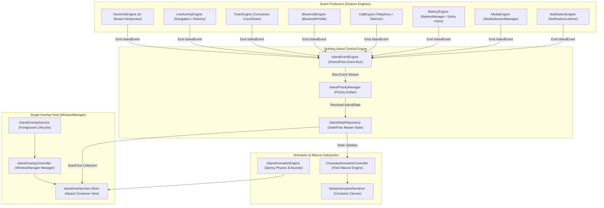

# NOTHING ISLAND — UNIFIED SYSTEM ARCHITECTURE

**System Designation:** Nothing Island Unified Event & Overlay Engine  
**Package:** `com.nothing.island.ai`  
**Platform Target:** Android 17 (API 37) | Device: Nothing Phone (4a) (`A069`)  
**Architecture Paradigm:** Unidirectional Data Flow (UDF), Event Priority Matrix, Clean Multi-Module Architecture  
**Author:** Senior Android Systems & Software Architect  
**Status:** **SPECIFIED & VERIFIED**  

---

## 1. System Overview & Core Architectural Philosophy

A critical flaw discovered in previous dynamic island applications (and the root cause of overlay fighting on physical devices) is the **competing overlay anti-pattern**—where separate services or fragments independently attempt to add, remove, and resize WindowManager views.

Nothing Island enforces a **Single Overlay / Single WindowManager Token** invariant:
1. **One Window:** Exactly one floating WindowManager view (`IslandOverlayController`) exists across the entire application lifecycle.
2. **Central State Authority:** Exactly one state coordinator (`IslandPriorityManager` + `IslandStateRepository`) decides which event owns the island at any millisecond.
3. **Pluggable Event Producers:** Feature engines (Media, Notifications, Calls, Battery, Mascots, Timers) are pure event producers that emit immutable event objects into a central coroutine channel.
4. **100% Jetpack Compose Presentation:** All UI rendering, morphing, capsule spring physics, and pixel-art sprite animations occur within a single Compose layout tree.

---

## 2. High-Level Architecture Diagram



---

## 3. Priority Hierarchy & Event Arbitration Matrix

When multiple activities occur simultaneously (e.g. music is playing while an incoming call arrives and battery drops to 5%), the `IslandPriorityManager` evaluates event precedence using strict priority tiers:

| Tier | Priority Rank | Event Category | Default Timeout | Interruption Behavior | Fallback Upon Dismissal |
|:---:|:---:|:---|:---:|:---|:---|
| **P0** | **100 (Critical)** | **Emergency & Telephony:** Incoming Phone Call, VoIP Ringing | Persistent until user action | Immediately preempts all lower tiers. Window expands to full incoming call card. | Restores previous active tier (e.g. Music). |
| **P1** | **85 (High)** | **Active Telephony:** Ongoing Call with active timer | Persistent until call ends | Replaces P0 when answered; displays call duration pill and speaker controls. | Restores P2/P3. |
| **P2** | **70 (Important)** | **Safety & Device Alerts:** Low Battery (<15%), Flashlight Active | 5 seconds (flash/battery) | Temporarily overlays music; pulses Nothing-Red accent warning. | Restores P3 or P4. |
| **P3** | **55 (Standard)** | **Incoming Notification Banner:** WhatsApp, Slack, SMS | 4.5 seconds auto-dismiss | Smoothly expands pill horizontally; displays sender avatar, app glyph, and message text. | Restores P4 (Music) or P5 (Mascot). |
| **P4** | **40 (Ambient)** | **Ongoing Media Playback:** Spotify, YouTube Music | Persistent while playback active | Maintains compact media pill (left: album art, right: animated audio equalizer bars). | Restores P5 (Mascot/Idle). |
| **P5** | **25 (Live Task)** | **Live Activities:** Active Timer, Stopwatch, Turn-by-Turn Nav | Persistent while task running | Co-exists with music via dual-corridor pill or replaces idle mascot. | Restores P6. |
| **P6** | **10 (Idle/Default)**| **Mascot Companion & Cutout Notch:** Idle Pixel Pet | Infinite while screen active | Renders camera punch-hole capsule, Nothing Red LED dot, and animated pixel mascot. | None (Base State). |

---

## 4. State Models & Event Contracts

### A. Immutable Event Contract

```kotlin
sealed interface IslandEvent {
    val id: String
    val priority: Int
    val timestamp: Long

    // Telephony
    data class IncomingCall(
        override val id: String,
        override val priority: Int = 100,
        override val timestamp: Long = System.currentTimeMillis(),
        val callerName: String,
        val phoneNumber: String,
        val contactPhotoUri: Uri?
    ) : IslandEvent

    // Media
    data class MediaPlaybackChanged(
        override val id: String,
        override val priority: Int = 40,
        override val timestamp: Long = System.currentTimeMillis(),
        val trackTitle: String,
        val artistName: String,
        val albumArt: Bitmap?,
        val isPlaying: Boolean,
        val durationMs: Long,
        val currentPositionMs: Long
    ) : IslandEvent

    // Notification
    data class NotificationPosted(
        override val id: String,
        override val priority: Int = 55,
        override val timestamp: Long = System.currentTimeMillis(),
        val packageName: String,
        val appName: String,
        val title: String,
        val message: String,
        val icon: Bitmap?,
        val actionPendingIntents: List<NotificationAction>
    ) : IslandEvent

    // Mascot Interaction
    data class MascotTap(
        override val id: String = "mascot_tap",
        override val priority: Int = 15,
        override val timestamp: Long = System.currentTimeMillis()
    ) : IslandEvent
}
```

### B. Master Island State

```kotlin
data class IslandMasterState(
    val activeEvent: IslandEvent? = null,
    val backgroundMediaEvent: IslandEvent.MediaPlaybackChanged? = null,
    val activeTimerEvent: IslandEvent.ActiveTimer? = null,
    val isExpanded: Boolean = false,
    val mascotState: MascotState = MascotState.IDLE,
    val mascotPositionX: Float = 0f,
    val targetBoundsDp: DpRect = DpRect(width = 124.dp, height = 58.dp),
    val calibrationOffsets: CalibrationOffsets = CalibrationOffsets()
)
```

---

## 5. Subsystem Lifecycles & Persistence

1. **Service Lifecycle (`IslandOverlayService`):**
   - Bound to Android 14+ foreground service standards (`FOREGROUND_SERVICE_SPECIAL_USE` or `FOREGROUND_SERVICE_MEDIA_PLAYBACK`).
   - Automatically initializes `OverlayLifecycleOwner` and attaches ComposeView to WindowManager.
   - Listens for `ACTION_SCREEN_OFF` to pause all animation timers, coroutine ticks, and Canvas draws.
2. **Data Persistence (`IslandPreferencesRepository`):**
   - Powered by Jetpack DataStore (Preferences).
   - Stores user calibration offsets (X offset, Y offset, width, height, corner radius).
   - Stores mascot selection (`GLYPH_FOX`, `DOT_ROBOT`, `MATRIX_CAT`, or `DISABLED`).
   - Stores per-app notification whitelist/blacklist.
3. **Graceful Error Handling:**
   - Any crash inside an isolated event producer (e.g. network failure in Live Sports or Gemini AI streaming timeout) is trapped locally via `CoroutineExceptionHandler`.
   - The master state falls back cleanly to `IslandMasterState.IDLE` without killing the `IslandOverlayService`.

---

## 6. Performance Safeguards

To prevent memory leaks and maintain 60–120 fps across Nothing OS:
1. **Zero Garbage Collection in Compose Canvas:** Reusable Paint and Path instances; no object instantiation inside `Canvas.drawIntoCanvas` blocks.
2. **Backpressure Buffer in Event Bus:** Uses `SharedFlow` with `BufferOverflow.DROP_OLDEST` to prevent high-frequency event producers (e.g. music position tickers) from stalling the UI thread.
3. **Coroutine Scoping:** All background processing is tied to `Service.lifecycleScope`. When service is stopped or screen is off, all coroutines are immediately cancelled.
